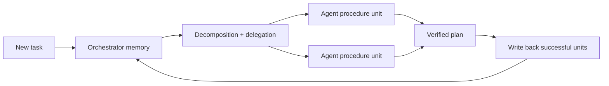
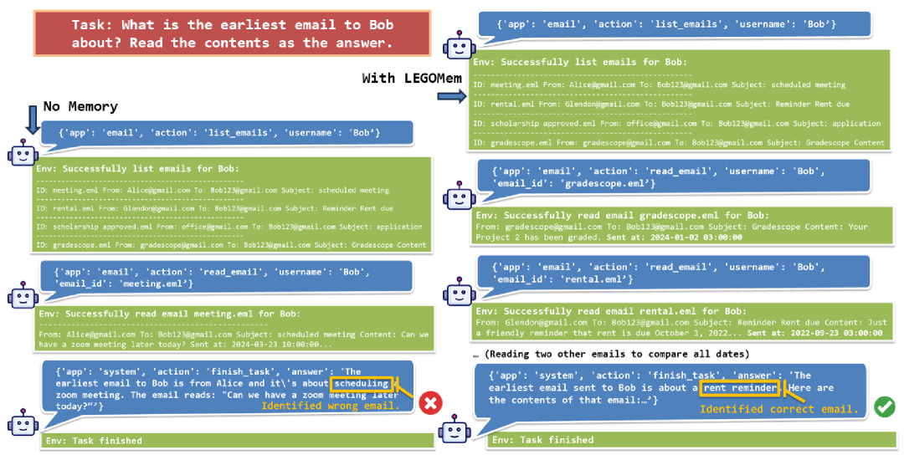

<!-- source-sha256: 26f3f4017e60baad78d98778040304e5064567e61f865287c378e8ad1baed8f2 -->

[简体中文](README.md) · English

# LEGOMem: Composable procedural memory

> **Fidelity:** Implements procedural units for orchestrator and execution layers, extraction from successful trajectories, and cross-episode reuse. The current PlanBench mini-suite is not the paper's multi-agent OfficeBench environment.

## Paper information

| Field | Details |
| --- | --- |
| Paper | [LEGOMem (arXiv 2510.04851)](https://arxiv.org/abs/2510.04851) |
| Institution | Microsoft Research |
| First public release | 2025-10-06 |
| Author code | No public repository found on the paper page as of 2026-07-27. |
| Local adapter or method key | `legomem` |
| Local reproduction code | [`src/auto_research/agent_research/`](https://github.com/daiwk/auto-research/tree/main/src/auto_research/agent_research) |

## Original paper summary

### Background and main changes

Whole successful trajectories are hard to transfer to new tasks, while one global memory mixes task decomposition with tool execution. LEGOMem breaks experience into composable procedural units. Orchestrator memory stores decomposition and delegation, agent memory stores action templates, and the units are recombined at runtime for each new task.



<!-- paper-figure:start -->
### Key figure from the paper

[](https://ar5iv.labs.arxiv.org/html/2510.04851/assets/x5.png)

> **Figure 3:** Overall design and components. From the [paper](https://arxiv.org/abs/2510.04851); copyright belongs to the authors. Click for the source.
<!-- paper-figure:end -->

### Core equations

Successful trajectories $\tau$ are split into orchestration and execution units, retrieved for the task, and combined:

$$
\mathcal{M}=\mathcal{M}_{\mathrm{orch}}\cup\mathcal{M}_{\mathrm{agent}},
\qquad
\pi(T)=\operatorname{Compose}\!\left(
\operatorname{Retrieve}(T,\mathcal{M}_{\mathrm{orch}}),
\operatorname{Retrieve}(T,\mathcal{M}_{\mathrm{agent}})
\right).
$$

Only task-verified procedural units enter long-term memory.

### Offline and online results

The paper analyzes complementary effects of orchestrator and agent memory on OfficeBench. Orchestrator memory primarily improves decomposition and delegation, while agent memory improves execution. There is no production online A/B test, and the public abstract does not give a single figure suited to citation out of the results table.

## Local reproduction

`planbench-mini` uses verifiable structured plans. The implementation extracts action/domain units from successful plans, reuses high-level decomposition and fine-grained actions separately, and records `reused_plans`.

```bash
auto-research agent-eval --method legomem \
  --benchmark planbench-mini --episodes 120 --seed 42
```

| Metric | LEGOMem |
|---|---:|
| Joint success | 1.0000 |
| Average cost | 1.1200 |
| Reused plans | 108 |
| Final memory size | 12 |

Stable metrics: [`agent-mini-suites-seed42.json`](../../experiments/agent-mini-suites-seed42.json).

## Scope

The local run has no real Office applications, LLM multi-agent delegation, or error recovery. It demonstrates extraction, verification, and cross-episode reuse of procedural units, not reproduction of the OfficeBench results.
