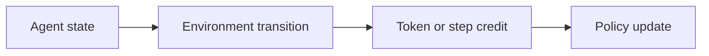
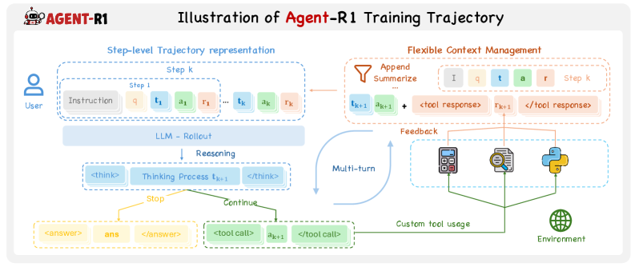

# Agent-R1

<!-- source-sha256: 3755158ee3892bb7fe18b0f06fed107252e4256b2ee532c671a1ff54fe605c8e -->

[简体中文](README.md)

> Core mechanism, not full benchmark reproduction.

## Paper information

| Field | Value |
| --- | --- |
| Paper | [Agent-R1 (arXiv 2511.14460)](https://arxiv.org/abs/2511.14460) |
| Affiliations | University of Science and Technology of China |
| First public release | 2025-11-18 (arXiv v1) |
| Authors' code | [Author code](https://github.com/AgentR1/Agent-R1). |
| Adapter / method | `agent-r1` |
| Local code | [`src/auto_research/agent_research/`](https://github.com/daiwk/auto-research/tree/main/src/auto_research/agent_research/) |

## Original paper

### Background and contribution

Treat each agent/environment interaction as a transition. Pluggable context management, environment interfaces, and optimizers support token- or step-level credit.



<!-- paper-figure:start -->
### Key figure from the paper

[](https://arxiv.org/html/2511.14460v2/x3.png)

Original Figure 3: Agent-R1. From the [paper](https://arxiv.org/abs/2511.14460); copyright belongs to the authors. Not a local result.
<!-- paper-figure:end -->

### Core mechanism

$$
\tau=(s_t,a_t,o_{t+1})_{t=1}^T,\quad A_t=\delta_t+\gamma\lambda A_{t+1}.
$$

### Paper results

The technical report supports multi-turn agentic RL workflows. No production A/B.

## Local reproduction

planbench-mini, 120 episodes, seed 42: joint success **1.0000**, average cost **0.9600**. See [metrics](../../experiments/global-p1-20260808-seed42.json).

```bash
auto-research agent-study --method agent-r1 --benchmark planbench-mini --episodes 120 --seed 42
auto-research evolve --model agent --dataset planbench-mini --direction "Combine agent-r1 with installed paper operators" --generations 2 --population 4
```

## Reproduction limits

Mechanism/contract diagnostics, not the original model, training scale, environments, or full benchmark.
