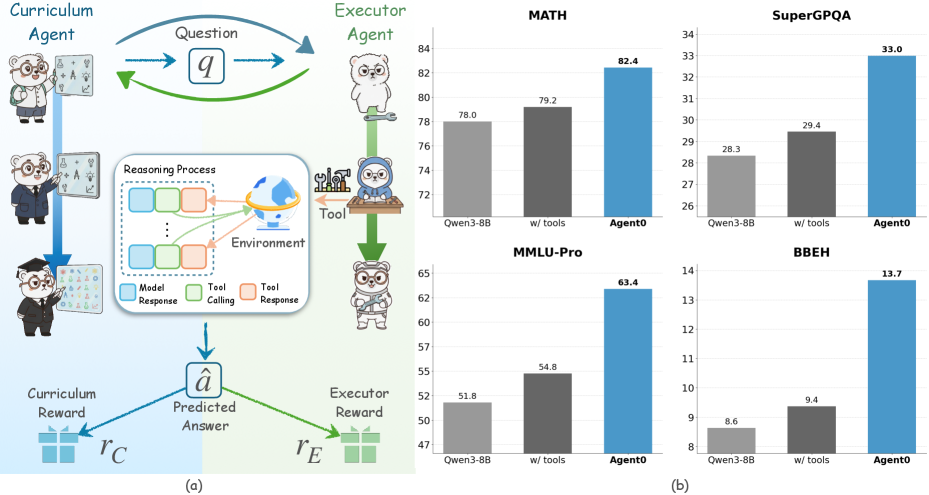

# Agent0: A self-evolving multi-agent curriculum without human seed data

<!-- source-sha256: 07547534243fdc256d9ba8ed5e9a24aa9c2f44459648bcc304a50c656a431975 -->

[简体中文](README.md)

> Deterministic core mechanism, not the original benchmark.

## Paper information

| Field | Details |
|---|---|
| Paper | [Agent0 (arXiv 2511.16043)](https://arxiv.org/abs/2511.16043) |
| Institution | University of North Carolina at Chapel Hill / Salesforce Research / Stanford University. |
| First public release | 2025-11-20 (arXiv v1) |
| Author code | No official author code found or released. |
| Local adapter or method key | `agent0` |
| Local reproduction code | [`src/auto_research/agent_research/`](https://github.com/daiwk/auto-research/tree/main/src/auto_research/agent_research/) |

## Paper method and evidence

A proposer generates verifiable tool tasks. Multiple execution agents produce candidates and vote; increase curriculum difficulty along the current capability boundary.


<!-- paper-figure:start -->
### Original paper figure

[](https://ar5iv.labs.arxiv.org/html/2511.16043/assets/x1.png)

The original figure shows task proposal and multi-agent verification. From the [original paper](https://arxiv.org/abs/2511.16043); copyright remains with the authors.
<!-- paper-figure:end -->

### Core equation

$$
x\sim\pi_{task},\ y_{1:K}\sim\pi_{agent},\ \hat y=\operatorname{mode}(y_{1:K}),\quad R=V(x,\hat y).
$$

### Reported results

The paper bootstraps tool-integrated reasoning without seed data and reports improvements across agent benchmarks. No production A/B.

## Local reproduction

PlanBench mini, 120 episodes, seed 42: joint success **1.0000**, mean cost **0.3200**, and nonzero method telemetry.

```bash
auto-research agent-eval --method agent0 --benchmark planbench-mini --episodes 120 --seed 42
auto-research evolve --model agent --dataset planbench-mini --direction "Combine agent0 with installed paper operators" --generations 2 --population 4
```

[Fixed-seed metrics](../../experiments/global-p0-20260808-seed42.json). Only the method-specific objective, state updates and matched budget are tested. No large model, multi-GPU RL, private environment, live web or full benchmark.
