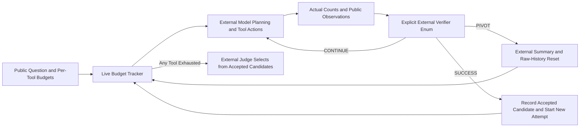
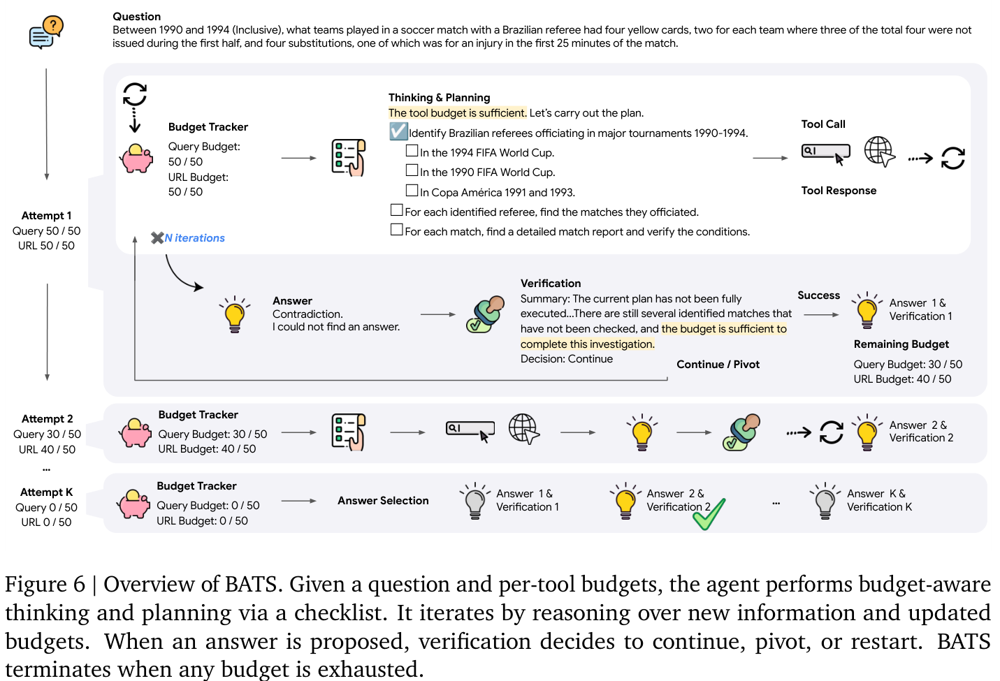

# BATS: Making Tool Budgets Visible to Search Agents

<!-- source-sha256: 59608573c3c430e125e4b02f6341c7fa47bbcf5d4adcdce334a54501391606cb -->

[简体中文](README.md)

> CPU / L1 only: Budget Tracker, unified-cost arithmetic, and state transitions driven by explicit external verifier decisions. No search agent, real browsing, semantic planning/verification, or answer judge. Full experiments are **not reproduced because of high cost; review DONE**. Google's page uses the older CATS description; the formal v2 calls the method BATS. First publication was in 2025, not November 12, 2026.

## Paper Information

| Field | Value |
| --- | --- |
| Paper | [Budget-Aware Tool Use Enables Effective Agent Scaling](https://arxiv.org/abs/2511.17006); reviewed [v2](https://arxiv.org/html/2511.17006v2) |
| Company / institution / university | First author Tengxiao Liu: UC Santa Barbara; work done during a Google Cloud AI Research internship. Original bylines include Google Cloud AI Research, Google DeepMind, New York University, and UC Santa Barbara, visually checked on PDF page 1 |
| First public release | 2025-11-21 07:18:55 UTC, arXiv v1; reviewed v2 released 2026-08-17 07:14:22 UTC, COLM 2026 |
| Author code | Public Apache-2.0 [google-research/budget-aware-agent](https://github.com/google-research/budget-aware-agent/tree/37d23f66c512734db476313cf436a506edbec9e0); README read without cloning or running |
| Local adapter / key | None (`adapter: null`); component key `bats` |
| Local code | `src/auto_research/agent_research/bats.py`; `tests/agent_research/test_nov12_agent.py` |

## Original Paper Summary

### Background and Main Changes

More tool allowance does not necessarily change a ReAct agent's strategy. Budget Tracker continuously exposes each tool's used and remaining calls. BATS combines that signal with planning, constraint-by-constraint self-verification, and repeated attempts. It does not simply spawn a fixed number of parallel agents: remaining resources inform whether to continue a direction or pivot.



<!-- paper-figure:start -->
### Key Figure from the Original Paper

[](https://arxiv.org/pdf/2511.17006v2#page=7)

Figure 6, v2 PDF page 7. The image comes from the [original paper](https://arxiv.org/pdf/2511.17006v2#page=7); copyright belongs to the authors. Original diagram and caption are cropped without scientific redrawing. Source hashes and crop coordinates are in [assets/provenance.json](assets/provenance.json). Model planning, browsing, self-verification, and answer selection were not executed locally.
<!-- paper-figure:end -->

### Core Equations

Per-tool usage satisfies $u_i\le b_i$, but Appendix B starts another iteration only while **every** tool still has budget: $\bigwedge_i(u_i<b_i)$. Exhausting search ends the loop even if nine browse calls remain; it does not wait until all tools are exhausted.

Budget is an advance limit; cost is realized consumption. Equation 2 is

$$
C=C_{token}+\sum_i u_i P_i.
$$

The local counting contract includes cached input inside total input: $C_{token}=(n_{in}-n_{cache})p_{in}+n_{cache}p_{cache}+n_{out}p_{out}$. Prices are explicit caller inputs, not current vendor quotes; cached input is not charged twice.

SUCCESS adds the candidate to the external verifier-accepted set, summarizes, and starts another attempt. PIVOT summarizes, clears the raw trajectory, and changes direction. CONTINUE keeps the current direction, compressing only when an external context-threshold decision requests it. None resets budget. The final judge selects only from accepted candidates; if none exist, the last candidate is returned, possibly None. Self-verification SUCCESS does not establish agreement with hidden gold.

### Reported Offline and Online Outcomes

The paper reports cost/performance curves on BrowseComp, BrowseComp-ZH, HLE-Search, and supplementary conversational/coding tasks, not production A/B. The full method requires real search/browsing, Gemini/Claude, self-verification, and a final judge. Local tests do not repeat its accuracy, cost-Pareto advantages, or reasoning capability.

## Local Component

### Data Protocol and Code Mapping

`BudgetTracker` actually charges per-tool counts and rejects overruns, unknown tools, and invalid counts; `status_block()` exposes used/remaining values. `TokenUsage` and `unified_cost()` implement Equation 2 for explicit finite nonnegative prices, rejecting cache counts above total input, unpriced tools, and NaN.

`BATSState` contains a public question, budget, public trajectory, and external summaries, with no gold/reference field. `apply_external_verdict()` requires the `Verdict` enum and does not generate semantic decisions. SUCCESS/PIVOT require external summaries and clear raw history while preserving counts; CONTINUE does not automatically pivot. Final selection opens only after budget termination and requires an external selector returning a member of the accepted set. No heuristic majority vote or gold-matching substitute is supplied.

```bash
PYTHONPATH=src python -c 'from auto_research.agent_research.bats import diagnostic; print(diagnostic(42))'
PYTHONPATH=src python -m pytest -q tests/agent_research/test_nov12_agent.py
```

### Local Results and Negative Controls

The [three-seed diagnostics](metrics/component-cpu-seeds42-44.json) run an explicit control sequence: one search and two browse calls, PIVOT followed by SUCCESS, retaining two attempt summaries and total usage. The illustrative prices yield cost 0.27, a constructed accounting value rather than an API bill. External-verifier-accepted counts are not accuracy.

Tests check that pivoting preserves counts and reject overspending, premature finalization, non-enum verdicts, and out-of-set selector results; they check cached-input pricing and input/summary isolation. This is not a sandbox against a caller mutating Python internals. Model-generated tree plans, actual tools, semantic constraint verification, summary quality, and final-answer correctness are not implemented. `promotion_eligible=false` and `evolve_integrated=false`; CUDA is rejected.

### High-Cost Full Experiments

Section 5 and Appendix A use Gemini-2.5-Flash / Pro and Claude-Sonnet-4, up to 64K–65,536 generated tokens, BrowseComp's 1,266 questions (the released code also provides a 200-question subset), 289 Chinese questions, 200 HLE-Search questions, multiple budget curves, and final judges. Tools include Google Search/SERPER and Jina/Crawl4AI. The paper's unified USD 0.001/tool-call rate is its post-hoc experimental average, not today's quote.

The full multi-model, multi-budget, long-page and repeated-verification matrix exceeds this affordable control-kernel scope and cannot be replaced by a single-card fixture. It is **not reproduced because of high cost; review DONE**. No benchmark questions are downloaded/decrypted, no gold is accessed, no API access is requested, and no real search retries or automatic Evolve jobs are launched.
