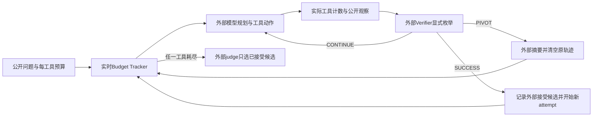
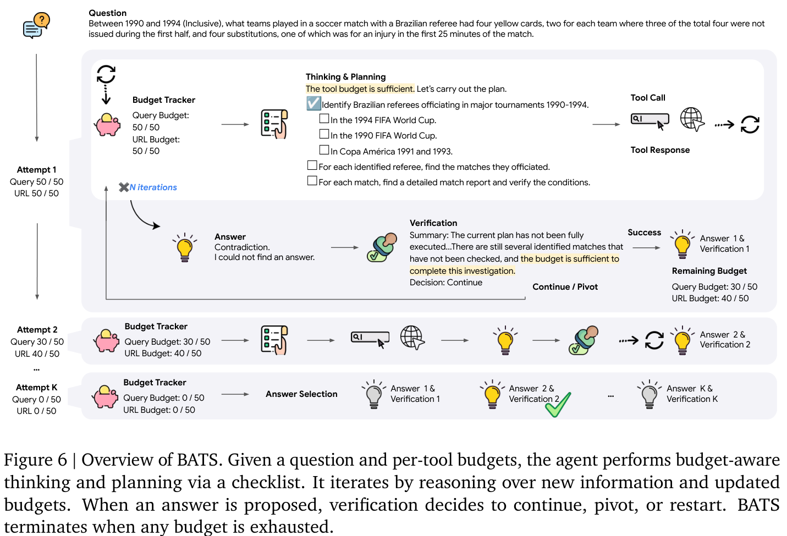

# BATS：让搜索 Agent 看见并遵守真实工具预算

[English](README-en.md)

> 仅纯 CPU / L1：Budget Tracker、统一费用公式、显式外部 verifier 的状态转移。没有搜索 Agent、真实浏览、语义规划/验证或答案 judge。完整实验**成本过高，不复现（审查 DONE）**。Google 官网旧称 CATS，当前正式 v2 为 BATS；首发在 2025 年，不能计为 2026-11-12 新论文。

## 论文信息

| 字段 | 内容 |
| --- | --- |
| 论文链接 | [Budget-Aware Tool Use Enables Effective Agent Scaling](https://arxiv.org/abs/2511.17006)；核对 [v2 正文](https://arxiv.org/html/2511.17006v2) |
| 公司 / 机构 / 学校 | 一作 Tengxiao Liu：UC Santa Barbara；研究在 Google Cloud AI Research 实习期间进行。合作署名含 Google Cloud AI Research、Google DeepMind、New York University、UC Santa Barbara；已目视核对 PDF 首页 |
| 首次公开日期 | 2025-11-21 07:18:55 UTC，arXiv v1；审查版本 v2 为 2026-08-17 07:14:22 UTC，COLM 2026 |
| 原作者开源代码 | [google-research/budget-aware-agent](https://github.com/google-research/budget-aware-agent/tree/37d23f66c512734db476313cf436a506edbec9e0)，公开 Apache-2.0；仅阅读 README，不克隆或运行 |
| 本地 Adapter / key | 无（`adapter: null`）；组件 key：`bats` |
| 本地复现代码 | `src/auto_research/agent_research/bats.py`；`tests/agent_research/test_nov12_agent.py` |

## 原始论文总结

### 背景与主要改动

给 ReAct 更多工具额度不保证它改变探索策略。Budget Tracker 将每个工具已经用掉和剩余的调用次数持续放进上下文。BATS 再利用这种显式资源状态做规划、逐约束自检和多次尝试：不是固定开更多平行 Agent，而是由剩余额度决定继续当前方向还是换路。



<!-- paper-figure:start -->
### 原论文关键图

[](https://arxiv.org/pdf/2511.17006v2#page=7)

Figure 6，v2 PDF 第 7 页。图片来自[原论文](https://arxiv.org/pdf/2511.17006v2#page=7)，版权归原作者所有；截取原图与图注，未重绘科学内容。来源 hash 与裁切范围见 [assets/provenance.json](assets/provenance.json)。本地不执行图中的模型规划、浏览、自验证或答案选择。
<!-- paper-figure:end -->

### 核心公式

每工具调用数满足 $u_i\le b_i$，但 Appendix B 的循环条件更强：仅当**所有**工具仍有余额，即 $\bigwedge_i(u_i<b_i)$ 时才开始下一迭代。因此搜索耗尽，即使浏览还剩九次，也结束；不是等所有工具都用完。

预算是事前上限，费用是实际消耗，不能混用。Eq.2 为

$$
C=C_{token}+\sum_i u_i P_i.
$$

本地明确使用“input tokens 含 cache 命中子集”的计数口径：$C_{token}=(n_{in}-n_{cache})p_{in}+n_{cache}p_{cache}+n_{out}p_{out}$。价格由调用方显式传入，不填当前供应商价格，也不对 cache 输入重复计费。

SUCCESS 把候选加入外部 verifier 接受集合，随后摘要并重开尝试；PIVOT 摘要、清空原轨迹并换方向；CONTINUE 保留当前方向，只在外层判定超过上下文阈值时压缩。三者都**不重置预算**。最终 judge 只能从已接受候选选；若集合为空，回退最后一个候选，可能为 None。自验证 SUCCESS 并不等于与隐藏 gold 一致。

### 论文离线与线上效果

原文在 BrowseComp、BrowseComp-ZH、HLE-Search 及补充对话/编程任务上报告成本—效果曲线，没有生产线上 A/B。完整方法依赖真实搜索/浏览、Gemini/Claude、自验证和最终 judge；本地不复测其正确率、成本 Pareto 优势或模型推理能力。

## 本地复现

### 数据协议与代码映射

`BudgetTracker` 实际扣除逐工具计数，越界/未知工具/非法计数拒绝；`status_block()` 输出已用和剩余额度。`TokenUsage` 与 `unified_cost()` 计算有限非负价格下的 Eq.2，并拒绝 cache 超过总 input、未定价工具和 NaN。

`BATSState` 只有公开问题、预算、公开轨迹和外部摘要，无 gold/reference 字段。`apply_external_verdict()` 强制使用 `Verdict` 枚举，不生成语义判断；SUCCESS/PIVOT 必须有外部摘要，清空原轨迹而保留次数，CONTINUE 不自动换方向。最终选择只在预算终止后开放，必须由显式外部 selector 返回集合内候选；没有多数票启发式或“猜 gold”替代 judge。

```bash
PYTHONPATH=src python -c 'from auto_research.agent_research.bats import diagnostic; print(diagnostic(42))'
PYTHONPATH=src python -m pytest -q tests/agent_research/test_nov12_agent.py
```

### 结果、负控与边界

[三 seed 诊断](metrics/component-cpu-seeds42-44.json)仅执行显式控制序列：一次搜索、两次浏览，先 PIVOT 再 SUCCESS，保留两次 attempt 的摘要与总用量。教学价格下费用为 0.27；它是构造的账本数值，不是实际 API 账单。外部接受候选数不命名为 accuracy。

测试核对换路不重置计数，并拒绝超支、提前 final、非枚举 verifier 和集合外 selector；同时核对 cache 不重复收费及输入/摘要隔离。它不是对抗调用方任意修改 Python 内部对象的沙箱。模型生成的树状计划、真实工具执行、按问题约束语义验证、摘要内容质量和最终答案正确性均未实现。`promotion_eligible=false`、`evolve_integrated=false`，CPU 路径拒绝 CUDA。

### 高成本完整实验

§5 与 Appendix A 配置 Gemini-2.5-Flash / Pro、Claude-Sonnet-4，最高 64K–65,536 生成 token，BrowseComp 1,266 题（公开代码也给 200 题子集）、中文 289 题、HLE-Search 200 题、多预算曲线及最终 judge；调用 Google Search/SERPER 与 Jina/Crawl4AI。论文统一工具单价为 USD 0.001/次，是当时实验事后平均而非今天报价。

完整多模型、多预算、长网页与重复验证矩阵超出本轮可负担控制核范围，不能用单卡 fixture 代替。**成本过高，不复现（审查 DONE）**；不下载/解密评测题、不接触 gold、不申请 API，不启动真实搜索重试或自动 Evolve。
