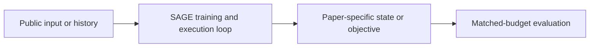
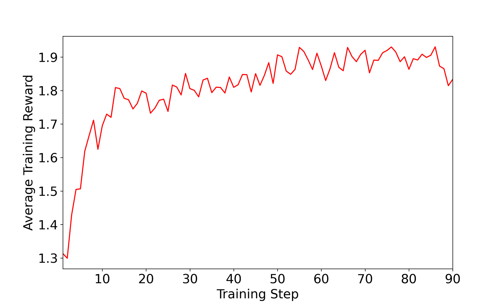

# SAGE: an RL-driven self-improving skill library

<!-- source-sha256: 8e3d9a4084c9c4b62f56b266e9171fe95905b03a718ddc093ed3f26bfef69e02 -->

[简体中文](README.md)

> **Fidelity: core mechanism.** The deterministic mini-suite does not stand in for the paper's full benchmark.

## Paper information

| Field | Details |
|---|---|
| Paper | [SAGE: an RL-driven self-improving skill library (arXiv 2512.17102)](https://arxiv.org/abs/2512.17102) |
| Organization | University of Wisconsin–Madison / Amazon Web Services |
| First public release | 2025-12-18 (arXiv v1) |
| Authors' code | No official author repository was found. |
| Adapter / method | `sage` |
| Local reproduction code | [`src/auto_research/agent_research/`](https://github.com/daiwk/auto-research/tree/main/src/auto_research/agent_research/) |

## Original paper

### Motivation and method

Abstract skills from successful trajectories, revise or retire them after failures, and use task rewards to learn retrieval and reuse.



<!-- paper-figure:start -->
### Key figure from the paper

[](https://arxiv.org/html/2512.17102v2/train.png)

> **Figure 5:** Training flow and key optimization steps. From the [original paper](https://arxiv.org/abs/2512.17102); copyright remains with the authors.
<!-- paper-figure:end -->

### Core equations

$$
s^*=\arg\max_{s\in\mathcal S}q_\phi(s|x),\quad\mathcal S\leftarrow\operatorname{Update}(\mathcal S,\tau,R),\quad\max_\phi\mathbb E[R].
$$

### Paper results

On continual tasks, the paper reports improved success and sample efficiency from skill reuse. No production online A/B test is reported; no online figures are inferred.

## Local reproduction

PlanBench mini-suite, 120 episodes, seed 42: joint success **1.0000**, average cost 0.3000, and nonzero method-specific telemetry.

```bash
auto-research agent-eval --method sage --benchmark planbench-mini --episodes 120 --seed 42
auto-research evolve --model agent --dataset planbench-mini --direction "组合 sage 与已安装论文算子" --generations 2 --population 4
```

See the [fixed metrics](../../experiments/global-p0-20260808-seed42.json).

## Reproduction boundaries

The local run checks the paper-specific objective, state updates, and fair budgets. It does not reproduce large models, multi-GPU RL, private environments, real websites, or the full benchmark. It verifies mechanisms rather than claiming numerical reproduction of the original tables.
