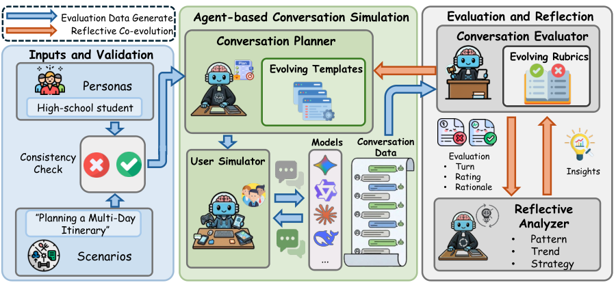

# CoReflect: A Reflective Co-Evolution Framework for Improving Conversational Evaluation

<!-- source-sha256: 39406e0c3fad5590163b0f28a0b9272f3b22206811b7d0273c7d1ca692576707 -->

[简体中文](README.md)

> **Literature and cost record only.** No executable capability adapter or heuristic substitute. Full experiment not reproduced due to cost (review complete); no weight/data downloads or automatic retry. This is a user-selected historical conference catch-up.

## Paper information

| Field | Details |
|---|---|
| Paper | [Original arXiv v1](https://arxiv.org/abs/2601.12208v1) |
| Organization | First author Yunzhe Li lists University of Illinois Urbana-Champaign first. Richie Yueqi Feng and Chin-Chia Hsu list Google DeepMind. |
| First public release | **2026-01-18 00:56:06 UTC**, arXiv v1. |
| Authors' code | No author implementation is verifiable from pinned v2 or its abstract. Exact-title search found only third-party commentary, not source evidence. Code license and pinned SHA are not applicable; the paper and figure are CC BY 4.0. |
| Adapter / method | `coreflect`; `adapter=null`; `promotion_eligible=false`; `evolve_integrated=false`. |
| Local reproduction code | None; no capability entry point. |
| Pinned method | [v2 text](https://arxiv.org/html/2601.12208v2); original publication remains the v1 date. |
| Local validation | Not applicable; review and documentation only, without training, GPU receipts, or fabricated metrics. |

A dialogue planner drafts per-turn templates from personas and scenarios. A user simulator interacts with the evaluated model; a judge scores it. A reflective analyzer clusters rationales and updates both the rubric and planner so that difficulty and diagnostic standards co-evolve over three rounds.

## Original paper

### Motivation and method

Sections 2.1–2.5 and Appendix G use 953 persona–scenario pairs filtered by real LLM consistency checks. Planner, simulator, evaluator, and analyzer are core semantic models. A JSON state machine, arithmetic means, or manual rubric edits do not reproduce them, so no cheap heuristic adapter is offered.

<!-- paper-figure:start -->
### Key figure from the paper

Original PNG from [pinned v2](https://arxiv.org/html/2601.12208v2#S2.F1), not redrawn. Copyright remains with the authors; CC BY 4.0. Source, SHA-256, and visual verification: `assets/provenance.json`.
<!-- paper-figure:end -->

### Core equations

$$
\mathcal I^{(t)}=Analyzer(\{r_{ijk}^{(t)},\rho_{ijk}^{(t)}\}),\quad\mathcal R^{(t+1)}=Update(\mathcal R^{(t)},\mathcal I^{(t)}),\quad\mathcal T^{(t+1)}=Planner(\mathcal D,\mathcal I^{(t)}).
$$

These equations explain the original method, not an implementation of the training or semantic models.

### Paper results

After three rounds the authors report more discriminative rubrics and human–judge alignment, checked on 40 pairs by three human annotators. There is no closed-form substitute for LLM reflection here. No production online A/B is reported; offline results and local arithmetic are not online gains.

## Local status

No model, loss wrapper, or proxy capability tests. Existing generic KL/RL/statistical utilities do not implement this workflow. Manual rules do not substitute for API-driven multiround generation or large-scale training. Only the verified method, resource and code status, and original figure are retained as `not_reproduced_high_cost`. Do not automatically requeue for training.

### High-cost full experiment

Section 3.1 and Appendix G filter 30 personas × 40 scenarios to 953 pairs, average 6.85 turns, T=3, and roughly seven large evaluated models. Gemini2.5Flash serves as simulator/judge and Gemini2.5Pro as reflective analyzer via AIStudio/VertexAI. The full multiround API matrix exceeds the budget of a single A100/A30 or Mac. No full run or large download was started to demonstrate cost. These are paper settings, not measured local timings, and no unreported accelerator or runtime is inferred.
