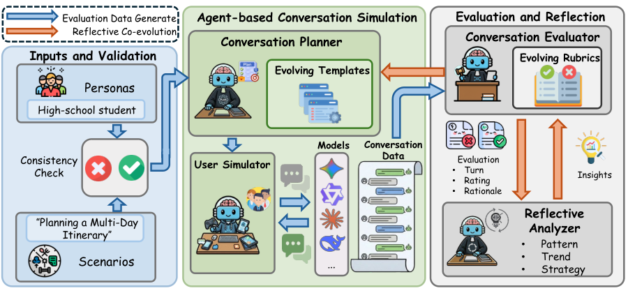

# CoReflect: A Reflective Co-Evolution Framework for Improving Conversational Evaluation

让对话planner依据persona/scenario生成逐turn模板，用户simulator与被测模型交互后由judge评分，reflective analyzer聚类理由、更新rubric和planner，三轮共同演化对话难度与诊断标准。

> 状态：**仅文献与成本收录**，没有可执行能力adapter，不以heuristic冒充核心模型。完整实验：**成本过高，不复现（审查 DONE）**，不下载权重/数据、不自动重试。此为用户指定的历史会议补漏，不是本日新发表。

## 论文信息

| 字段 | 内容 |
|---|---|
| 论文链接 | [原始 arXiv v1](https://arxiv.org/abs/2601.12208v1) |
| 固定方法版本 | [v2正文](https://arxiv.org/html/2601.12208v2)；原始发布日期仍按v1，不把更新版日期当首发 |
| 公司 / 作者机构 | 一作 Yunzhe Li 第一机构为 University of Illinois Urbana-Champaign；Richie Yueqi Feng、Chin-Chia Hsu 明确列 Google DeepMind。 |
| 原始发布日期 | **2026-01-18 00:56:06 UTC**，arXiv v1 |
| 原作者代码 | 固定v2全文与摘要未提供可核验作者代码；精确名称检索仅发现第三方综述引用，不作为源码证据。 |
| 原作者代码许可 | 未核实作者源码仓库，源码许可与固定SHA不适用。论文/原图许可：CC BY 4.0 |
| 本地 Adapter / key | `coreflect`；`adapter=null`；`promotion_eligible=false`；`evolve_integrated=false` |
| 本地代码 | 无：未实现完整方法，不发布伪能力入口 |
| 本地验证 | 不适用：只审查和文档，不训练、不生成GPU收据或虚构metrics |

## 原始论文总结

### 背景与主要改动

Sec.2.1–2.5 / Appendix G：953条通过真实LLM一致性检查的persona-scenario；planner/simulator/evaluator/analyzer是核心语义模型。只写JSON状态机、对给定数字求均值或手工替换rubric都不能复现其核心，因此不强建低成本heuristic adapter。

<!-- paper-figure:start -->
### 原论文关键图

Figure 1取自固定v2的原始PNG，未重绘。图片来自[原论文](https://arxiv.org/html/2601.12208v2#S2.F1)，版权归原作者所有。许可 CC BY 4.0。来源、SHA256与实际目视核验见 `assets/provenance.json`。
<!-- paper-figure:end -->

### 核心公式

$$
\mathcal I^{(t)}=Analyzer(\{r_{ijk}^{(t)},\rho_{ijk}^{(t)}\}),\quad\mathcal R^{(t+1)}=Update(\mathcal R^{(t)},\mathcal I^{(t)}),\quad\mathcal T^{(t+1)}=Planner(\mathcal D,\mathcal I^{(t)}).
$$

上述公式仅解释原方法，不表示已经实现该训练或大模型语义模块。

### 论文离线与线上效果

原文报告三轮后rubric区分度及人类-评审对齐，并用40pair、3名人类标注员验证；没有本地可替代大模型反思的闭式核心。本地只完成文献与成本收录。 未报告互联网生产线上A/B；不得将离线分析或本地数值测试写成线上收益。

## 本地复现

本轮不提供可运行模型、loss包装或伪测试。库里已有通用KL/RL/统计工具并不构成本文核心流程；原文语义模型、API多轮生成或大规模训练不能用手工规则替换。仅保存经过核验的方法、资源、源码状态与原图，终态为 `not_reproduced_high_cost`。后续不得自动移回待训练队列。

### 高成本完整实验

Sec.3.1 / Appendix G：30persona×40scenario筛得953对，平均6.85turn，T=3，约7种大型被测模型；Gemini2.5Flash担当simulator/judge，Gemini2.5Pro做reflective analyzer，经AIStudio/VertexAI。完整API多轮矩阵明显高成本，不运行。

资源基准为单张A100/A30或本地Mac。上述为原论文配置/公开报告，不是本地实测耗时，也不推造未披露的GPU型号或训练小时。完整实验结论：**成本过高，不复现（审查 DONE）**。没有为了证明它昂贵而先下载大权重或启动长跑。
