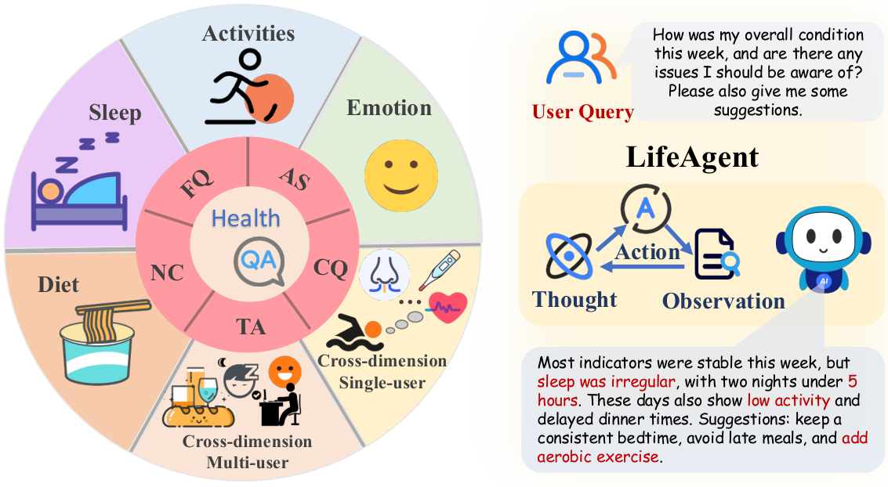

<!-- source-sha256: 7a7deeed76309c66ad3d31cd388d0ece48a8aaa008917b0db05886b0f69a7d5a -->

[简体中文](README.md) · English

# LifeAgentBench: Evidence reasoning over long-term heterogeneous life logs

> **Research material only.** Neither LifeAgent nor its benchmark runs locally. The full experiment is **too costly; not reproduced (review DONE)**. This is not a clinical diagnosis, treatment, or medical decision system.

## Paper information

| Field | Details |
|---|---|
| Paper | [arXiv 2601.13880v1](https://arxiv.org/abs/2601.13880v1); [v2 used for local review](https://arxiv.org/html/2601.13880v2) |
| Institution | First author Ye Tian's first affiliation is UC San Diego; coauthor Xiaoran Fan is at Google Research |
| First public release | **2026-01-20 11:51:58 UTC** (v1); method and cost reviewed against v2 dated 2026-08-31 |
| Author code | [gdfwj/LifeAgentBench](https://github.com/gdfwj/LifeAgentBench/tree/cfc227736965f4cd42261ee780f41050ae44cc67), [official project page](https://gdfwj.github.io/LifeAgentBench/), pinned to `cfc227736965f4cd42261ee780f41050ae44cc67` |
| Author code license | No LICENSE at the pinned root; GitHub license=null. Appendix F explicitly limits use to research and noncommercial settings, not an MIT grant or permission to redistribute data. |
| Local adapter or method key | Research reference `lifeagentbench`; no executable adapter; `evolve_integrated=false` |
| Local reproduction code | None. Documentation, original figure, and source records only; no model calls or evaluation scores. |

## Original paper summary

### Background and main changes

LifeAgentBench uses executable SQL or programs to derive deterministic answers from diet, sleep, activity, and mood records. It covers long windows, cross-dimension tasks, and cross-user tasks. LifeAgent is a separate tool-reasoning baseline: decompose questions, maintain an evidence cache and intermediate statistics, revise plans based on new evidence, and synthesize answers. A benchmark scorer is not this agent.

<!-- paper-figure:start -->
### Key figure from the paper

Original PNG of Figure 1 from pinned v2, not redrawn. From the [paper](https://arxiv.org/abs/2601.13880v2), copyright the authors. The paper uses arXiv perpetual non-exclusive licensing, with no inferred CC license. See `assets/provenance.json`. Health examples are from the original paper, not local medical advice.
<!-- paper-figure:end -->

### Core protocol

Context Prompting filters evidence by user before passing it to the model. Database-augmented Prompting first generates read-only SQL and executes it, then returns results for the answer. Executable gold references remain in the evaluator and are not given to the predictor beforehand.

Section 5 distinguishes answer Acc, executable-SQL VA, complete evidence EX conditioned on VA, and Acc|EX conditioned on complete evidence. SQL execution success does not imply full evidence retrieval. Yes/No and short text use exact match. Numbers use the paper's piecewise tolerance. Multi-item answers require matching cardinality and correct matching; loose substrings are not equivalent.

### Offline and online results

Across 22,573 questions and 13 models, Qwen2.5-7B overall CP / DP accuracy is 40.45% / 21.45%. On the hard subset, LifeAgent averages 40.16%, versus CP 7.74% and DP 9.43%. The hard subset and overall dataset are not one leaderboard. These are author results, not production A/B or local scores.

## Local reproduction and cost

Appendix E reports about **300–500 GPU hours** for open-model inference. Larger models including 70B use 4×A6000, with additional closed APIs and multi-turn tool baselines. A single small inference sample cannot reproduce the comparison. **Full experiment too costly; not reproduced (review DONE).** No life logs, weights, or large datasets are downloaded. There are no inference runs, local metrics, GPU receipts, or automatic retries.
