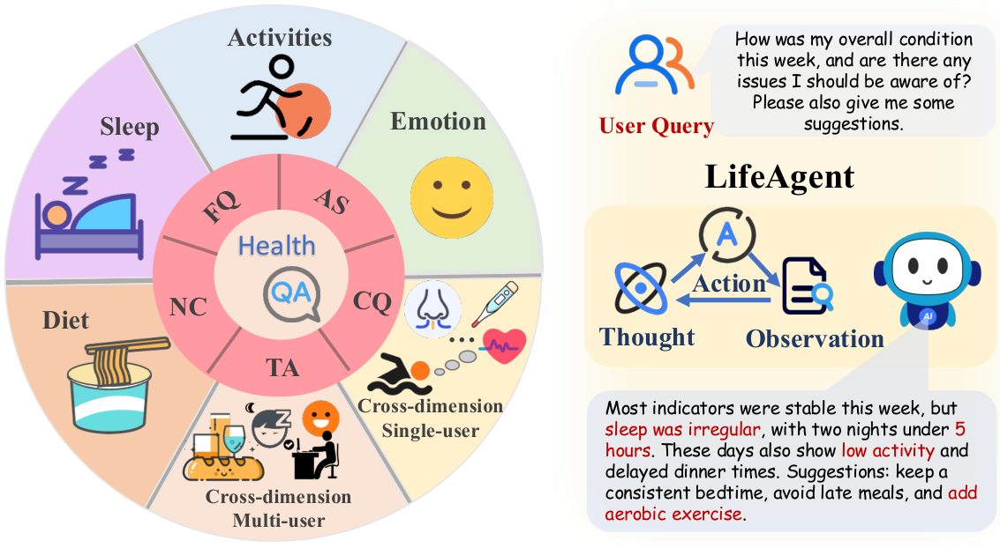

# LifeAgentBench：长期异构生活记录上的证据推理

> **仅研究资料**，未实现 LifeAgent 或运行 benchmark。完整实验**成本过高，不复现（审查 DONE）**。它不是临床诊断、治疗或医疗决策系统。

## 论文信息

| 字段 | 内容 |
|---|---|
| 论文链接 | [arXiv 2601.13880v1](https://arxiv.org/abs/2601.13880v1)；[本地核对 v2](https://arxiv.org/html/2601.13880v2) |
| 公司 / 作者机构 | 一作 Ye Tian 第一机构 UC San Diego；共同作者 Xiaoran Fan 为 Google Research |
| 原始发布日期 | **2026-01-20 11:51:58 UTC**（v1）；方法和成本按 2026-08-31 修订 v2 核对 |
| 原作者代码 | [gdfwj/LifeAgentBench](https://github.com/gdfwj/LifeAgentBench/tree/cfc227736965f4cd42261ee780f41050ae44cc67)，[官方项目页](https://gdfwj.github.io/LifeAgentBench/)，固定 `cfc227736965f4cd42261ee780f41050ae44cc67` |
| 原作者代码许可 | 固定根目录未见 LICENSE、GitHub license=null；论文 Appendix F 明确研究及非商业限制，不能据此推断 MIT 或数据再分发权 |
| 本地 Adapter / key | 资料键 `lifeagentbench`，无可执行 adapter，`evolve_integrated=false` |
| 本地代码 | 不提供：仅文档、原图和来源记录，没有模型调用或评测成绩 |

## 原始论文总结

### 背景与主要改动

LifeAgentBench 用可执行 SQL / 程序在饮食、睡眠、活动和情绪记录上生成确定性答案，覆盖长期窗口、跨维度与跨用户任务。LifeAgent 是另一个工具推理基线：先分解子问题，维护证据缓存与中间统计，再根据新证据修订计划并合成回答，不能把 benchmark scorer 当成该 Agent。

<!-- paper-figure:start -->
### 原论文关键图

固定 v2 Figure 1 原始 PNG，未重绘。图片来自[原论文](https://arxiv.org/abs/2601.13880v2)，版权归原作者所有；论文为 arXiv perpetual non-exclusive，未推断 CC 许可，出处见 `assets/provenance.json`。图内健康例子是原文展示，不是本地医疗建议。
<!-- paper-figure:end -->

### 核心协议

Context Prompting 先按用户筛选证据再给模型；Database-augmented Prompting 先生成只读 SQL，执行后才交回结果供回答。可执行金标在评测器内，不能提前给预测者。

§5 除答案 Acc 外还区分 SQL 可执行 VA、在 VA 分母下的完整证据 EX，以及在完整证据分母下的 Acc|EX；“SQL 成功”不等于完整取回证据。Yes/No 与短文本精确匹配；数字按原文分段容差，多项答案要求相同项数并正确匹配，不能随意改成宽松 substring。

### 论文离线与线上效果

22,573 题、13 模型中，Qwen2.5-7B 的 CP / DP 总准确率为 40.45% / 21.45%；困难子集 LifeAgent 平均 40.16%，高于 CP 7.74% 与 DP 9.43%。后者是困难子集，不能与总集成绩混为一张榜。以上均为作者实验，不是生产 A/B 或本地成绩。

## 本地复现与成本

正文 Appendix E 明确开放模型推理约 **300–500 GPU 小时**；含 70B 的较大模型使用 4×A6000，另有闭源 API 和多轮工具基线。这不是单次小样本推理可以重现的整套比较。完整实验**成本过高，不复现（审查 DONE）**；不下载生活记录、权重或大数据，不运行推理，也不生成本地 metrics / GPU receipt。后续不会自动重试。
