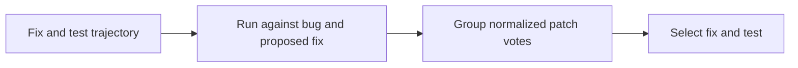
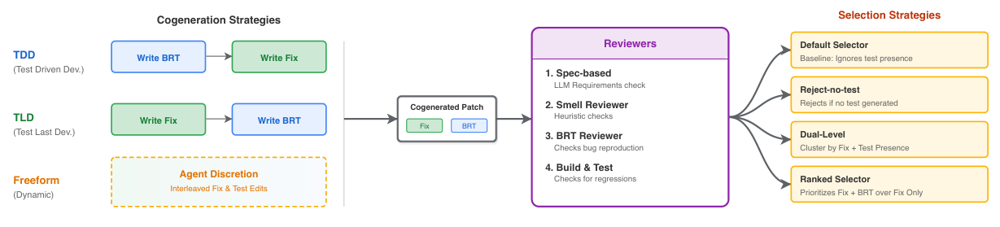

# Dynamic Cogeneration: Generate a fix and a reproducing test together

<!-- source-sha256: 98dfab9b97d3d833ebf535dab1f0cdd118a88de33f4f631dde14695641d3d077 -->

[简体中文](README.md)

> **Standalone L1 diagnostic, `adapter: null`.** Test validation and selection, not a Passerine generation agent. Full experiment too costly and not reproduced (review DONE).

## Paper information

| Field | Details |
|---|---|
| Paper | [arXiv 2601.19066](https://arxiv.org/abs/2601.19066); [v1 Sections 3.2–3.3](https://arxiv.org/html/2601.19066v1#S3.SS2) |
| Institution | First author Runxiang Cheng: Google |
| First public release | 2026-01-27 01:02:57 UTC (arXiv v1; historical backfill) |
| Author code | No Passerine implementation found in reviewed paper or official listing. Input/reference repositories are not author code. |
| Local adapter or method key | `dynamic-brt` |
| Local reproduction code | `src/auto_research/agent_research/google16_dynamic_brt.py` |

## Paper method and evidence

The fix and bug reproduction test (BRT) are generated in one trajectory; TDD, TLD and Freeform differ in order. A BRT fails on the bug and passes on the generated fix. Group by non-test patch so different tests do not split votes for the same fix; ranked favors a test within the majority group. This is not `plausibleBRT`, which also needs an isolated oracle fix. A generated fix agreeing with its own test is not proof of correctness. [Section 3](https://arxiv.org/html/2601.19066v1#S3).



<!-- paper-figure:start -->
### Original paper figure

[](https://arxiv.org/pdf/2601.19066v1#page=4)

Figure 1 from v1 page 4 shows the larger workflow, not the limited local implementation. [Screenshot provenance](assets/provenance.json). From the [original paper](https://arxiv.org/abs/2601.19066); copyright remains with the authors.
<!-- paper-figure:end -->

### Core equation

$$
\mathrm{candidateBRT}(f,t)=[t(b)=\mathrm{fail}]\land[t(f)=\mathrm{pass}].
$$

### Reported results

On 120 private Google bugs, best selector fix+BRT precision/recall is 0.16/0.71 vs default 0.08/0.57. Internal deployment is not quantified production A/B. [Section 5.3](https://arxiv.org/html/2601.19066v1#S5.SS3).

## Local reproduction

Eleven tests pass. A constructed `increment` example really launches separate Python processes and observes `assertion_failed → passed`. Tautologies, non-assertion exceptions and fixes failing regression do not qualify. Majority examples verify distinct ranked and dual selections. [Diagnostic metrics](metrics/component-contract.json).

`execute_subset` accepts AST-allowlisted public functions, limited integer arithmetic, conditionals and nonempty assertions; blocks imports, attributes, files/network/external processes, loops and exponentiation. Each pair runs in a new `-I -S` process with CPU 1s and wall 2s limits and process group cleanup; Linux also limits address space to 256 MiB, not claimed on Mac. **Not a general malicious-code sandbox**, and never runs downloaded repos. `normalized_implementation` keeps operators/constants and heuristically normalizes identifiers, not semantic equivalence. `review_patch` and reviewer do not receive gold; `select_patch` consumes reviewed results. No generator or spec/smell LLM review; `semantic_reviewer_observed=false`. A supplied callback is actually invoked and can reject. Fixtures are not Google benchmark, model capability or Evolve evidence.

The private monorepo and Gemini 2.5 Pro campaign is 5×120×20 trajectories up to 25 steps, roughly 300,000 configured agent steps (not measured local runtime). No complete single-GPU/Mac campaign or automatic retry.

```bash
PYTHONPATH=src python -m pytest tests/test_google16_dynamic_brt.py
```
