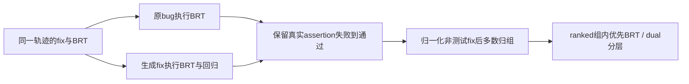
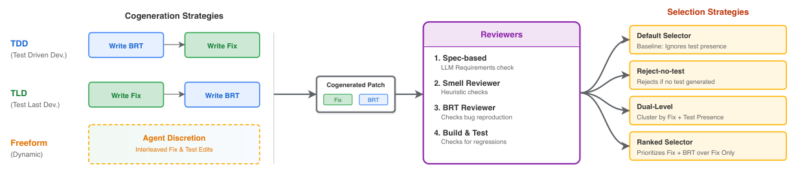

# Dynamic Cogeneration：共同生成修复与复现测试

> `component_only` / L1 机制诊断。实现测试验证及选择器，**没有实现或宣称 Passerine 生成 Agent 的能力**。完整实验：**成本过高，不复现（审查 DONE）**。

## 论文信息

| 字段 | 内容 |
| --- | --- |
| 论文链接 | [arXiv 2601.19066](https://arxiv.org/abs/2601.19066)，本地机制按 [v1 §3.2–3.3](https://arxiv.org/html/2601.19066v1#S3.SS2) 核对 |
| 公司/机构 | 一作 Runxiang Cheng，Google |
| 首次公开日期 | 2026-01-27 01:02:57 UTC（v1；不是本轮新发） |
| 原文开源代码 | 已审读正文及官方条目未找到作者 Passerine 实现；不能把输入/引用仓库当源码 |
| 本地 Adapter | 无（`adapter: null`）；独立组件 `dynamic-brt` |
| 本地复现代码 | `src/auto_research/agent_research/google16_dynamic_brt.py` |

## 原始论文总结

### 背景与主要改动

论文让修复和 BRT 留在同一条轨迹；TDD、TLD、Freeform 改变生成顺序。BRT 必须在原 bug 上失败、生成修复上通过。选择器按非测试修复归组，避免不同测试拆散同一修复的票数；ranked 在多数修复组内优先保留测试。[原文 §3](https://arxiv.org/html/2601.19066v1#S3)



<!-- paper-figure:start -->
### 原论文关键图

[](https://arxiv.org/pdf/2601.19066v1#page=4)

> 原论文 v1 Figure 1，第4页流程图截图；版权归作者，本地仅实现验证及选择器，不包含图中完整生成Agent。[截图来源记录](assets/provenance.json)

图片来自[原论文](https://arxiv.org/abs/2601.19066)，版权归原作者所有。
<!-- paper-figure:end -->

### 核心公式

$$
\mathrm{candidateBRT}(f,t)=[t(b)=\mathrm{fail}]\land[t(f)=\mathrm{pass}].
$$

这不是 `plausibleBRT`：后者还需要对隔离 oracle 修复执行。本地没有 oracle，不把生成修复与自生成测试相互吻合称作正确修复。

### 论文离线与线上效果

原文私有 120 个 Google bug；best selector 的 fix+BRT precision/recall 为 0.16/0.71，默认为 0.08/0.57。内部部署不等于量化生产 A/B，本条不按工业线上效果纳入。[§5.3](https://arxiv.org/html/2601.19066v1#S5.SS3)

## 本地复现

```bash
PYTHONPATH=src python -m pytest tests/test_google16_dynamic_brt.py
```

### 数据协议与结果

11 项单元测试已通过。自建 `increment` 算术实例真实启动独立 Python 子进程，观察 `assertion_failed → passed`；恒真测试、异常而非断言失败、未通过回归的修复均不接纳。ranked 与 dual 的不同选项已通过多数分组实例验证。[诊断指标](metrics/component-contract.json)

这些是人工机制实例，不是模型生成、Google 基准、成功率比较或 Evolve 证据。`semantic_reviewer_observed=false` 表示没有实际 LLM reviewer；提供回调后会真正执行并可拒绝，而不是默认捏造“审查通过”。

### 代码映射与边界

`execute_subset` 只支持已验证 AST 白名单的公开函数、有限整数算术、条件和非空断言；禁止 import、属性访问、文件/网络/外部程序、循环和幂运算。每对代码/测试重新启动 `-I -S` 进程，CPU 1 秒、wall 2 秒并回收进程组；Linux 另限地址空间 256 MiB。Mac 不宣称该内存限制可用。**这不是任意恶意代码的通用安全沙箱**，不接受下载仓库执行。

`normalized_implementation` 保留常数/操作符但启发式归一化标识符，不是语义等价证明。`review_patch` 和 reviewer 不接收 gold fix；`select_patch` 仅接受已有审核结果。TDD/TLD/Freeform 提案生成与 spec/smell LLM reviewers未运行。

### 成本决定

原配置 5×120×20 条轨迹、每条最多 25 步，且使用私有 monorepo 与 Gemini 2.5 Pro；最多约 300,000 Agent 步（配置推算，非实测）。单张 A100/A30 或 Mac 不跑完整 campaign；**成本过高，不复现（审查 DONE）**，不自动重试。
