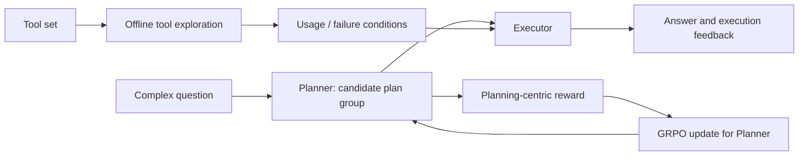
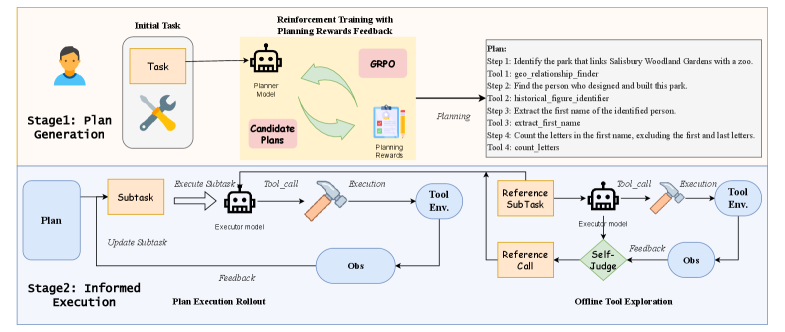

<!-- source-sha256: 532b148015bbbd2de06c926b5a15312dd5363cd425850d51adf04f4c408892d9 -->

[简体中文](README.md) · English

# PEARL: Tool exploration and reinforcement learning for planning

> PEARL explores valid tool parameters and failure conditions offline, then trains a separate Planner with planning-centric rewards and GRPO. Reliable execution and long-horizon planning are optimized separately.

## Paper information

| Field | Details |
| --- | --- |
| Paper | [PEARL: Plan Exploration and Adaptive Reinforcement Learning for Multihop Tool Use](https://arxiv.org/abs/2601.20439) |
| Institution | Institute of Information Engineering, Chinese Academy of Sciences / School of Cyber Security, University of Chinese Academy of Sciences |
| First public release | 2026-01-28 |
| Author code | No author code found or released. |
| Local adapter or method key | `pearl` |
| Local reproduction code | `src/auto_research/agent_research/` |

## Original paper summary

### Background and main changes

Multi-hop tool use can fail due to hallucinated tools, incorrect arguments, and weak long-horizon planning. The offline stage learns tool usage and failure conditions by trial and error. The online stage separates Planner and Executor and applies GRPO with a dense reward for plan correctness, tool chains, and final outcomes rather than relying only on sparse success.



<!-- paper-figure:start -->
### Key figure from the paper

[](https://ar5iv.labs.arxiv.org/html/2601.20439/assets/x1.png)

> **Figure 1:** The core architecture, its main modules, and their connections. From the [paper](https://arxiv.org/abs/2601.20439); copyright belongs to the authors. Click for the source.
<!-- paper-figure:end -->

### Core equations

$$
P=((s_1,\tau_1),\ldots,(s_n,\tau_n)),\qquad
R_{\mathrm{plan}}=
w_1R_{\mathrm{tool}}+w_2R_{\mathrm{order}}+w_3R_{\mathrm{success}},
$$

$$
\hat A_i=\frac{R_i-\operatorname{mean}(R_{1:G})}
{\operatorname{std}(R_{1:G})+\epsilon},
\qquad
\mathcal J=\frac1G\sum_i\min(\rho_i\hat A_i,
\operatorname{clip}(\rho_i,1-\epsilon_c,1+\epsilon_c)\hat A_i).
$$

### Offline and online results

PEARL-7B reaches 56.5% success and 3.8% invocation errors on ToolHop and 77.0% success with 1.0% errors on T-Eval. Removing planning rewards drops ToolHop success to 23.4%. These are offline public benchmarks, not production A/B tests.

## Local reproduction

Over 120 fixed PlanBench mini episodes, joint success is 1.0000 and average cost is 1.1200. For 12 new task families, the run performs 24 plan explorations and 12 policy updates, then reuses plans 108 times.

```bash
auto-research agent-eval --method pearl \
  --benchmark planbench-mini --episodes 120 --memory-size 24 --seed 42
```

Stable metrics: [`classic-agent-mini-suites-seed42.json`](../../experiments/classic-agent-mini-suites-seed42.json).

## Scope

The implementation includes offline candidate plan exploration, planning rewards, group-relative selection updates, a separate Planner and Executor, and cross-episode reuse. It does not train Qwen2.5-7B or connect to live ToolHop/T-Eval APIs and a GRPO cluster.
