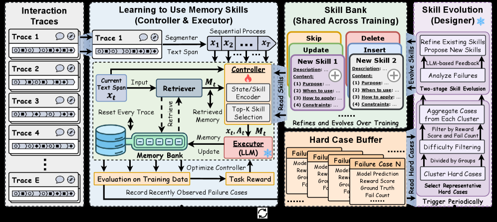

# MemSkill: consolidating episodic memory into executable skills

<!-- source-sha256: d2d004598a4f482d4e8dc7f1a714139819f92112b2f43072312576cf3ffdf20a -->

[简体中文](README.md)

> **Fidelity: core mechanism.** The deterministic mini-suite does not stand in for the paper's full benchmark.

## Paper information

| Field | Details |
|---|---|
| Paper | [MemSkill: consolidating episodic memory into executable skills (arXiv 2602.02474)](https://arxiv.org/abs/2602.02474) |
| Organization | Nanyang Technological University / University of Illinois Urbana-Champaign / University of Illinois Chicago / Tsinghua University |
| First public release | 2026-02-02 (arXiv v1) |
| Authors' code | [Public implementation](https://github.com/ViktorAxelsen/MemSkill) |
| Adapter / method | `memskill` |
| Local reproduction code | [`src/auto_research/agent_research/`](https://github.com/daiwk/auto-research/tree/main/src/auto_research/agent_research/) |

## Original paper

### Motivation and method

The controller selects memories from past episodes. The designer compiles recurring successful patterns into skills and updates their versions using new feedback.


<!-- paper-figure:start -->
### Key figure from the paper

[](https://arxiv.org/html/2602.02474v2/x2.png)

> **Figure 2:** Core architecture, modules, and connections. From the [original paper](https://arxiv.org/abs/2602.02474); copyright remains with the authors.
<!-- paper-figure:end -->

### Core equations

$$
m^*=q_\phi(x,M),\quad s=G(\tau,m^*),\quad M,S\leftarrow\operatorname{Consolidate}(M,S,R).
$$

### Paper results

The paper improves success rates and reduces context costs on long-horizon and cross-task agent benchmarks. No production online A/B test is reported; no online figures are inferred.

## Local reproduction

PlanBench mini-suite, 120 episodes, seed 42: joint success **1.0000**, average cost 0.3200, and nonzero method-specific telemetry.

```bash
auto-research agent-eval --method memskill --benchmark planbench-mini --episodes 120 --seed 42
auto-research evolve --model agent --dataset planbench-mini --direction "组合 memskill 与已安装论文算子" --generations 2 --population 4
```

See the [fixed metrics](../../experiments/global-p0-20260808-seed42.json).

## Reproduction boundaries

The local run checks the paper-specific objective, state updates, and fair budgets. It does not reproduce large models, multi-GPU RL, private environments, real websites, or the full benchmark. It validates the mechanism, not the numerical results in the original tables.
