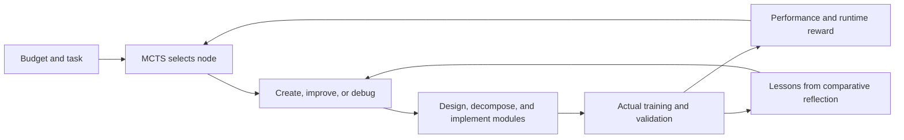
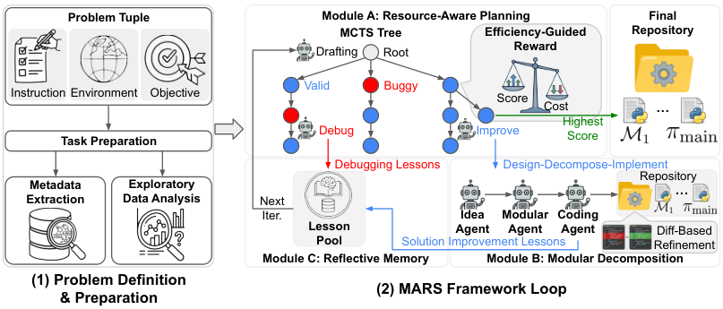

# MARS: Budget-aware search for modular automated research

<!-- source-sha256: 8ed47dabbc4068ab9a3b3f8312b6ac6696469e147d2f8787ddb4a2879ec7a05a -->

[简体中文](README.md)

> High-priority historical backfill. **Not reproduced due to cost (review DONE).** No local capability result or executable Evolve operator.

## Paper information

| Field | Value |
| --- | --- |
| Paper | [arXiv 2602.02660v1](https://arxiv.org/abs/2602.02660v1); [pinned full text](https://arxiv.org/html/2602.02660v1) |
| Organization | First author Jiefeng Chen; all authors list Google Cloud AI Research in v1 |
| First published | 2026-02-02 19:00:03 UTC (arXiv v1; not overwritten with an institution catalog date) |
| Original author code | [jfc43/MARS](https://github.com/jfc43/MARS), MIT. Root includes exp-logs, figures, README and LICENSE. Generated code and trajectories are released; the full controller was not verified. |
| Local adapter / stable key | `mars-research` (reference key only); `adapter: null` |
| Local reproduction code | None; this page and `src/auto_research/paper_specs/catalog/agent-research/mars-research.json` only |

## Original paper summary

### Background and main changes

Automated research must not only generate correct code but also identify useful changes within training time limits. MARS constructs modular repositories through design, decomposition, and implementation. Budget-aware MCTS chooses whether to create, improve, or debug a solution. Comparing old and new execution results and code diffs yields solution and debugging lessons reusable by other branches.

Redrawn from Figure 2; see the [paper's flowchart](https://arxiv.org/html/2602.02660v1).

<!-- paper-figure:start -->
### Key figure from the paper

**Original Figure 2:** Budget-aware MCTS, modular repository construction, and a library of lessons from comparisons. This is the authors' original PNG, not the Mermaid redraw or a local training trace. Image from the [original paper](https://arxiv.org/abs/2602.02660v1); copyright belongs to the authors. Click the image for its source.
<!-- paper-figure:end -->

### Core equation

Section 4.4 range-normalizes metrics over explored nodes, returning 0.5 when all metrics coincide:

$$
G(v)=\frac{M(v)-M_{\min}}{M_{\max}-M_{\min}},\qquad
R(v)=G(v)\left[\frac{t(v)}{L(v)}\right]^w,\quad w=-0.07.
$$

Slower proposals are penalized at comparable performance. Failed nodes enter bounded debugging; valid nodes have bounded offspring. The paper uses up to 10 debug attempts, 2 improvement children, and 30 recent lessons. Scheduling rules are not capability evidence: $M(v)$ must come from actual execution.

### Offline and online results in the paper

In v1 §5, with matched environment and model, Gemini-3-Pro-Preview MARS reaches 56.0%±1.5% Any Medal (SEM), versus 37.8%±2.5% for AIRA-dojo, over three runs. MARS+ uses two GPUs and is not a single-GPU result. Later leaderboard figures in the author repository do not replace the pinned v1 experiment definition. No production A/B is reported.

## Local reproduction and cost

MLE-Bench has 75 competitions, each with a budget of 24 hours on one A100-40GB, plus substantial RAM, storage, and closed-model calls. Full evaluation of several methods over three runs exceeds a short single-GPU budget (§5.1). **Not reproduced due to cost (review DONE)**; no competition training or downloads were started to measure cost.

The MIT [author repository](https://github.com/jfc43/MARS) includes generated code and traces, not a verified release of the complete controller. There is no local implementation, training result, or Evolve integration. The budget reward and experience contract are potential lower-cost follow-ups only.
