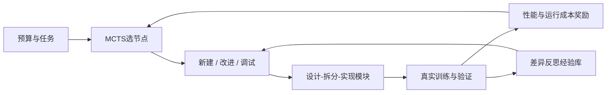
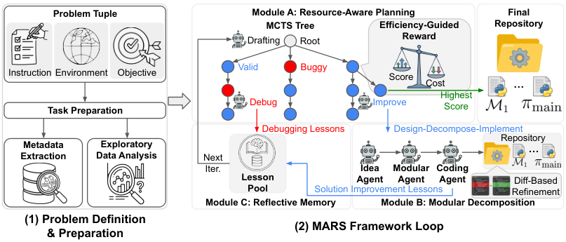

# MARS：预算感知搜索与模块化自动研究

> 历史高优先补漏资料；**成本过高，不复现（审查 DONE）**。没有本地能力结果或可执行 Evolve 算子。

## 论文信息

| 字段 | 内容 |
| --- | --- |
| 论文链接 | [arXiv 2602.02660v1](https://arxiv.org/abs/2602.02660v1)；[固定正文](https://arxiv.org/html/2602.02660v1) |
| 公司 / 机构 | 一作 Jiefeng Chen；所读 v1 全体作者署名 Google Cloud AI Research |
| 首次公开日期 | 2026-02-02 19:00:03 UTC（arXiv v1，不用机构目录日期覆盖） |
| 原作者代码 | [jfc43/MARS](https://github.com/jfc43/MARS)；MIT 作者仓库存在，根目录为 exp-logs/figures/README/LICENSE；发布生成代码和轨迹，未确认完整 MARS controller |
| 本地 adapter / 稳定键 | `mars-research`（仅资料键）；`adapter: null` |
| 本地复现代码 | 无；仅本文及 `src/auto_research/paper_specs/catalog/agent-research/mars-research.json` |

## 原始论文总结

### 背景与主要改动

自动研究不仅要生成正确代码，还需在有限训练时间内分辨改动价值。MARS 使用“设计—拆分—实现”生成模块化仓库，以预算感知 MCTS 选择新方案、改进或调试；比较新旧执行结果和代码差异，提炼解决方案经验与调试经验，供其他搜索分支复用。

图按原文 Figure 2 重绘。[原文流程图](https://arxiv.org/html/2602.02660v1)。

<!-- paper-figure:start -->
### 原论文关键图

> **原论文 Figure 2**：预算感知MCTS、模块化仓库构建与比较反思经验库；为作者研究流程图，不是本地训练轨迹。 图片来自[原论文](https://arxiv.org/abs/2602.02660v1)，版权归原作者所有；此处保留作者PNG，不是上方Mermaid重绘。点击图片查看原始图源。
<!-- paper-figure:end -->

### 核心公式

原文 §4.4 对已探索节点的指标作范围归一化，指标全相同时取 0.5：

$$
G(v)=\frac{M(v)-M_{\min}}{M_{\max}-M_{\min}},\qquad
R(v)=G(v)\left[\frac{t(v)}{L(v)}\right]^w,\quad w=-0.07.
$$

较慢方案在可比性能下受到惩罚。失败节点进入有上限的调试循环，有效节点只允许有界子代；论文使用至多 10 次调试、2 个改进子代与 30 条近期经验。这些调度规则不产生模型能力证据，真正的 $M(v)$ 必须来自执行结果。

### 论文离线与线上效果

v1 §5 在同环境、同模型对照中报告 Gemini-3-Pro-Preview 的 MARS Any Medal 为 56.0%±1.5%（SEM），AIRA-dojo 为 37.8%±2.5%；三次独立运行。MARS+ 使用双卡，不能与单卡结果混写。作者仓库后续榜单数字不覆盖本文固定 v1 的实验定义。未报告生产 A/B。

## 本地复现与成本判断

MLE-Bench 包含 75 个竞赛，每竞赛预算 24 小时单张 A100-40GB，另有大内存、存储和闭源 LLM 调用；完整多方法三次评测显然超出短时单卡预算（§5.1）。**成本过高，不复现（审查 DONE）**，不启动下载与竞赛训练来验证成本。

[作者仓库](https://github.com/jfc43/MARS) 为 MIT 发布物，可核到生成代码和轨迹；不能等同已发布完整控制器。本轮无本地实现、训练成绩或 Evolve 接入。预算奖励与经验合同只是后续低成本可能方向，尚未实现。
