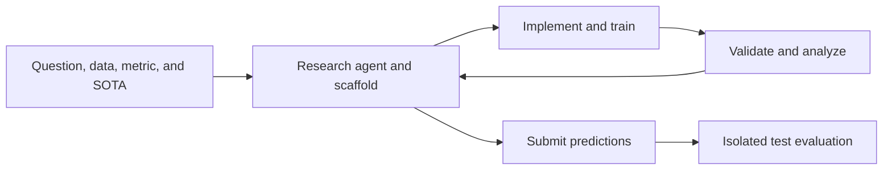
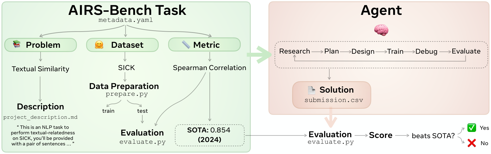

# AIRS-Bench: end-to-end evaluation of AI research agents

<!-- source-sha256: d2d21e40dbddc4be11f4b58ceb119b5d69cfc65193b9316e5f149ffccacedbc3 -->

[简体中文](README.md)

> Historical coverage, prioritizing Google and Meta. **Not reproduced due to cost (review complete).** Indexing the task specifications does not integrate the benchmark.

## Paper information

| Field | Details |
|---|---|
| Paper | [arXiv 2602.06855](https://arxiv.org/abs/2602.06855); [official Meta page](https://ai.meta.com/research/publications/airs-bench-a-suite-of-tasks-for-frontier-ai-research-science-agents/) |
| Organization | First author Alisia Lupidi, FAIR at Meta / University of Oxford |
| First public release | 2026-02-06 16:45:02 UTC (arXiv v1); Meta catalog February 10; v3 February 16 |
| Authors' code | [facebookresearch/airs-bench](https://github.com/facebookresearch/airs-bench), task and evaluation code, CC BY-NC 4.0. |
| Adapter / method | No executable adapter (`adapter: null`); reference key `airs-bench` |
| Local reproduction code | None; this page and `src/auto_research/paper_specs/catalog/agent-research/airs-bench.json` only |

## Original paper

### Motivation and method

Define 20 tasks by question, dataset, metric, and human state of the art. Agents propose methods, implement training, analyze experiments, and revise without baseline solutions. The protocol distinguishes the agent, search scaffold, and execution harness and compares sequential MLGym with tree-search AIRA-dojo. See [Sections 3–5](https://arxiv.org/html/2602.06855v1).

<!-- paper-figure:start -->
### Key figure from the paper

> **Figure 1:** Task definition and submission/evaluation workflow, in the authors' original PNG. This is not a local run or redraw. From the [original paper](https://arxiv.org/abs/2602.06855); copyright remains with the authors.
<!-- paper-figure:end -->

### Core protocol and paper results

Public task descriptions and evaluation scripts do not make test labels readable. Candidate selection, execution budgets, and label isolation must be preserved. The paper reports that 4 tasks beat human SOTA and 16 do not; these are not local results. Different task metrics cannot be directly added into one capability ranking. No production online A/B is reported.

## Local reproduction and cost decision

The paper uses a dedicated H200 for 24 hours per run over 20 tasks. Appendix D lists 10 to 20 runs per task. On one A100/A30 or a Mac, **the cost is prohibitive and the benchmark is not reproduced (review complete)**. See [Appendices C–D](https://arxiv.org/html/2602.06855v1#A3).

Task documentation or a public-result import interface could be reviewed separately. This entry does not implement that interface, start complete tasks, or claim that evolve runs this benchmark. No local metrics, CUDA path, GPU acceptance requirement, or automatic retry.
