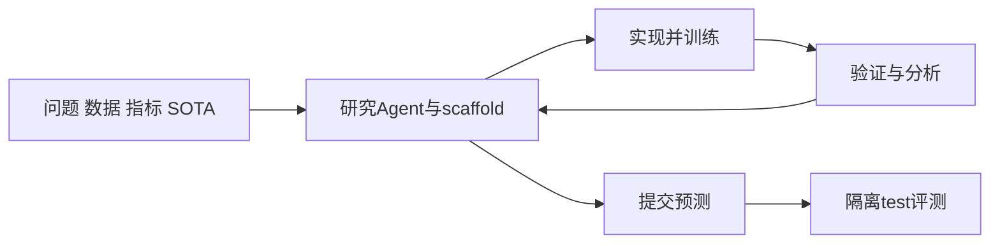
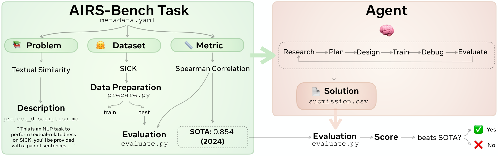

# AIRS-Bench：端到端AI研究Agent评测

> Google/Meta优先补漏资料。**成本过高，不复现（审查 DONE）**；任务规范收录不等于已接入benchmark。

## 论文信息

| 字段 | 内容 |
| --- | --- |
| 论文链接 | [arXiv 2602.06855](https://arxiv.org/abs/2602.06855)；[Meta官方页](https://ai.meta.com/research/publications/airs-bench-a-suite-of-tasks-for-frontier-ai-research-science-agents/) |
| 公司 / 机构 | 一作Alisia Lupidi，FAIR at Meta / University of Oxford |
| 首次公开日期 | 2026-02-06 16:45:02 UTC（arXiv v1）；Meta目录02-10；v3为02-16 |
| 原作者代码 | [facebookresearch/airs-bench](https://github.com/facebookresearch/airs-bench)，任务与评测代码，CC BY-NC 4.0 |
| 本地 adapter / 稳定键 | 无可执行adapter（`adapter: null`）；资料键`airs-bench` |
| 本地复现代码 | 无；仅本文和`src/auto_research/paper_specs/catalog/agent-research/airs-bench.json` |

## 原始论文总结

### 背景与主要改动

以问题、数据集、指标和人工SOTA定义20个任务。Agent自行提出方法、实现训练、分析实验并修订，不提供基线解法；协议区分Agent、搜索scaffold与运行harness，比较顺序MLGym和树搜索AIRA-dojo。[原文§3–5](https://arxiv.org/html/2602.06855v1)

<!-- paper-figure:start -->
### 原论文关键图

> **原文Figure1**：任务定义与提交评测流程，作者发布的原始PNG。图片来自[原论文](https://arxiv.org/abs/2602.06855)，版权归原作者所有；不是本地运行或重绘。
<!-- paper-figure:end -->

### 核心协议与原文效果

任务说明和评测脚本可见不表示test标签可读；候选选择、运行预算和标签隔离须保留。论文报告4项任务超过人工SOTA、16项未达到；不是本地成绩。任务指标不同，不能直接相加作为统一能力排名；未报告生产线上A/B。

## 本地复现与成本决策

原文每次运行24小时、独占1张H200，20个任务；附录D还列每任务10至20次运行。单A100/A30或Mac下，**成本过高，不复现（审查 DONE）**。[原文附录C–D](https://arxiv.org/html/2602.06855v1#A3)

以后可独立审查任务说明或公开结果导入接口，但本页没有实现该接口、没有启动完整任务，也不声明evolve已调用该benchmark。无本地指标、CUDA路径或GPU验收需求，不自动重试。
