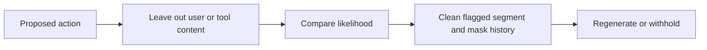
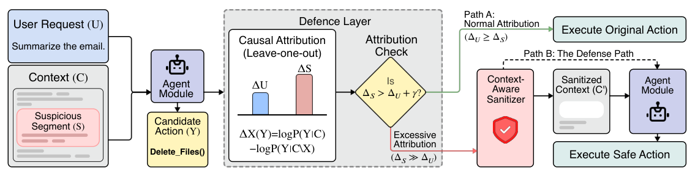

# CausalArmor: Locate what drives an action with leave-one-out attribution

<!-- source-sha256: af465c7296fac2946ba356f2ddd5966ea8a03631a80b220e973eb31ca62ff235 -->

[简体中文](README.md)

> **Standalone L1 component**, real likelihood operator and fail-closed intervention API; not a validated injection detector. Full experiment too costly and not reproduced (review DONE).

## Paper information

| Field | Details |
|---|---|
| Paper | [arXiv 2602.07918](https://arxiv.org/abs/2602.07918); [v1 full text](https://arxiv.org/html/2602.07918v1) |
| Institution | First author Minbeom Kim: Google Cloud AI Research / Seoul National University. [PDF title page](https://arxiv.org/pdf/2602.07918v1) notes the work was done as a Google student researcher; grouping uses the first affiliation. |
| First public release | 2026-02-08 11:34:08 UTC (arXiv v1) |
| Author code | No author implementation found in the reviewed paper or Google entry. AgentDojo is an environment, not CausalArmor code. |
| Local adapter or method key | `causal-armor` |
| Local reproduction code | `src/auto_research/agent_research/google16_causal_armor.py`; `scripts/run_google16_agent.py` |

## Paper method and evidence

Before high-privilege actions, remove the user request and each untrusted tool segment in turn and compare the likelihood of the same action. If tool attribution exceeds user attribution by the rule, sanitize flagged segments only, mask assistant history after the first hit and regenerate. Keep the source sign convention: larger `tau` flags more segments. Low user attribution alone is not attack detection; LOO is an operational ablation, not a proof of safety. [Sections 3–4 and Algorithm 1](https://arxiv.org/html/2602.07918v1#S4).



<!-- paper-figure:start -->
### Original paper figure

[](https://arxiv.org/pdf/2602.07918v1#page=2)

Figure 1, v1 page 2, illustrates the proposed intervention, not locally validated safety. [Screenshot provenance](assets/provenance.json). From the [original paper](https://arxiv.org/abs/2602.07918); copyright remains with the authors.
<!-- paper-figure:end -->

### Core equation

$$
\bar\Delta_X(Y)=\frac{\log P(Y\mid C)-\log P(Y\mid C\setminus X)}{|Y|},
\qquad B(\tau)=\{S:\bar\Delta_S>\bar\Delta_U-\tau\}.
$$

### Reported results

Paper evaluation on AgentDojo and DoomArena compares safety, utility and latency. For Gemini-3-Pro on DoomArena, ASR falls 88.87%→3.65% and BU 73.57→70.96. No production A/B. [Section 5](https://arxiv.org/html/2602.07918v1#S5).

## Local reproduction

Seven CPU contract tests cover separate LOO effects, action-length normalization, strict margin, selective sanitation, history masking, withholding with missing callback and low-risk bypass. Fixtures do not measure security accuracy. [CPU record](metrics/component-contract.json).

The GPU runner uses only a pre-existing cache and pinned revision, one public constructed context, and a batch of full/user-removed/tool-removed prompts. Prefix is at most 384 tokens and action at most 48; it performs teacher-forced likelihood on one fixed action, with no tool execution, training or download. GPU measurements and a sanitized receipt are reported separately, not assumed. `attribute` implements Eqs. 2/5/6; `guard` needs explicit sanitizer and agent callbacks or returns `action=None`. The likelihood probe has `sanitizer_observed=false` and `regeneration_observed=false`. `CachedLikelihoodScorer` fixes target tokens, padding masks and independent prefix positions, rejecting silent truncation. Supports one request and up to eight untrusted tool messages, not distributed multi-turn attacks.

The full study has several backbones, three attacks, four environments, 115 DoomArena scenarios × five seeds, 8×A100 and cloud sanitation/agent calls. The paper configuration exceeds the short single-card budget. No escalation to larger models for a diagnostic or Evolve promotion.

```bash
PYTHONPATH=src python -m pytest tests/test_google16_causal_armor.py
PYTHONPATH=src python scripts/run_google16_agent.py \
  --checkpoint <existing-local-checkpoint> --model-id <public-model-id> \
  --revision <40-char-public-revision> --device cuda --seed 42 \
  --output runs/google16-agent/causal-armor.json
```
