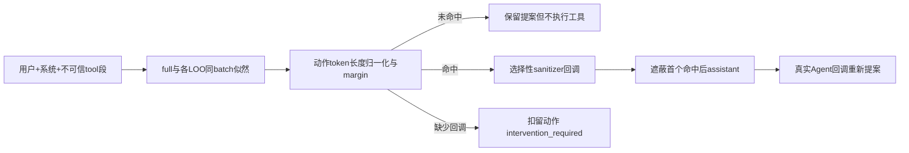
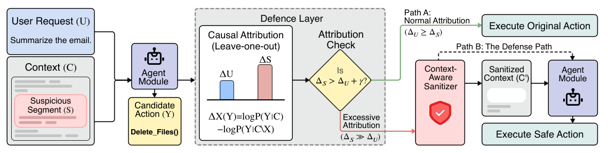

# CausalArmor：用留一消融定位动作的支配来源

> `component_only` / L1。真实似然算子与安全失败的干预接口，不是已验证的注入检测器。完整实验：**成本过高，不复现（审查 DONE）**。

## 论文信息

| 字段 | 内容 |
| --- | --- |
| 论文链接 | [arXiv 2602.07918](https://arxiv.org/abs/2602.07918)，[v1 全文](https://arxiv.org/html/2602.07918v1) |
| 公司/机构 | 一作 Minbeom Kim：Google Cloud AI Research / Seoul National University；[原 PDF 首页](https://arxiv.org/pdf/2602.07918v1)注明 Google student researcher 期间完成。按第一列机构聚合，不归作仅 SNU 或合作者机构 |
| 首次公开日期 | 2026-02-08 11:34:08 UTC（arXiv v1） |
| 原文开源代码 | 已读原文与 Google 条目未找到作者实现；AgentDojo 是评测环境，不是 CausalArmor 代码 |
| 本地 Adapter | 无；独立组件 `causal-armor` |
| 本地复现代码 | `src/auto_research/agent_research/google16_causal_armor.py`；`scripts/run_google16_agent.py` |

## 原始论文总结

### 背景与主要改动

在高权限动作前，分别去掉用户请求与不可信工具段，比较同一个动作的似然变化。工具段的归因高于用户时，只清洗命中段，再遮蔽首个命中点后的 assistant 内容并重新提案。[§3–4、Algorithm 1](https://arxiv.org/html/2602.07918v1#S4)



<!-- paper-figure:start -->
### 原论文关键图

[](https://arxiv.org/pdf/2602.07918v1#page=2)

> 原论文 v1 Figure 1，第2页；版权归作者。图示的安全动作是论文设计，不是本地已经验证的安全保证。[截图来源记录](assets/provenance.json)

图片来自[原论文](https://arxiv.org/abs/2602.07918)，版权归原作者所有。
<!-- paper-figure:end -->

### 核心公式

$$
\bar\Delta_X(Y)=\frac{\log P(Y\mid C)-\log P(Y\mid C\setminus X)}{|Y|},
\qquad B(\tau)=\{S:\bar\Delta_S>\bar\Delta_U-\tau\}.
$$

保留原文的负号约定：增大 `tau` 会标记更多段。小用户归因本身不是攻击结论；LOO 是操作性消融，不是因果安全证明。

### 论文离线与线上效果

论文在 AgentDojo、DoomArena 比较安全/效用/延迟；DoomArena 的 Gemini-3-Pro 示例 ASR 从 88.87% 到 3.65%，BU 从 73.57 到 70.96。未报告生产 A/B。[§5](https://arxiv.org/html/2602.07918v1#S5)

## 本地复现

```bash
PYTHONPATH=src python -m pytest tests/test_google16_causal_armor.py
PYTHONPATH=src python scripts/run_google16_agent.py \
  --checkpoint <existing-local-checkpoint> --model-id <public-model-id> \
  --revision <40-char-public-revision> --device cuda --seed 42 \
  --output runs/google16-agent/causal-armor.json
```

### 数据协议与结果

7 项 CPU 契约测试通过：LOO 分离、动作长度归一化、margin 严格边界、选择性清洗、历史遮蔽、缺回调扣留和非高权限跳过。固定 fixture 仅验证公式，**不计算安全准确率**。[CPU 诊断记录](metrics/component-contract.json)

GPU runner 只读取已有本地缓存、固定模型 revision，单个公开自建上下文，一次 batch 包含 full/user-removed/tool-removed 三个输入；prefix 最多 384 token、动作最多 48 token。对固定目标动作做真实 teacher-forced log-likelihood，没有执行邮件等工具、无训练或下载。GPU 最终实测与脱敏回执由本 MR 的验收记录报告，不预填成功。

### 代码映射与边界

`attribute` 实现 Eq.2/5/6；`guard` 是显式 sanitizer/Agent 回调接口，若缺一个就返回 `action=None`。CPU callback 实例不是真实 LLM 清洗效果；本轮 CUDA 探针只验证似然，`sanitizer_observed=false`、`regeneration_observed=false`。`CachedLikelihoodScorer` 对所有消融使用同一目标 token 序列、padding mask 及独立 prefix 位置，禁止悄悄截断。当前仅支持一个用户请求、最多 8 个不可信 tool 消息，不宣称分布式多轮攻击已防御。

### 成本决定

原实验覆盖多个 backbone、三种攻击、四环境与 115 DoomArena 场景×5 seed，原环境 8×A100，并使用云 sanitizer/Agent。完整矩阵超出单卡短验证预算（依据论文配置，非本地实测），**成本过高，不复现（审查 DONE）**。不换大模型追求一次诊断命中，不加入 Evolve 晋级。
