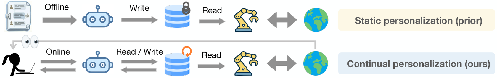

# PAHF: Learning Personalized Agents from Human Feedback

<!-- source-sha256: d9b9f279ffa6ca567de26c91124aa6e69e447f579a932c9f2685a7e84dd9aab7 -->

[简体中文](README.md)

> L1 memory, clarification gate, and drift overwrite. No hidden persona, gold action, GPT calls, robotics, or paper shopping simulator.

## Paper information

| Field | Details |
|---|---|
| Paper | [arXiv](https://arxiv.org/abs/2602.16173) |
| Institution | Meta Superintelligence Labs / Princeton University (first author; work done at Meta). |
| First public release | 2026-02-18 (arXiv v1) |
| Author code | [facebookresearch/PAHF](https://github.com/facebookresearch/PAHF). |
| Local adapter or method key | `pahf` |
| Local reproduction code | [`src/auto_research/agent_research/official_meta_backfill_20261004.py`](https://github.com/daiwk/auto-research/tree/main/src/auto_research/agent_research/official_meta_backfill_20261004.py) |

## Paper method and evidence

Retrieve explicit user preferences before acting and ask for clarification when unknown or uncertain. Accept corrections after acting even when memory was confident, replacing stale preferences across new users, contexts and preference drift.

<!-- paper-figure:start -->
### Original paper figure

The original figure shows pre-action clarification and post-action correction. From the [original paper](https://arxiv.org/abs/2602.16173); copyright remains with the authors.
<!-- paper-figure:end -->

### Core equation

$a_t=\pi_{act}(I_t,O_t,m_t,q_t,f_t^{pre})$; theoretical dynamic regret $O(K+\gamma Tm^{-k})$.

### Reported results

Phase-2/4 scores are **70.5%/68.8%** embodied and **41.3%/70.3%** shopping, ahead of no-memory and single-channel feedback. Paper offline results, not attributable production A/B or local measurements.

## Local reproduction

Compare with mechanism disabled/default. [Three-seed diagnostics](metrics/mechanism-seeds42-44.json) are `diagnostic_only=true` and excluded from capability ranking.
