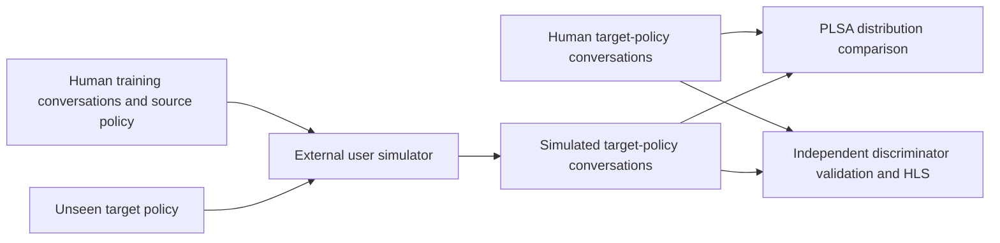
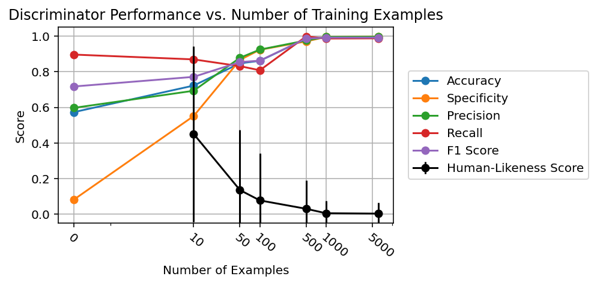

<!-- source-sha256: f84b588948c64d907f92dd1542540ef90f3939c767151cf9b1ca7cd3e905811a -->

[简体中文](README.md) · English

# ConvApparel: Distribution alignment and counterfactual validation for conversational user simulators

> The local CPU `evaluation_protocol_interface` is not a full simulator reproduction. Fixed public stimuli test only the L0 interface. The full experiment is **too costly; not reproduced (review DONE)**.

## Paper information

| Field | Details |
| --- | --- |
| Paper | [ConvApparel](https://arxiv.org/abs/2602.16938); checked against [v1 §§4, 6, and Appendix B.2](https://arxiv.org/html/2602.16938v1) |
| Institution | First author Ofer Meshi, Google |
| First public release | 2026-02-18 23:00:21 UTC (arXiv v1) |
| Author code | No algorithm source found in the paper or Google paper page. [Official data](https://huggingface.co/datasets/google/ConvApparel) is not source code. |
| Local adapter or method key | No adapter; standalone component `convapparel` |
| Local reproduction code | `src/auto_research/agent_research/google16_convapparel.py`; `scripts/run_google16_evaluation.py` |

## Original paper summary

### Background and main changes

A simulated user who completes a shopping goal does not necessarily behave like a real one. The paper uses three complementary forms of evidence: PLSA compares behavior distributions, HLS checks whether a trained discriminator can distinguish human and simulated conversations, and counterfactual validation places a simulator trained under one recommendation policy under a different policy. PLSA stands for **Population-Level Statistical Alignment**, not the topic model with the same abbreviation. See [paper §4](https://arxiv.org/html/2602.16938v1#S4).



<!-- paper-figure:start -->
### Key figure from the paper

[](https://arxiv.org/html/2602.16938v1/figures/discriminator.png)

From [Figure 3 of the original paper](https://arxiv.org/abs/2602.16938), copyright the authors. Discriminator performance and HLS as a function of training volume were checked.
<!-- paper-figure:end -->

### Core equations

The empirical KS distance and MWU with half-weighted ties are:

$$
D_{KS}=\sup_x|F_h(x)-F_s(x)|,\qquad
U=\sum_{i,j}\left[\mathbb{1}(h_i>s_j)+\tfrac12\mathbb{1}(h_i=s_j)\right].
$$

HLS is the probability that the conversation is human, not task success:

$$
\operatorname{HLS}(c)=D(c)\in[0,1],\qquad
\overline{\operatorname{HLS}}_s=\frac1{N_s}\sum_{c\in\mathcal C_s}D(c).
$$

The local run uses exact permutation tests for small samples. Above the enumeration limit, it uses seeded Monte Carlo permutation with a `+1` correction. This is an explicit statistical implementation choice, not a claim about the authors' testing library.

### Offline and online results

The trained Gemini discriminator reaches about 0.99 held-out accuracy while simulated conversations average about 0.004 HLS. High discrimination exposes the realism gap rather than indicating an excellent simulator. The paper does not report production online A/B; collecting human experiments is not evidence for industrial recommendation eligibility. See [paper §6](https://arxiv.org/html/2602.16938v1#S6).

## Local reproduction

### Runnable component

```bash
PYTHONPATH=src python scripts/run_google16_evaluation.py \
  --component convapparel --fixture-demo --seed 42 \
  --output runs/google16/convapparel.json
```

Replace `--fixture-demo` with `--input conversations.json` to provide your own data. The top-level JSON has `train` and `heldout` arrays. Each row contains `session_id`, `participant_id`, `policy`, `user_turns`, a Boolean `is_human`, and optional `annotations`. Simulated rows for the target policy also need `simulator_training_sessions` listing the source-policy human training sessions.

The first argument to `counterfactual_validation` is **the manifest of human data used to train the simulator**, not the HLS discriminator's training set. The function checks provenance and compares caller-supplied trajectories. It does not train or run a user simulator or claim to verify remote training.

### Data protocol and information isolation

Train/held-out overlap is rejected by session and participant. Only an explicitly specified source policy and unseen target policy are accepted. `DiscriminatorView` includes user text only, not the human label, policy ID, participant identity, or experience score. Satisfaction, frustration, dialog acts, and other annotations must come from a trusted external annotator; the component does not fabricate them from keywords.

### Results and scope

[Stable interface metrics](metrics/protocol-cpu-seed42.json) use hand-authored style stimuli, not public ConvApparel data. The CPU unigram/bigram logistic discriminator optimizes binary BCE, but is a runnable low-cost control, **not a replacement for the paper's fine-tuned Gemini**. Fixture discriminator accuracy of 1 only means the two artificial styles are easy to separate. It is not evidence of human fidelity, agent capability, or Evolve promotion.

| Implementation | Location |
| --- | --- |
| PLSA, KS/MWU, exact/sampled permutation | `google16_convapparel.py` / `plsa`, `alignment_test` |
| HLS, probability validation, identity isolation | `evaluate_hls`, `DiscriminatorView` |
| Cross-policy trajectory provenance checks | `counterfactual_validation` |
| Actual CPU diagnostic discriminator | `train_logistic_discriminator` |

The full experiment collects over four thousand human conversations, runs multiple Gemini SFTs, and generates hundreds of multi-turn conversations per good and bad policy for each simulator. It is not a short-budget task on one A100/A30; no download or trial was made. The CPU statistics interface claims no CUDA behavior and does not require a GPU receipt. A real CUDA discriminator would need separate A100/A30 acceptance.
