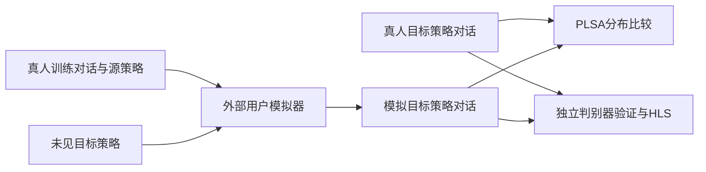
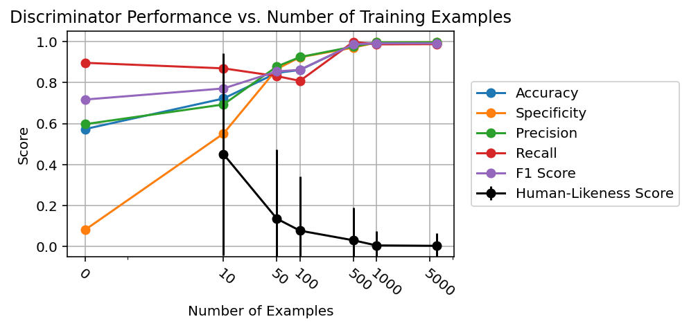

# ConvApparel：对话用户模拟器的分布对齐与反事实验证

> 本地为 CPU `evaluation_protocol_interface`，不是完整模拟器复现。公开固定刺激只检验 L0 接口；完整实验 **成本过高，不复现（审查 DONE）**。

## 论文信息

| 字段 | 内容 |
| --- | --- |
| 论文链接 | [ConvApparel](https://arxiv.org/abs/2602.16938)，核对 [v1 §4、§6 与附录 B.2](https://arxiv.org/html/2602.16938v1) |
| 公司/机构 | 一作 Ofer Meshi，Google |
| 首次公开日期 | 2026-02-18 23:00:21 UTC（arXiv v1） |
| 原文开源代码 | 已核原文与 Google 论文页未找到作者算法源码；[官方数据](https://huggingface.co/datasets/google/ConvApparel)不等于源码 |
| 本地 Adapter | 无；独立组件 key：`convapparel` |
| 本地复现代码 | `src/auto_research/agent_research/google16_convapparel.py`；`scripts/run_google16_evaluation.py` |

## 原始论文总结

### 背景与主要改动

模拟用户能完成购物目标，不等于像真人。论文将验证拆成三条互补证据：PLSA 比较行为分布；HLS 检查训练过的真假对话判别器能否识别模拟；反事实验证把仅在一种推荐策略下训练的模拟器放到另一策略下。PLSA 的全称是 **Population-Level Statistical Alignment**，不是同名主题模型。[原文 §4](https://arxiv.org/html/2602.16938v1#S4)



<!-- paper-figure:start -->
### 原论文关键图

[](https://arxiv.org/html/2602.16938v1/figures/discriminator.png)

图片来自[原论文](https://arxiv.org/abs/2602.16938) Figure 3，版权归原作者所有；已核对图中随训练量变化的判别性能与 HLS。
<!-- paper-figure:end -->

### 核心公式

经验分布的 KS 距离与带并列半权的 MWU：

$$
D_{KS}=\sup_x|F_h(x)-F_s(x)|,\qquad
U=\sum_{i,j}\left[\mathbb{1}(h_i>s_j)+\tfrac12\mathbb{1}(h_i=s_j)\right].
$$

HLS 是真人概率，不是任务成功率：

$$
\operatorname{HLS}(c)=D(c)\in[0,1],\qquad
\overline{\operatorname{HLS}}_s=\frac1{N_s}\sum_{c\in\mathcal C_s}D(c).
$$

本地小样本使用精确置换检验；大于枚举上限时使用带 `+1` 修正的定种子 Monte Carlo 置换。这是明确的统计实现选择，不冒称论文作者检验库配置。

### 论文离线与线上效果

原文训练过的 Gemini 判别器可达到约 0.99 留出准确率，但模拟对话平均 HLS 约为 0.004：高判别准确率恰好揭示 realism gap，不能解释成模拟器优秀。未报告生产线上 A/B；真人实验采集不是工业推荐准入证据。[原文 §6](https://arxiv.org/html/2602.16938v1#S6)

## 本地复现

### 可运行组件

```bash
PYTHONPATH=src python scripts/run_google16_evaluation.py \
  --component convapparel --fixture-demo --seed 42 \
  --output runs/google16/convapparel.json
```

也可传 `--input conversations.json` 代替 `--fixture-demo`：JSON 顶层为 `train` 与 `heldout` 数组，每行有 `session_id`、`participant_id`、`policy`、`user_turns`、布尔 `is_human`、可选 `annotations`。目标策略的模拟行还要提供 `simulator_training_sessions`，列出源策略真人训练 session。

`counterfactual_validation` 的第一个参数是**模拟器使用的真人训练清单**；它不同于 HLS 判别器训练集。函数只核对来源并比较调用方已生成的轨迹，不替调用方训练/生成用户模拟器，也不声称验证了远程训练过程。

### 数据协议与信息隔离

按 session 和 participant 拒绝训练/留出重叠；只接受明确的源策略到未见目标策略。`DiscriminatorView` 只有用户文本，不含真人标签、策略 ID、用户身份或体验评分。满足度、挫败、dialog act 等注释由外部可信标注提供，组件不靠关键词编造。

### 结果与边界

[稳定接口指标](metrics/protocol-cpu-seed42.json)来自自写风格刺激，不是 ConvApparel 公共数据。CPU unigram/bigram logistic 判别器确实优化了二分类 BCE，但它只是可运行的廉价对照，**不是论文微调 Gemini 的替代实现**。fixture 判别准确率为 1 只说明两种人工风格容易分开，不能支撑真人保真、Agent 能力或 Evolve 晋级。

| 实现 | 位置 |
| --- | --- |
| PLSA、KS/MWU、精确/采样置换 | `google16_convapparel.py` / `plsa`、`alignment_test` |
| HLS、概率有效性与身份隔离 | `evaluate_hls`、`DiscriminatorView` |
| 跨策略轨迹清单核验 | `counterfactual_validation` |
| 实际 CPU 诊断判别器 | `train_logistic_discriminator` |

四千余真人对话采集、多个 Gemini SFT、每模拟器好/坏策略各数百次多轮生成构成完整实验；不是一张 A100/A30 的短预算任务，本轮不下载或尝试。CPU 统计接口无 CUDA 宣称，因此不要求 GPU 回执。后续接入真实 CUDA 判别器需要另过真实 A100/A30 验证门禁。
