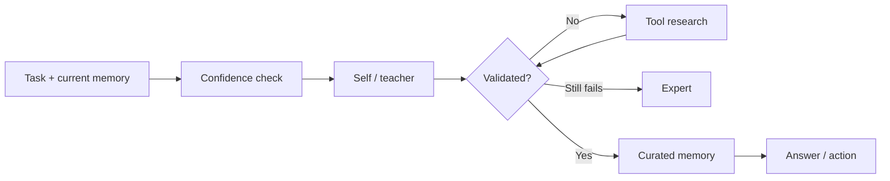
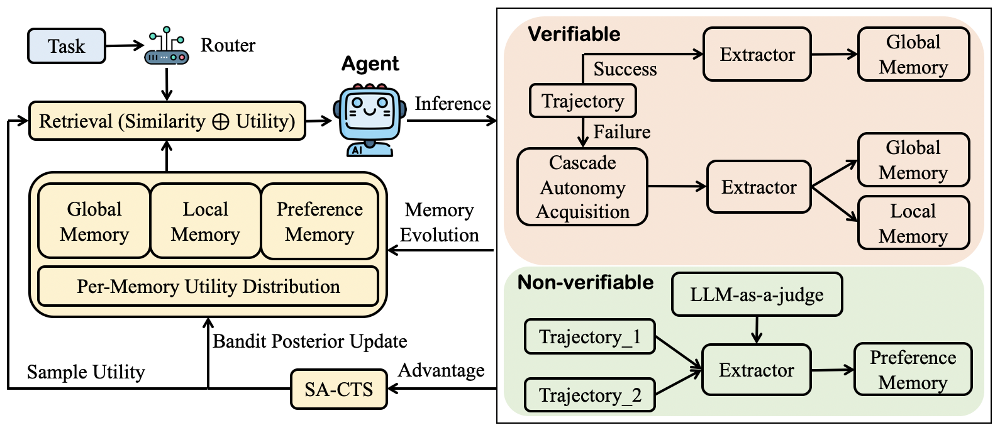

<!-- source-sha256: d888e4b20c235b5bda09d3ecaf9060792bdcd0d382bbb26149d49ebb758e8895 -->

[简体中文](README.md) · English

# U-Mem: Autonomous knowledge acquisition and memory management

> **Fidelity:** Implements cost-aware tiered acquisition, semantic retrieval, Thompson sampling, and memory validation. The mini-suite does not include the paper's real LLMs, HotpotQA, or AIME inference.

## Paper information

| Field | Details |
| --- | --- |
| Paper | [Towards Autonomous Memory Agents (arXiv 2602.22406)](https://arxiv.org/abs/2602.22406) |
| Institution | National University of Singapore |
| First public release | 2026-02-25 |
| Author code | [Anonymous review repository](https://anonymous.4open.science/r/code-release-456D/) |
| Local adapter or method key | `u-mem` |
| Local reproduction code | [`src/auto_research/agent_research/`](https://github.com/daiwk/auto-research/tree/main/src/auto_research/agent_research) |

## Original paper summary

### Background and main changes

Traditional agent memory passively stores and retrieves information without deciding where to look when current knowledge is insufficient. U-Mem uses an acquisition cascade with rising cost: try self/teacher first, then research with tools, and finally consult an expert. Retrieval combines semantic similarity and Thompson sampling, and memory is validated and curated before write-back.



<!-- paper-figure:start -->
### Key figure from the paper

[](https://arxiv.org/html/2602.22406v1/figures/overview.png)

> **Figure 2:** Overall design and components. From the [paper](https://arxiv.org/abs/2602.22406); copyright belongs to the authors. Click for the source.
<!-- paper-figure:end -->

### Core equations

Memory selection balances semantic relevance and exploration under uncertainty:

$$
s(m\mid q)=\lambda\,\mathrm{sim}(q,m)
+(1-\lambda)\,\tilde p_m,\qquad
\tilde p_m\sim\mathrm{Beta}(\alpha_m,\beta_m).
$$

Success and failure update the Beta posterior. The cascade weighs the extra knowledge gained against call cost.

### Offline and online results

The paper reports a 14.6-point improvement with Qwen2.5-7B on HotpotQA and 7.33 points with Gemini-2.5-Flash on AIME25. No production online A/B test is reported.

## Local reproduction

`evomem-mini` covers four quadrants: within-episode versus cross-episode, crossed with knowledge versus execution. The implementation records each retrieval, validation, escalation, and write, escalating from a local knowledge source to tool research at low confidence.

```bash
auto-research agent-eval --method u-mem \
  --benchmark evomem-mini --episodes 120 --seed 42
```

| Metric | Long-context | U-Mem |
|---|---:|---:|
| Joint success | 1.0000 | 1.0000 |
| Average cost | 64.5000 | **3.0500** |
| Final memory size | Full history | 12 |

Stable metrics: [`agent-mini-suites-seed42.json`](../../experiments/agent-mini-suites-seed42.json).

## Scope

The mini-suite's knowledge sources, experts, and validators are deterministic. It has no real search APIs, model hallucination, or token cost. It verifies the active-acquisition state machine and cost accounting, not HotpotQA or AIME scores.
