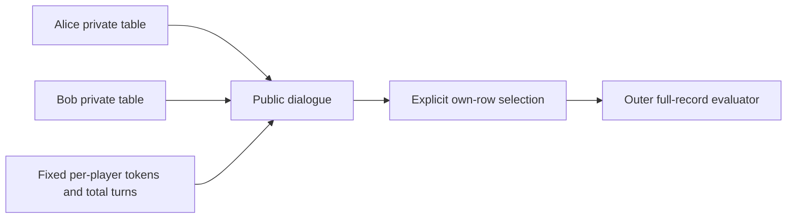

<!-- source-sha256: 8d76f5844fbe873df528ef274e4e03c16a46520b1c7a5d4223780f5ef151cfe9 -->
# MT-PingEval: private Name-game views and isotoken budgets

[简体中文](README.md)

> **component_only/L1 mechanism diagnostics, not full-model or agent capability.** The full experiment is not reproduced because of cost (review DONE); only the explicitly bounded components below execute.

## Paper information

| Field | Value |
| --- | --- |
| Paper | [MT-PingEval: Evaluating Multi-Turn Collaboration with Private Information Games](https://arxiv.org/abs/2602.24188v1), [fixed v1](https://arxiv.org/html/2602.24188v1) |
| Institution | First author Jacob Eisenstein, Google DeepMind; verified priority affiliations: Google DeepMind / Google Research. Collaboration does not replace the first-listed affiliation |
| Original publication | **2026-02-27 17:13:20 UTC**; a historical repair, not a November13 first release |
| Authors' code | No verifiable dedicated author source release was found in fixed v1 or bounded official-entry checks; cited libraries and third-party replicas are not counted |
| Local adapter / key | `mt-pingeval`; `adapter=null`; no Evolve integration |
| Local code | `src/auto_research/agent_research/mt_pingeval.py` |

## Original paper

### Motivation and changes

MT-PingEval asks whether collaboration actually benefits from interaction, rather than simply receiving more tokens. Players see private information and communicate to solve a shared task. The full suite includes chess, COVR, image selection and Name-game.

Name-game gives each player a five-field table with exactly one shared complete record. A shared name alone is insufficient. Isotoken evaluation holds each player's total tokens fixed while changing alternating turns. More turns are not guaranteed to help real models: flat or decreasing performance is a central finding.

### Architecture



<!-- paper-figure:start -->
### Key original figure

[](https://arxiv.org/html/2602.24188v1/covr_alice.png)

From the [original paper](https://arxiv.org/html/2602.24188v1#S3.F1); copyright remains with the original authors. These are official HTML PNG bytes without cropping, redrawing or PDF rendering. Alice's private COVR image illustrates information asymmetry; local code implements text Name-game, not COVR perception.
<!-- paper-figure:end -->

### Core equations

$$
c_{turn}=\left\lfloor\frac{2T_{player}}{n_{turn}}\right\rfloor,\qquad
success=\mathbf1[row_{selected}=row_{unique\ intersection}].
$$

With128 tokens/player and16 total alternating turns, each utterance allows16 tokens, not8. Budgets count actual tokenizer IDs, not whitespace words. Token and turn budgets are maxima, not mandatory usage. Local code truncates supplied IDs without implementing a tokenizer or actor.

### Author results

The paper evaluates five models plus thinking variants,1000 examples/task and2/4/8/16 turns. Many tasks show flat or declining accuracy; Name-game gains must also be distinguished from extra random guesses. No production-user A/B is reported. Local code measures no model-dialogue success.

## Local reproduction

### Protocol and code mapping

NameGame.view(player) returns only that player's table. The scorer stays in an evaluator-owned NameGame object, which must never be passed to actors. score_selection uses one-based SELECT ROW and complete five-field equality. IsotokenBudget.submit validates alternating roles, truncates IDs and charges per-player budgets. This is neither official dataset ingestion nor a full-suite bridge.

```bash
PYTHONPATH=src python -c 'from auto_research.agent_research.mt_pingeval import diagnostic; print(diagnostic(42))'
PYTHONPATH=src python -m pytest tests/test_nov13_colm_agent_components.py -q
```

### Evidence and controls

Controls reject same-name/different-company matches, non-unique intersections, wrong role order and exhausted turns; per-player token budgets do not reset each turn. Fixed tables/IDs test protocols, not LLM or multimodal collaboration.

Three-seed mechanism receipts are in [CPU metrics](metrics/component-cpu-seeds42-44.json) and the batch's frozen record. Fixed-input diagnostics are not full training, capability gain or online benefit. GPU acceptance requires actual A100/A30 evidence.

## Boundaries

Chess/COVR/MD3/Tangram environments, image models, tokenizer, dialogue policy, public data and cross-model runners are absent. Capability evaluation requires a real model and isolated private views. Current checks are not eligible for capability rankings or Evolve promotion.

### Full experiment not reproduced

The full matrix has five games,1000 examples per game, five models plus thinking variants, four turn budgets and commercial/image resources. This paper/upstream configuration exceeds the current single-A100/A30-or-Mac budget. It is a source-reported configuration, not local training measurement. No cost probe, paid API, checkpoint download or full experiment was attempted. **Too costly; not reproduced (review DONE)**. Automatic retry and implementation queues remain disabled.
