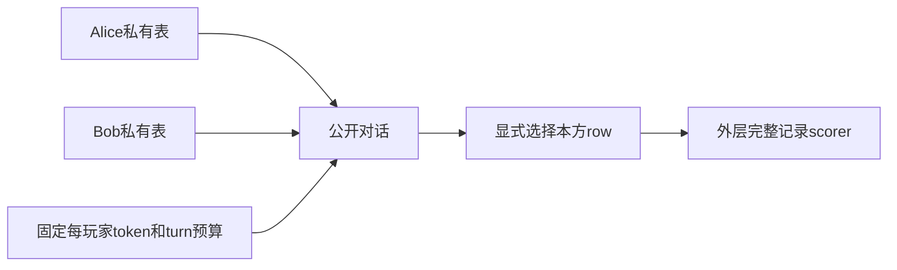

# MT-PingEval：私有信息 Name-game 与等 token 预算

[English](README-en.md)

> **component_only／L1机制诊断，不是完整模型或Agent能力复现。** 完整实验成本过高，不复现（审查 DONE）；仅以下精确定义子组件可执行。

## 论文信息

| 字段 | 内容 |
| --- | --- |
| 论文链接 | [MT-PingEval: Evaluating Multi-Turn Collaboration with Private Information Games](https://arxiv.org/abs/2602.24188v1)，[固定 v1 原文](https://arxiv.org/html/2602.24188v1) |
| 公司 / 机构 | 一作 Jacob Eisenstein，Google DeepMind；已核优先署名：Google DeepMind / Google Research，合作属性不覆盖第一署名机构 |
| 首次公开日期 | **2026-02-27 17:13:20 UTC**；历史补漏，不是2026-11-13新首发 |
| 原作者代码 | 固定v1与本轮有界官方入口检索未找到可核实专属源码；未把引用库或第三方复刻算作作者代码 |
| 本地 adapter / key | `mt-pingeval`；`adapter=null`；未接入Evolve |
| 本地复现代码 | `src/auto_research/agent_research/mt_pingeval.py` |

## 原始论文总结

### 背景与主要改动

MT-PingEval 用协作游戏检查模型是否真正从交互中获益，而非比较多轮时顺便增加总 token。每名玩家只看到自己的信息，通过对话解决共同任务；原 suite 包含棋局、COVR、图片选择与 Name-game。

Name-game 给双方各一张五字段人物表，只有一条完整记录共同出现。仅同名不够。论文固定每玩家总预算、改变总交替轮次，限制每次输出 token 数，检验交互扩展。它不保证真实模型随轮次增加会变好，原文恰发现多任务持平或下降。

### 架构与流程



<!-- paper-figure:start -->
### 原论文关键图

[](https://arxiv.org/html/2602.24188v1/covr_alice.png)

图片来自[原论文](https://arxiv.org/html/2602.24188v1#S3.F1)，版权归原作者所有。保存官方HTML原PNG字节，未裁剪、重画或PDF渲染。原文 COVR 中 Alice 的私有图像视图，说明信息不对称；本地实现的是文字 Name-game，不是 COVR 图像能力。
<!-- paper-figure:end -->

### 核心公式

$$
c_{turn}=\left\lfloor\frac{2T_{player}}{n_{turn}}\right\rfloor,\qquad
success=\mathbf1[row_{selected}=row_{unique\ intersection}].
$$

例如每玩家 128 token、总 16 个交替 turn，每次上限 16 token；不能错除成 8。预算使用真实 tokenizer ID 数，不把空格词数当 subword token。双方轮流发言，token 与 turn 都是上限，不强制用满；本地只裁剪传入 ID，不实现 tokenizer 或 actor。

### 论文离线与线上效果

原文用五模型与思考变体、每游戏 1000 例、2／4／8／16 turn 比较。在许多游戏中更多轮次不改善甚至降低准确率；Name-game 的提升还要排除随机逐行猜测带来的机会。未报告生产流量线上 A/B。本地不测模型对话成功率。

## 本地复现

### 数据协议与代码映射

`NameGame.view(player)` 只返回该玩家表格，scorer 留在 evaluator-owned `NameGame`；切勿把 evaluator 对象传给 actor。`score_selection` 按一基 SELECT ROW 检查完整五字段记录。`IsotokenBudget.submit` 检查交替角色、裁剪当前 ID 并计入每玩家预算。不声称已接官方数据集或整套 benchmark。

```bash
PYTHONPATH=src python -c 'from auto_research.agent_research.mt_pingeval import diagnostic; print(diagnostic(42))'
PYTHONPATH=src python -m pytest tests/test_nov13_colm_agent_components.py -q
```

### 结果与负控

负控覆盖同名但不同公司不能算匹配、共同记录必须唯一、角色错序／超轮拒绝、每玩家总预算不被 turn 重置。固定表与 token ID 是协议测试，不是 LLM、多模态理解或协作能力。

三seed机制执行回执见[CPU组件指标](metrics/component-cpu-seeds42-44.json)及本轮冻结记录；它是固定输入机制诊断，不是完整训练、能力提升或线上收益。GPU验收仅以真实A100/A30回执为准。

## 复现边界

没有 Chess/COVR/MD3/Tangram 环境、图像模型、tokenizer、对话策略、公开数据下载或跨模型 runner。仅可在自有真实模型接入并隔离私有视图后做能力评测；当前不能参与能力排名或 Evolve 晋级。

### 高成本完整实验

5游戏×1000样本×5模型/思考变体×4轮次预算，包含商业LLM和图像任务；完整能力矩阵高成本不复现。 这是论文／上游配置成本依据，不是本地训练测量。没有为估价试训、调用收费API或下载checkpoint。**成本过高，不复现（审查 DONE）**；不进入自动重试或自动实现队列。
