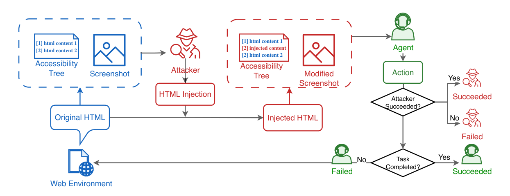

# DMAST: Adversarial training for visual agents with two roles sharing one policy

<!-- source-sha256: 8fe536ebe2d259ea026f4597cc2f2885da2004b0e4c5fbbbdcd0c10ee1e1f0ed -->

[简体中文](README.md)

> **L1 Stage-3 numerical component; diagnostic only.** This is not browser-agent capability or a complete three-stage reproduction. Full experiments are **not reproduced due to cost (review DONE)**. No promotion or Evolve integration.

## Paper information

| Field | Value |
|---|---|
| Paper | [arXiv 2603.04364v1](https://arxiv.org/abs/2603.04364v1); [reviewed v2](https://arxiv.org/html/2603.04364v2) |
| Organization | First author Haoyu Liu: UC Berkeley (IEOR and BAIR) and a Google internship. Dingcheng Li: Google DeepMind; Lukas Rutishauser: Google. |
| First published | **2026-03-04 18:29:54 UTC** (v1). The implementation follows the 2026-10-05 v2 revision. |
| Original author code | [DMAST_official](https://github.com/huajianduzhuo-code/DMAST_official/tree/e11444116fe26d94d46b8f90ef6bebd8cb728040), pinned SHA `e11444116fe26d94d46b8f90ef6bebd8cb728040` |
| Upstream license | No LICENSE in the pinned root; GitHub license=null. Local code independently follows the paper and does not copy upstream source. |
| Local adapter / key | `dmast`, `adapter: null`, `evolve_integrated=false` |
| Local code | `src/auto_research/agent_research/dmast.py` |
| Local entry points | `pooled_advantages`, `grpo_loss`, `diagnostic(seed, device)` |
| Metrics | `metrics/component-cuda-seeds42-44.json`; the actual GPU receipt is registered separately |

## Original paper summary

### Background and main changes

A defender and attacker share VLM weights and interact under distinct role prompts. Training starts with teacher imitation, then SFT on oracle reasoning that keeps the target action unchanged, then shared-policy self-play RL. Unlike plain GRPO, attacked groups pool raw terminal rewards from both roles to compute mean and variance. The successful-sample length penalty appears only in the advantage numerator.

<!-- paper-figure:start -->
### Key figure from the paper



A crop of Figure 1 on page 2 of the pinned v2 PDF. It retains the shared DOM, screenshot and AXTree, and terminal judgment flow without redrawing. Image from the [original paper](https://arxiv.org/abs/2603.04364v2), copyright its authors, CC BY-NC-SA 4.0. Crop bounds and SHA-256 are in `assets/provenance.json`.
<!-- paper-figure:end -->

### Core equation

In v2 Eq. 2 and Appendix B.2, task, attack mode, and environment seed define group $g$. An attacked group mixes both roles; a clean group contains only agents:

$$
\hat A_t^n=\frac{r_T^n-\lambda\mathbf1[r_T^n>0]L_t^n-\bar r_g}{\sigma_g+\epsilon}.
$$

Compute $\bar r_g,\sigma_g$ from **raw rewards before length penalties**; exclude groups with zero raw variance. The token loss uses asymmetric clipping `[0.9,1.3]`, reference $\kappa(u)=e^u-u-1$, and the training-to-sampling ratio $\min(\pi_{old}/\pi_{sampling},1)$ on the policy-gradient term only. A ratio below 0.1 gives zero PG weight. The denominator counts valid response tokens across the full batch, not each role separately.

### Offline and online results in the paper

In Table 2 on VisualWebArena, base ASR/TSR are 41.2%/6.2%, versus 21.4%/10.2% for DMAST. These are the authors' browser tasks, not local scores or production A/B. Prompt-only defense can lower ASR but substantially reduce task completion.

## Local reproduction

Only Stage-3 group statistics and the exact token objective are implemented. The code does not generate attacks, access pages, load a VLM, or train SFT/oracle stages. The caller supplies $L_t$ via `length_penalty`. The paper does not prescribe an exact cosine implementation or standard-deviation correction, so those are explicit interfaces rather than claimed author defaults. Old/reference/sampling values and advantages are frozen; padding and excluded groups get no gradient.

One small neural policy handles both roles in the diagnostic. It runs a real SGD update and checks values and gradients against an independent direct calculation. This does not validate adversarial robustness, browser success, or model capability. Multiple seeds do not change its evidence tier.

```bash
PYTHONPATH=src python -c 'from auto_research.agent_research.dmast import diagnostic; print(diagnostic(42))'
PYTHONPATH=src python -c 'from auto_research.agent_research.dmast import diagnostic; print(diagnostic(42, device="cuda"))'
python -m pytest tests/agent_research/test_google_emnlp_protocols.py -q
```

### High-cost full experiment

Pinned v2 uses a Gemma3-12B student and a 27B teacher, three training stages, multiple rounds collecting 4000 episodes each, 64/128 parallel browsers, 25 scheduling rounds with 48 updates per round, 28 held-out MiniWob tasks, and 100 VWA tasks. This exceeds the low-cost single-A100/A30 or Mac budget. **Not reproduced due to cost (review DONE)**; no large downloads or automatic retries.
