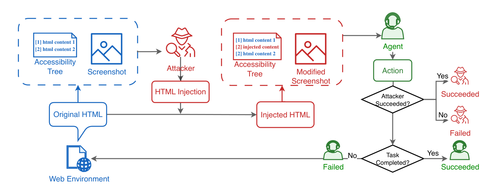

# DMAST：共享双角色的视觉 Agent 对抗训练

> **L1 Stage-3 数值组件，diagnostic only**，不是浏览器 Agent 能力或完整三阶段复现。完整实验**成本过高，不复现（审查 DONE）**，不可晋级、未接入 Evolve。

## 论文信息

| 字段 | 内容 |
|---|---|
| 论文链接 | [arXiv 2603.04364v1](https://arxiv.org/abs/2603.04364v1)；[本地核对 v2](https://arxiv.org/html/2603.04364v2) |
| 公司 / 作者机构 | 一作 Haoyu Liu 第一机构 UC Berkeley（IEOR & BAIR），兼 Google 实习；Dingcheng Li 为 Google DeepMind、Lukas Rutishauser 为 Google |
| 原始发布日期 | **2026-03-04 18:29:54 UTC**（v1）；所实现细则按 2026-10-05 修订 v2，不混同版本 |
| 原作者代码 | [DMAST_official](https://github.com/huajianduzhuo-code/DMAST_official/tree/e11444116fe26d94d46b8f90ef6bebd8cb728040)，固定 SHA `e11444116fe26d94d46b8f90ef6bebd8cb728040` |
| 原作者代码许可 | 固定根目录未找到 LICENSE，GitHub license=null；本地根据论文独立实现，不复制上游代码 |
| 本地 Adapter / key | `dmast`，`adapter: null`，`evolve_integrated=false` |
| 本地代码 | `src/auto_research/agent_research/dmast.py` |
| 本地入口 | `pooled_advantages`、`grpo_loss`、`diagnostic(seed, device)` |
| 指标 | `metrics/component-cuda-seeds42-44.json`；真实 GPU 收据单独登记 |

## 原始论文总结

### 背景与主要改动

DMAST 让防守 Agent 与攻击者共享同一 VLM 参数，以不同角色提示交互；先教师模仿，再用不改变目标动作的 oracle reasoning 做 SFT，最后进行共享策略自博弈 RL。改动不只是普通 GRPO：受攻击组中两个角色的原始终局奖励共同决定均值与方差，而成功样本的长度惩罚只进入优势分子。

<!-- paper-figure:start -->
### 原论文关键图



固定 v2 原 PDF 第 2 页 Figure 1 裁图，保留共享 DOM、截图与 AXTree、终局判断流程，未重绘。图片来自[原论文](https://arxiv.org/abs/2603.04364v2)，版权归原作者所有；CC BY-NC-SA 4.0，裁剪范围和 SHA-256 见 `assets/provenance.json`。
<!-- paper-figure:end -->

### 核心公式

按 v2 Eq.2 / Appendix B.2，以任务、攻击模式、环境 seed 定义组 $g$，受攻击组混合两种角色、clean 组仅有 Agent：

$$
\hat A_t^n=\frac{r_T^n-\lambda\mathbf1[r_T^n>0]L_t^n-\bar r_g}{\sigma_g+\epsilon}.
$$

$\bar r_g,\sigma_g$ 由**未减长度罚的 raw reward**计算；raw 方差为零的组直接排除。token 损失使用非对称 clip `[0.9,1.3]`、reference 的 $\kappa(u)=e^u-u-1$，并仅对 PG 项乘训推概率比 $\min(\pi_{old}/\pi_{sampling},1)$；比值小于 0.1 时 PG 权重置零。分母为全批次有效 response token 数，非角色局部平均。

### 论文离线与线上效果

原文 Table 2 的 VisualWebArena：Base ASR 41.2%、TSR 6.2%，DMAST 为 21.4%、10.2%。这是作者浏览器任务实验，不是生产 A/B，也不是本地成绩；提示防御单独能降低 ASR，但可能严重降低任务完成率。

## 本地复现

只保留 Stage-3 精确组统计与 token 目标；不生成攻击载荷、不访问网页、不加载 VLM、不训练 SFT 或 oracle。`length_penalty` 是外部提供的 $L_t$；论文未给精确 cosine 实现与 std correction，因此两者作为显式接口，不冒充作者默认。所有 old/reference/sampling/advantage 都冻结，padding 和排除组无梯度。

诊断让同一个微型神经策略处理两种角色，真实执行一次 SGD，并与独立直接公式核对值和梯度。它没有验证对抗鲁棒性、浏览器成功率或模型能力；多 seed 不改变诊断等级。

```bash
PYTHONPATH=src python -c 'from auto_research.agent_research.dmast import diagnostic; print(diagnostic(42))'
PYTHONPATH=src python -c 'from auto_research.agent_research.dmast import diagnostic; print(diagnostic(42, device="cuda"))'
python -m pytest tests/agent_research/test_google_emnlp_protocols.py -q
```

### 高成本完整实验

固定 v2 使用 Gemma3-12B 学生与 27B 教师，三阶段训练、多轮各 4000 episode 采集、64/128 并行浏览器、25 轮调度和每轮 48 更新，另有 28 保留 MiniWob 任务及 100 VWA 任务评测。其模型、浏览器和采集成本超出当前单张 A100/A30 或 Mac 的低成本预算：**成本过高，不复现（审查 DONE）**，不下载大资源、不自动重试。
