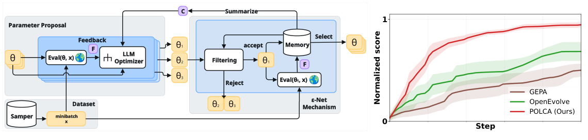

# POLCA: Generative program optimization with noisy evaluation histories

<!-- source-sha256: db81891906e0f62281f4c141732deb5f84b1aed0d7d90430a417db4a0719e6fc -->

[简体中文](README.md)

> **Standalone L0 `component_only`.** Priority queue and genuine callback interfaces, not a measured LLM optimizer. Full experiment too costly and not reproduced (review DONE).

## Paper information

| Field | Details |
|---|---|
| Paper | [arXiv 2603.14769](https://arxiv.org/abs/2603.14769); [v1 Section 3 / Algorithm 1](https://arxiv.org/html/2603.14769v1#S3) |
| Institution | First author Xuanfei Ren: University of Wisconsin–Madison; Google DeepMind / Google Research collaborators |
| First public release | 2026-03-16 03:07:44 UTC (arXiv v1) |
| Author code | Yes: [pinned rlx-lab/POLCA](https://github.com/rlx-lab/POLCA/tree/356d0177d034df8c70bf351f5f62c93dbb226b41). Setup points to Trace experimental; [pinned epsilon-net/summarizer implementation](https://github.com/xuanfeiren/Trace/blob/4ee52f12f0bb328dfee2f16b6c1801232c6ccf46/opto/features/priority_search/epsNetPS_plus_summarizer.py) verified beyond the README. |
| Local adapter or method key | `polca` |
| Local reproduction code | `src/auto_research/agent_research/google16_polca.py` |

## Paper method and evidence

Stochastic minibatches, programs and evaluators create noisy scores. POLCA retains and updates histories instead of trusting one high score. A Summarizer builds global lessons; a Proposer consumes current feedback; an epsilon-net limits redundant semantic candidates. Keep empirical-mean priority separate from the theoretical UCB variant. Farthest-first filtering recomputes remaining distances after adding each item. [Section 3](https://arxiv.org/html/2603.14769v1#S3).


<!-- paper-figure:start -->
### Original paper figure

[](https://arxiv.org/pdf/2603.14769v1#page=2)

Figure 1, v1 page 2; curves are paper results. [Screenshot provenance](assets/provenance.json). From the [original paper](https://arxiv.org/abs/2603.14769); copyright remains with the authors.
<!-- paper-figure:end -->

### Core equation

$$
p(\theta)=\frac1{N_\theta}\sum_i r_i,
\qquad \min_{q\in Q}\|\phi(\theta')-\phi(q)\|_2>\varepsilon.
$$

### Reported results

The paper compares sample/time efficiency and epsilon-net/Summarizer ablations on tau-bench, HotpotQA, VeriBench and KernelBench. Offline optimization, not production A/B; paper aggregate scores are not local metrics. [Section 5](https://arxiv.org/html/2603.14769v1#S5).

## Local reproduction

Six tests cover strict epsilon, mutual novelty, a shared with-replacement minibatch, cross-round noisy means and variances, full histories to callbacks, exhausted budgets and rejection of test split. [Diagnostic record](metrics/component-contract.json).

`Polca.round` requires evaluator, summarizer and proposer, with no canned LLM output. `EvaluationResult(score, feedback, output)` and `Observation` preserve actual inputs/outputs separately from feedback; inputs and outputs are deep-copied. Summarizer sees full memory, proposer sees selected history. Caller supplies real reward-independent embeddings; one-dimensional fixture coordinates test only distance. Completed observations survive later failures; metric calls count before invocation. Existing and new candidates share a batch; unevaluated proposals are `deferred_budget`, excluded from statistics. Defaults: 64 metric calls, 16 memories, 16 new proposals per round. Limits do not bound external callback hardware cost.

No API billing, download, CUDA or unified Evolve. Full multi-benchmark/baseline matrices with 3/6 seeds, up to 50 rounds per question and repeated optimizer/embedding calls exceed short single-card or Mac budget by configuration, not measured local cost. No automatic retries.

```bash
PYTHONPATH=src python -m pytest tests/test_google16_polca.py
```
