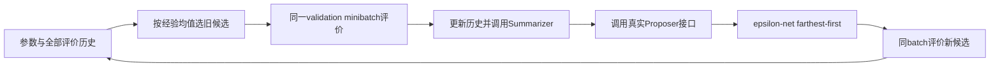
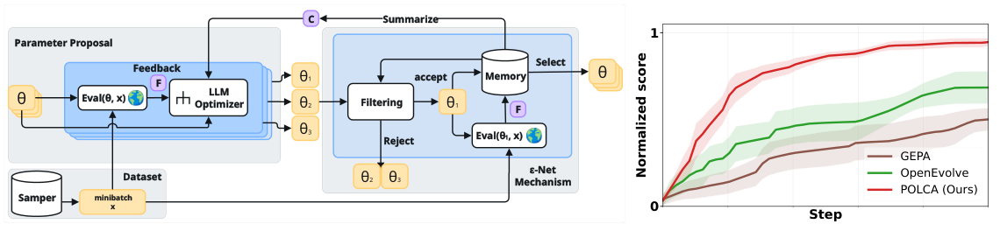

# POLCA：保留噪声历史的生成式程序优化

> `component_only` / L0；优先队列和真实回调接口已实现，**没有声称已运行 LLM 优化器或 benchmark 能力**。完整实验：**成本过高，不复现（审查 DONE）**。

## 论文信息

| 字段 | 内容 |
| --- | --- |
| 论文链接 | [arXiv 2603.14769](https://arxiv.org/abs/2603.14769)，[v1 §3 / Algorithm 1](https://arxiv.org/html/2603.14769v1#S3) |
| 公司/机构 | 一作 Xuanfei Ren：University of Wisconsin-Madison；Google DeepMind / Google Research 合作 |
| 首次公开日期 | 2026-03-16 03:07:44 UTC（v1） |
| 原文开源代码 | 是：[rlx-lab/POLCA](https://github.com/rlx-lab/POLCA/tree/356d0177d034df8c70bf351f5f62c93dbb226b41)；入口 setup 指向 Trace experimental，已核[真实 epsilon-net / summarizer 核心](https://github.com/xuanfeiren/Trace/blob/4ee52f12f0bb328dfee2f16b6c1801232c6ccf46/opto/features/priority_search/epsNetPS_plus_summarizer.py)，不只看 README |
| 本地 Adapter | 无；独立组件 `polca` |
| 本地复现代码 | `src/auto_research/agent_research/google16_polca.py` |

## 原始论文总结

### 背景与主要改动

随机 minibatch、程序与评估器都会产生噪声。POLCA 不仅保留一次最高分，而是持续更新候选评价历史；Summarizer 形成全局经验，Proposer 利用当前反馈提出参数，语义 epsilon-net 限制冗余候选。[原文 §3](https://arxiv.org/html/2603.14769v1#S3)



<!-- paper-figure:start -->
### 原论文关键图

[](https://arxiv.org/pdf/2603.14769v1#page=2)

> 原论文 v1 Figure 1，第2页；版权归作者。右侧曲线是论文汇总，不是本地结果。[截图来源记录](assets/provenance.json)

图片来自[原论文](https://arxiv.org/abs/2603.14769)，版权归原作者所有。
<!-- paper-figure:end -->

### 核心公式

$$
p(\theta)=\frac1{N_\theta}\sum_i r_i,
\qquad \min_{q\in Q}\|\phi(\theta')-\phi(q)\|_2>\varepsilon.
$$

正文的经验均值优先级与理论分析 UCB 版本分开；本地没有把不同规则混用。过滤按作者实现采用距当前集合最远者优先，加入一个后重新计算余下候选距离。

### 论文离线与线上效果

原文在 tau-bench、HotpotQA、VeriBench、KernelBench 比较样本/时间效率，并研究 epsilon-net 与 Summarizer 消融；这是离线优化，不是生产 A/B。本地不抄论文归一化汇总分当作自己的指标。[§5](https://arxiv.org/html/2603.14769v1#S5)

## 本地复现

```bash
PYTHONPATH=src python -m pytest tests/test_google16_polca.py
```

### 数据协议与结果

6 项测试通过，覆盖严格 epsilon 边界、新候选互相过滤、同一有放回 minibatch、跨轮噪声均值/方差、完整输入/输出历史送入 Summarizer/Proposer、预算耗尽及拒绝 test split。[诊断记录](metrics/component-contract.json)

### 代码映射与边界

`Polca.round` 要求提供 evaluator、summarizer、proposer；没有默认固定“LLM 输出”兜底。evaluator明确返回 `EvaluationResult(score, feedback, output)`；`Observation` 保存真实 `input/output` 及分数、反馈，而非约定把轨迹藏在feedback字符串。Summarizer读取完整memory，Proposer读取当前选中候选的完整history。输入输出深拷贝防止后续mutation篡改历史。

调用方须提供真实、与奖励独立的语义 embedding；单测中的一维坐标仅检验距离规则。失败前已完成的观察也保留，metric call在调用前计数。既有与新候选用同一 batch，未评价的新提案单列 `deferred_budget`，不加入候选统计。

默认最多 64 次 metric、16 个 memory、每轮最多 16 个新提案；这不限制外部回调自身的硬件成本，接入真实模型前仍需成本门禁。本组件没有付费 API、模型下载或 CUDA 路径，未接入统一 Evolve，callback 单测不代表 LLM 搜索能力。

### 成本决定

完整多 benchmark×多 baseline×3/6 seed、每题最多 50 轮并调用优化/embedding API，明显超出单卡/Mac短验预算（依据论文及上游配置，非本地计费实测）。**成本过高，不复现（审查 DONE）**，不自动展开完整搜索矩阵。
