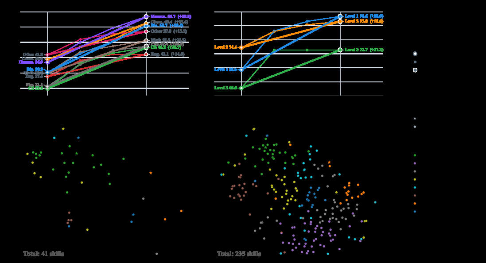

# Memento-Skills: agents design transferable agent skills

<!-- source-sha256: c29a07693df29ca891ada74659f01bff99567f1206833eb36c415f44e903dd55 -->

[简体中文](README.md)

> **Fidelity: core mechanism.** The deterministic mini-suite does not stand in for the paper's full benchmark.

## Paper information

| Field | Details |
|---|---|
| Paper | [Memento-Skills: agents design transferable agent skills (arXiv 2603.18743)](https://arxiv.org/abs/2603.18743) |
| Organization | Memento Team |
| First public release | 2026-03-19 (arXiv v1) |
| Authors' code | [Public implementation](https://github.com/Memento-Teams/Memento-Skills) |
| Adapter / method | `memento-skills` |
| Local reproduction code | [`src/auto_research/agent_research/`](https://github.com/daiwk/auto-research/tree/main/src/auto_research/agent_research/) |

## Original paper

### Motivation and method

Reflect on execution logs to extract structured skill descriptions. Retrieve them by task and write back versioned skills rather than appending raw trajectories.


<!-- paper-figure:start -->
### Key figure from the paper

[](https://ar5iv.labs.arxiv.org/html/2603.18743/assets/x1.png)

> **Figure 1:** Overview of the paper's method and key components. From the [original paper](https://arxiv.org/abs/2603.18743); copyright remains with the authors.
<!-- paper-figure:end -->

### Core equations

$$
s=\operatorname{Reflect}(\tau,R),\quad k^*=\arg\max_k\operatorname{sim}(x,k),\quad k\leftarrow\operatorname{Merge}(k,s).
$$

### Paper results

The technical report shows skill extraction and cross-task transfer gains on a multi-task agent suite. No production online A/B test is reported; no online figures are inferred.

## Local reproduction

PlanBench mini-suite, 120 episodes, seed 42: joint success **0.0500**, average cost 0.2800, and nonzero method-specific telemetry.

```bash
auto-research agent-eval --method memento-skills --benchmark planbench-mini --episodes 120 --seed 42
auto-research evolve --model agent --dataset planbench-mini --direction "组合 memento-skills 与已安装论文算子" --generations 2 --population 4
```

See the [fixed metrics](../../experiments/global-p0-20260808-seed42.json).

## Reproduction boundaries

The local run checks the paper-specific objective, state updates, and fair budgets. It does not reproduce large models, multi-GPU RL, private environments, real websites, or the full benchmark. It verifies the mechanism, not the numerical results in the original tables.
