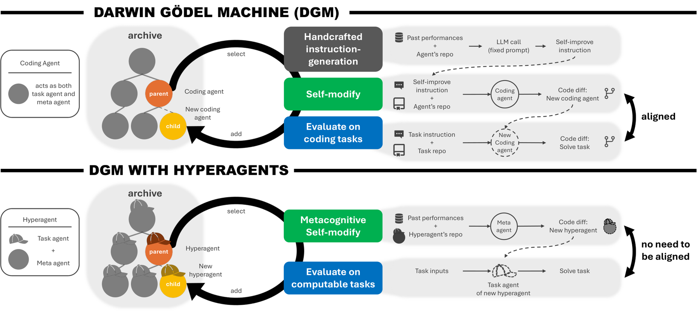

# HyperAgents

<!-- source-sha256: 1979730922fe1fc814edeb47150a2a99f4321e7bb27941e59e6644a2ac5c90ec -->

[简体中文](README.md)

> **Core mechanism evidence.** Paper and local evaluations are separate.

## Paper information

| Field | Value |
| --- | --- |
| Paper | [arXiv](https://arxiv.org/abs/2603.19461) |
| Affiliations | University of British Columbia, first author's affiliation |
| First public release | 2026-03-19 (arXiv v1) |
| Authors' code | [Author code](https://github.com/facebookresearch/hyperagents). |
| Adapter / method | `hyperagents` |
| Local code | [`src/auto_research/agent_research/official_meta_backfill_20261004.py`](https://github.com/daiwk/auto-research/tree/main/src/auto_research/agent_research/official_meta_backfill_20261004.py) |

## Original paper

### Background and contribution

Put the task agent and meta-agent in one editable program. Accumulate variants in an open archive; favor strong parents and those with fewer descendants, allowing the improvement mechanism itself to evolve.

<!-- paper-figure:start -->
### Key figure from the paper

Original Figure 1: HyperAgents. From the [paper](https://arxiv.org/abs/2603.19461); copyright belongs to the authors. Not a local result.
<!-- paper-figure:end -->

### Core mechanism

On student trajectory $y$, compute teacher–student differences $d_t$. Select $S_k=\operatorname{TopK}_t(d_t)$ and optimize $\mathcal L=-|S_k|^{-1}\sum_{t\in S_k}\log p_T(y_t|y_{<t})/p_\theta(y_t|y_{<t})$.

### Paper results

Paper evaluations cover code, review, robotic reward design, and IMO grading, with evolving evaluation analysis, cost planning, and memory. No attributable production A/B.

## Local reproduction

[Three-seed mechanism metrics](metrics/mechanism-seeds42-44.json) compare disabled/default to enabled. Diagnostic only, no formal ranking.

## Reproduction limits

Only parent sampling and bounded structured archive updates. Never run generated code or shell; not self-referential code-edit capability.
