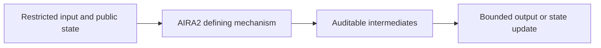
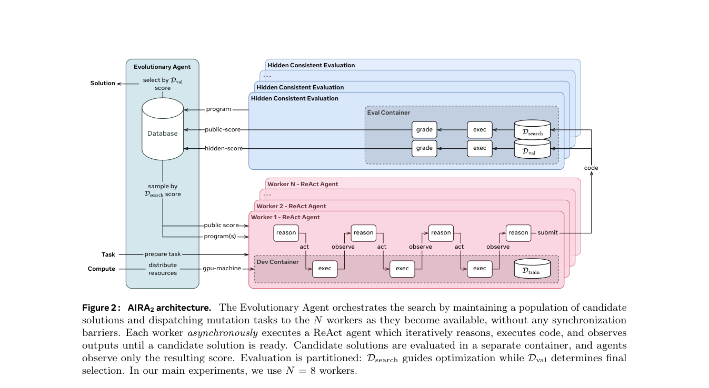

# AIRA2: Overcoming Bottlenecks in AI Research Agents

<!-- source-sha256: 6498a3d439222ad000520c707d2de83290bbc3024269fe2e2cd6abd2eb3acf28 -->

[简体中文](README.md)

> **L1 core-mechanism diagnostic.** Runs only asynchronous scheduling and HCE signal isolation. The paper's 8×H200 setup, Apptainer, Gemini ReAct operator, and long-duration training are not reproduced, so this is not a multi-GPU performance result.

## Paper information

| Field | Details |
|---|---|
| Paper | [arXiv](https://arxiv.org/abs/2603.26499) |
| Organization | First-author affiliations: FAIR at Meta / University College London |
| First public release | 2026-03-27 (arXiv v1) |
| Authors' code | As of 2026-10-04, no public author implementation was found in the paper, Meta's official page, or author homepages. |
| Adapter / method | `aira2` |
| Local reproduction code | [`src/auto_research/agent_research/official_meta_backfill_20261004.py`](https://github.com/daiwk/auto-research/tree/main/src/auto_research/agent_research/official_meta_backfill_20261004.py) |

## Original paper

### Motivation and method

A steady-state worker pool without synchronization barriers increases experiment throughput. Training, search, and final selection use one fixed hidden 80/10/10 split. Search sees only the search score. Only after search ends does held-out validation that was not used for hill climbing select the champion.

<!-- paper-figure:start -->
### Key figure from the paper

> **Figure 2:** Core architecture, modules, and their connections. From the [original paper](https://arxiv.org/abs/2603.26499); copyright remains with the authors.
<!-- paper-figure:end -->

### Core equations

$p(i)\propto(N-r_i+1)^{1/T}$. Once split, $D_{train}$, $D_{search}$, and $D_{val}$ remain fixed across candidates. Test signals never enter the local interface.

### Paper results

On MLE-bench-30, paper v2 reports 24h/72h percentile ranks of 81.5%/83.1%. Six of 20 AIRS-Bench tasks surpass human state of the art.

> No production online A/B result attributable to the method is reported. These public offline results are separate from local diagnostics.

## Local reproduction

- [Three-seed diagnostic](metrics/mechanism-seeds42-44.json).
- The baseline disables the mechanism or uses default state. `diagnostic_only=true`, ineligible for formal capability ranking.

## Reproduction boundaries

Only asynchronous scheduling and HCE signal isolation run locally. No 8×H200, Apptainer, Gemini ReAct operator, or long training is reproduced; this is not a multi-GPU performance comparison.
