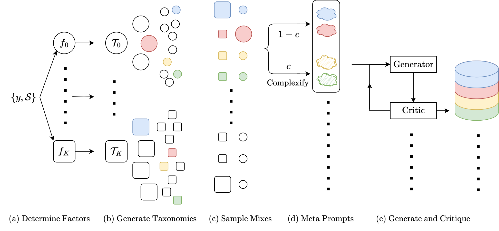

# Simula: Synthetic data orchestration with taxonomies and independent critics

<!-- source-sha256: c637d1ed7ed0b2116935125162e6ed0bbc557576d7b6fde9939d5b9e4e3eee8e -->

[简体中文](README.md)

> **CPU L0 interface and formula check**, not M3 inference or a synthetic-data quality result. Full experiments are too costly and not reproduced (review DONE). No adapter: `simula` is a standalone component key.

## Paper information

| Field | Details |
|---|---|
| Paper | [Reasoning-Driven Synthetic Data Generation and Evaluation](https://arxiv.org/abs/2603.29791); [v1 full text](https://arxiv.org/html/2603.29791v1) |
| Institution | First author Tim R. Davidson: EPFL; work done during a Google internship, with Google / Google DeepMind collaborators |
| First public release | 2026-03-31 14:26:33 UTC (arXiv v1) |
| Author code | No author implementation identified in the reviewed text; no claim of global absence. |
| Local adapter or method key | `simula` |
| Local reproduction code | `src/auto_research/agent_research/google16_simula.py`; `scripts/run_google16_evaluation.py` |

## Paper method and evidence

Simple seed expansion can skip concepts or collapse onto similar items. Simula builds a factor taxonomy, samples global node combinations and local scenarios, then runs independent critics and calibrates complexity through in-batch comparisons. The semantic generator and critics determine data quality and cannot be replaced by heuristics in a reproduction claim. [Section 2 and Appendices B/C/E](https://arxiv.org/html/2603.29791v1#S2).


<!-- paper-figure:start -->
### Original paper figure

[](https://arxiv.org/html/2603.29791v1/simula-framework.png)

Figure 2 shows taxonomy construction, sampling and independent criticism. From the [original paper](https://arxiv.org/abs/2603.29791); copyright remains with the authors.
<!-- paper-figure:end -->

### Core equation

$$
\operatorname{Accept}(x)=C_{req}(x)\land C_{correct}(x)\land\neg C_{incorrect}(x).
$$

$$
E_i=\frac1{1+10^{(r_j-r_i)/400}},\quad
r_i\leftarrow r_i+k(s_i-E_i),\quad r_j\leftarrow r_j-k(s_i-E_i).
$$

### Reported results

The paper tests multiple domains and languages, generating up to 512K unique examples per dataset and training multiple variants/seeds. No production A/B. Local fixtures are not comparable to paper downstream scores. [Section 3 and Appendix F](https://arxiv.org/html/2603.29791v1#S3).

## Local reproduction

`TaxonomyModels` exposes factors, proposals, tree critic and level plan. `GenerationModels` exposes strategy, scene, complexity, generation, requirement criticism, revision and independent positive/negative criticism. Each critic sees the sample only, not the other's verdict. The same underlying model is allowed if calls are independent. No benchmark gold or held-out text enters generation; curator-only `contamination_overlap` measures exact 13-gram overlap. Short inputs without 13-grams are not evidence of no contamination; this does not reproduce the underspecified Jaccard policy.

`build_taxonomies` runs bounded BFS, best-of-N merging, ancestor/sibling context, an independent critic and level planning (B.4). `generate_dataset` implements weighted scenarios, complexity, retries and dual critics (C and §2.2). `calibrated_complexity` scores each sample K times per batch and updates global Elo (E.3); a final singleton receives only its raw score. Local settings are initial 1000, scale 400, k=32 and seeded pairing; the paper did not prescribe those exact values. `CallBudget` limits calls, attempts and refinements; underfilled N returns partial output and failure. [CPU artifact](metrics/protocol-cpu-seed42.json) records roles, input/output hashes, rejections and match counts.

No real M3 generation, calibrated semantic judges, multilingual quality tests, downstream training or Evolve integration. Hundreds of thousands of samples, API critiques and training runs are too costly and not attempted or automatically retried. This component is CPU-only; a future CUDA provider requires its own A100/A30 receipt.

```bash
PYTHONPATH=src python scripts/run_google16_evaluation.py \
  --component simula --fixture-demo --seed 42 \
  --output runs/google16/simula.json
```
