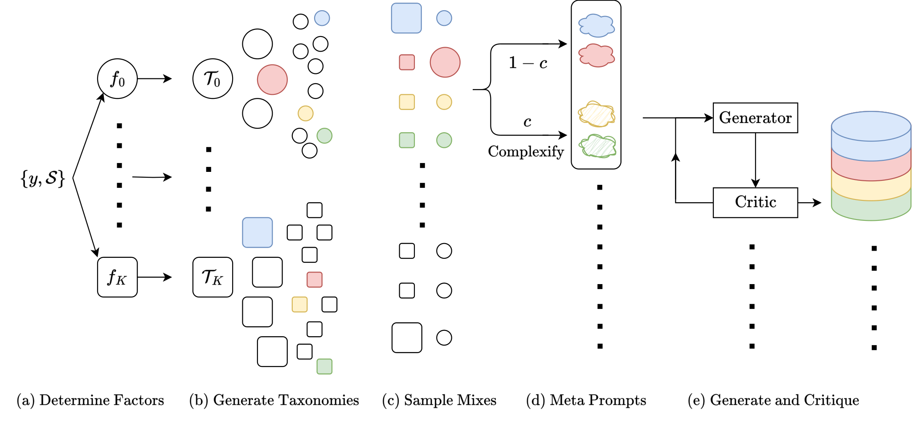

# Simula：有分类树与独立批判的数据合成编排

> CPU 协议组件，当前验证为 **L0 接口与公式检验**。没有把固定回调称为 M3 推理，也没有宣称合成数据质量提升。完整实验 **成本过高，不复现（审查 DONE）**。

## 论文信息

| 字段 | 内容 |
| --- | --- |
| 论文链接 | [Reasoning-Driven Synthetic Data Generation and Evaluation](https://arxiv.org/abs/2603.29791)，[v1 全文](https://arxiv.org/html/2603.29791v1) |
| 公司/机构 | 一作 Tim R. Davidson：EPFL；工作于 Google 实习期间完成；Google / Google DeepMind 合作者 |
| 首次公开日期 | 2026-03-31 14:26:33 UTC（arXiv v1） |
| 原文开源代码 | 本轮核对的原文未找到作者算法仓库；不作全网不存在断言 |
| 本地 Adapter | 无；独立组件 key：`simula` |
| 本地复现代码 | `src/auto_research/agent_research/google16_simula.py`；`scripts/run_google16_evaluation.py` |

## 原始论文总结

### 背景与主要改动

单纯扩写种子容易遗漏概念或坍缩到相似样本。Simula 先按因素建立分类树，再控制全局节点组合与局部场景；独立批判过滤样本，并通过批内相对评分校准复杂度。语义生成器与批判模型是决定质量的核心，本地接口不能用启发式替代后宣称复现。[§2 与附录 B/C/E](https://arxiv.org/html/2603.29791v1#S2)


<!-- paper-figure:start -->
### 原论文关键图

[](https://arxiv.org/html/2603.29791v1/simula-framework.png)

图片来自[原论文](https://arxiv.org/abs/2603.29791) Figure 2，版权归原作者所有；本地没有把示意图当作实验结果。
<!-- paper-figure:end -->

### 核心公式

因素树和兼容采样策略确定组合空间。独立正反批判分别判断“正确”与“错误”，只在前者肯定、后者否定且要求批判通过时接纳：

$$
\operatorname{Accept}(x)=C_{req}(x)\land C_{correct}(x)\land\neg C_{incorrect}(x).
$$

复杂度评分按附录 E.3 保持每样本约 K 次批内比较，再由成对胜负更新 Elo：

$$
E_i=\frac1{1+10^{(r_j-r_i)/400}},\quad
r_i\leftarrow r_i+k(s_i-E_i),\quad r_j\leftarrow r_j-k(s_i-E_i).
$$

论文未唯一规定 Elo 数值超参；本地显式记录初始 1000、尺度 400、k=32 和定种子对局顺序，不冒称作者精确配置。

### 论文离线与线上效果

论文比较多领域和多语言的合成数据及下游模型；完整生成按数据集达到 512K 唯一点，并涉及多版本与多 seed 训练。没有生产线上 A/B。这里不把本地固定样本统计与原文下游性能比较。[§3 与附录 F](https://arxiv.org/html/2603.29791v1#S3)

## 本地复现

```bash
PYTHONPATH=src python scripts/run_google16_evaluation.py \
  --component simula --fixture-demo --seed 42 \
  --output runs/google16/simula.json
```

### 数据协议与调用边界

`TaxonomyModels` 显式提供因素、提案、树 critic 和层计划；`GenerationModels` 显式提供策略、场景、复杂化、生成、要求批判、修改及正反两个批判回调。它们可接真实提供方，但本轮 runner 使用的都是标明 fixture 的独立调用。

正反 critic 各自只收到样本，不看到另一个的 verdict；回调可共享同一底模，但必须是独立调用。没有 benchmark gold 或 heldout 文本进入生成接口。`contamination_overlap` 只在 curator 一侧计算精确 13-gram 重叠；短文本无 13-gram 不代表无污染，也未伪称复现未给出阈值的完整 Jaccard 策略。

### 结果与边界

[CPU 接口产物](metrics/protocol-cpu-seed42.json)记录角色、调用输入/输出哈希、拒绝记录与复杂度对局数。BFS 真正执行 best-of-N 合并、批判、层计划；生成有硬调用数、尝试数与 refinement 上限，达不到 N 则返回部分数据和失败状态，不无限重试。批评分每样本恰好出现 K 次，尾部单样本批仅提供原始分而不制造对局。

| 组件 | 已实现内容 |
| --- | --- |
| `build_taxonomies` | 附录 B.4 的有界 BFS、祖先/兄弟上下文、独立 critic |
| `generate_dataset` | 附录 C 的加权采样、场景、复杂化、重试；§2.2 双 critic |
| `calibrated_complexity` | 附录 E.3 的批内评分与全局 Elo |
| `CallBudget` | 调用上限、角色/来源摘要与失败保留 |

**未做**真实 M3 合成、语义 critic 校准、多语言质量验证和下游训练；不宣称 Evolve 接入。数十万样本与多次 API 批判/训练矩阵明显高成本，不试跑、不自动重试。协议组件仅用 CPU；未来真实 CUDA 模型接入须另外取得 A100/A30 回执。
