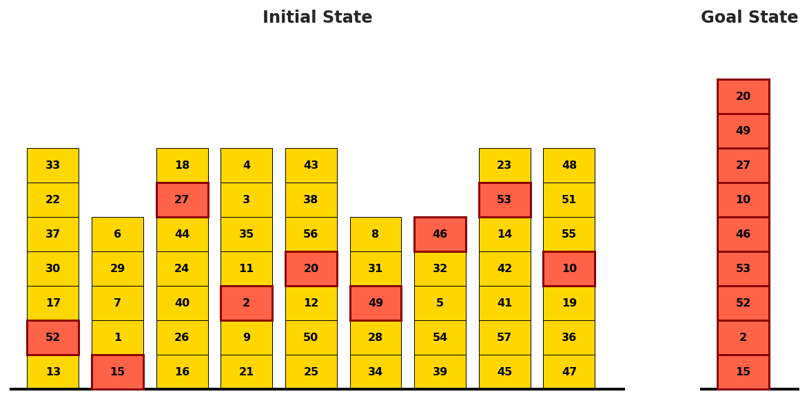

# Planning optimality: valid plans are not necessarily shortest

<!-- source-sha256: 70f95350719817ea8743bf83e2b0bc31a2cd69a14073951b224018ab81d546c5 -->

[简体中文](README.md)

> **L1 mechanism/evaluation component, diagnostic only—not a complete capability reproduction.** CPU component tests passed. There is no CUDA execution path and no GPU claim. Not integrated with Evolve; fixture results cannot justify promotion.

## Paper information

| Field | Value |
| --- | --- |
| Paper | [arXiv:2604.02910v1](https://arxiv.org/abs/2604.02910v1); [fixed v1 source](https://arxiv.org/html/2604.02910v1) |
| First author / institution | **Bernd Bohnet**, first affiliation **Google DeepMind**; Google participation is verified from the author block, not model names |
| Original publication date | **2026-04-03 09:27:16 UTC**, arXiv v1 record; historical official-source backfill, not today's first publication |
| Author code | No verified paper-specific author implementation repository was found in fixed v1 as of 2026-11-13; model/dependency repositories do not count as this paper's code. |
| Local adapter / key | `planning-optimality`; `adapter: null`, independent component |
| Local code | `src/auto_research/agent_research/planning_optimality.py` |
| Validation | CPU component tests passed. There is no CUDA execution path and no GPU claim. |

## Original paper summary

### Background and main change

Checking goal reachability alone ignores unnecessary actions. The paper extends LLM planning evaluation from validity to optimality using Blocksworld and abstract P* curricula with known optimum lengths.

<!-- paper-figure:start -->
### Key original-paper figure

[](https://arxiv.org/html/2604.02910v1)

Figure 1(a), fixed v1 HTML: the original Blocksworld target-block task panel, not a locally generated plan. Source and image hashes are in [assets/provenance.json](assets/provenance.json). Figure from the [original paper](https://arxiv.org/html/2604.02910v1); copyright belongs to the original authors. Full-paper findings are not local component results.

<!-- paper-figure:end -->

### Defining mechanism and formula

The local simulator enforces the real pickup/putdown/unstack/stack preconditions. The Section 4.1 formula is accepted only for the restricted curriculum: at most one target per initial tower, table-supported goal base and an empty hand. Depth counts covering blocks. Unsupported interleaved-target cases are rejected rather than scored with the wrong formula.

```text
C_opt = Σ_{b in targets} 2*depth(b) + 2*(|targets|-1); gap=(|plan|-C_opt)/C_opt
```

### Original results and limitations

The model study includes very tall towers and many target blocks; those model/API experiments were not run. Local gaps are defined only after executable goal-reaching validation. Invalid plans have no gap, and zero-step optima avoid division by zero.

## Local reproduction

### Data protocol and code mapping

`transition` receives no gold plan; scoring belongs to an independent evaluator. A separate bounded BFS explores the four-operator state graph for at most six blocks without calling the formula. Controls reject illegal pickups and multi-target source towers, and detect a valid detour with gap one. This is not an LLM planner, VAL replacement or agent capability result.

```bash
PYTHONPATH=src python -c 'from auto_research.agent_research.planning_optimality import diagnostic; print(diagnostic(42, device="cpu"))'
PYTHONPATH=src python -m pytest -q tests/test_colm_foundation_components.py
```

### Results, negative controls and boundaries

The component test set has 47 passes and six locally skipped CUDA cases; skipping is not passing. Standard three-seed outputs use `metrics/component-cpu-seeds42-44.json`, not training or public-benchmark results. CPU component tests passed. There is no CUDA execution path and no GPU claim. All metrics are L1 diagnostics. No gold is exposed to an actor, no test-based selection is authorized, and no model improvement is claimed.

Goal satisfaction requires the **exact complete goal tower, a clear top and an empty hand**, not a goal-chain prefix. Initially, a singleton target A covered by x was incorrectly treated as solved at cost zero while the formula returned two. The corrected verifier adds independent BFS controls for one/two covering blocks (two/four actions), a held obstacle requiring putdown (one action), an empty plan and an unfinished one-action plan. The initial multi-target permutation tests did not cover this case; old evidence is not claimed to validate singleton goals. Delivery uses newly frozen and rerun final CPU evidence.

### Full-experiment disposition

Gemini 3 Pro planning across large curricula (tower heights up to 1000 and hundreds of goal blocks); full model/API evaluation not reproduced.

**Full experiment not reproduced due to cost (review DONE).** No large checkpoint/corpus downloads, scaled-down substitute presented as replication, or automatic full-training retries.
