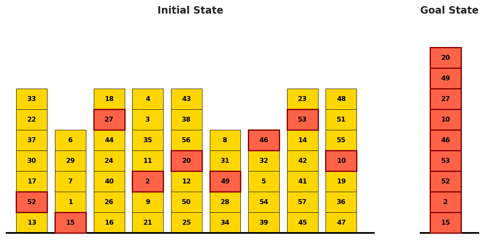

# Planning Optimality：合法计划不等于最短计划

[English](README-en.md)

> **L1 机制/评测组件，diagnostic only，不是完整模型能力复现。** CPU组件专测已通过；没有CUDA路径，不需要GPU验收。 未接入Evolve，不可据本地fixture成绩晋级。

## 论文信息

| 字段 | 内容 |
| --- | --- |
| 论文链接 | [arXiv:2604.02910v1](https://arxiv.org/abs/2604.02910v1)；[固定v1原文](https://arxiv.org/html/2604.02910v1) |
| 公司 / 作者机构 | 一作 **Bernd Bohnet**，第一单位 **Google DeepMind**；论文有Google相关作者，按原文作者栏确认，不凭模型名归属 |
| 首次公开日期 | **2026-04-03 09:27:16 UTC**，依据arXiv v1记录；本次是历史官方源补漏，不是今天新首发 |
| 原作者开源代码 | 截至2026-11-13，固定v1未找到已核实的本篇作者代码仓库；基础模型与依赖仓库不算本篇开源。 |
| 本地 adapter / key | `planning-optimality`；`adapter: null`，独立组件 |
| 本地复现代码 | `src/auto_research/agent_research/planning_optimality.py` |
| 验收范围 | CPU组件专测已通过；没有CUDA路径，不需要GPU验收。 |

## 原始论文总结

### 背景与主要改动

只判断计划能否达到目标，会忽略大量无必要动作。论文把LLM规划评测从validity扩展到optimality，在Blocksworld和抽象P*任务中构造具有已知最优长度的课程，分析推理模型随着难度增长的计划冗余。

<!-- paper-figure:start -->
### 原论文关键图

[](https://arxiv.org/html/2604.02910v1)

Figure1(a)，固定v1 HTML；Blocksworld目标块搬运任务。仅截取作者提供的完整左侧任务图，非本地生成。 来源与图像SHA见[assets/provenance.json](assets/provenance.json)。图片来自[原论文](https://arxiv.org/html/2604.02910v1)，版权归原作者所有；图中的完整实验结论不等于本地组件结果。

<!-- paper-figure:end -->

### 核心机制与公式

本地执行pickup、putdown、unstack、stack四种操作的实际前置条件，验证手是否为空、被搬块及支撑块是否clear。最优公式只用于原文§4.1的受限课程：每座初始塔最多一个目标块，目标链底块初始在桌面，初始空手。depth表示目标上方遮挡块数；每个遮挡块需unstack+putdown，每个非底目标需pickup/unstack后stack两动作。不支持的interleaved课程直接拒绝，不能套公式。

```text
C_opt = Σ_{b in targets} 2*depth(b) + 2*(|targets|-1); gap=(|plan|-C_opt)/C_opt
```

### 原文结果与限制

原文评测Gemini3 Pro等模型，任务可有高达1000层的塔和大量目标块；这些API/模型计划实验未运行。本地所有gap只对实际合法且达成目标的计划定义；非法计划返回无gap。最优0步时不除0，也不把无意义detour硬算成无穷相对提升。

## 本地复现

### 数据协议与代码映射

`transition` 不接收gold计划；`score_plan` 只由独立evaluator调用。小于等于6块时另用独立BFS穷举四操作图，不调用公式，校验多种排列的最短距离。负控包括无法pickup非桌面块、同塔多个目标拒绝、合法但多绕两步的计划gap=1。不是LLM planner、VAL兼容实现或Agent能力成绩。

```bash
PYTHONPATH=src python -c 'from auto_research.agent_research.planning_optimality import diagnostic; print(diagnostic(42, device="cpu"))'
PYTHONPATH=src python -m pytest -q tests/test_colm_foundation_components.py
```

### 结果、负控与边界

本批组件专测为47项通过、6项CUDA本机跳过；跳过不等于通过。三种子标准产物统一使用 `metrics/component-cpu-seeds42-44.json`；没有训练或公开benchmark成绩。CPU组件专测已通过；没有CUDA路径，不需要GPU验收。 所有metric仅属L1诊断，无gold给actor、无test选择、无模型效果提升声明。

目标判定必须同时满足**完整目标塔恰好等于目标链、塔顶clear、手为空**；不能只匹配目标链前缀。初版前缀判断在单目标A上方有x时，曾把初始状态错误判为0步完成，而公式为2步；已修复，并新增单目标含1/2个遮挡块的独立BFS（2/4步）、手持遮挡块还需putdown（1步）、空计划和未完成单动作计划的负控。初版多目标排列测试未覆盖此情形，不声称旧回执验证过单目标；交付以重新冻结和执行的最终CPU证据为准。

### 完整实验处置

原文对Gemini3 Pro等模型运行大规模规划课程，塔高可达1000层、目标块数达数百，并多次采样/验证。完整模型/API矩阵不复现；BFS只用于不超过6块的独立核验。

**完整实验成本过高，不复现（审查 DONE）**。不下载大权重/语料、不以缩水模型冒充原论文、不自动重试完整训练。
