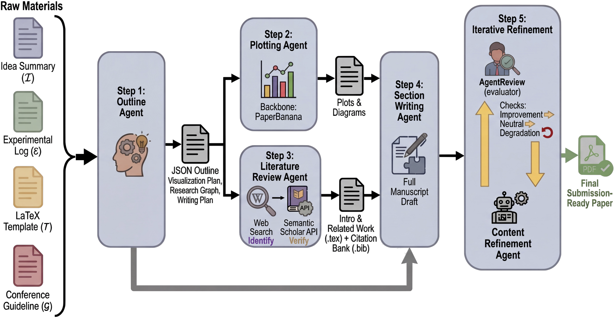
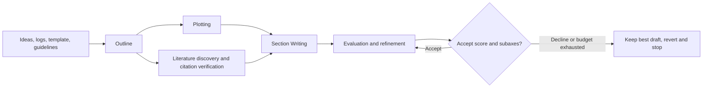

# PaperOrchestra: A Five-Agent Paper Writing Workflow

<!-- source-sha256: df8de2cf87758bdb41afd7aea881572d81e34a9ec76cf535287c1688607a673f -->

[简体中文](README.md)

> Historical directory catch-up. Full experiment not reproduced due to cost (review complete); no executable adapter, generative capability metrics, or GPU pass claim. Excluded from automatic implementation and retry.

## Paper information

| Field | Details |
|---|---|
| Paper | [PaperOrchestra: A Multi-Agent Framework for Automated AI Research Paper Writing](https://arxiv.org/abs/2604.05018v1) |
| Organization | First author Yiwen Song and all other authors: Google Cloud AI Research; see the [author project page](https://yiwen-song.github.io/paper_orchestra/). |
| First public release | **2026-04-06 18:00:00 UTC**, arXiv v1; method and cost are pinned to v1. |
| Authors' code | No verified author implementation. Author code SHA/license are not applicable. Community `Ar9av/PaperOrchestra` is not author code. |
| Adapter / method | catalog key `paperorchestra`；`adapter=null` |
| Local reproduction code | None; only `src/auto_research/paper_specs/catalog/agent-research/paperorchestra.json` and this review. |
| Inclusion | `historical-directory-backfill`; a new Google directory entry is not a new publication of the April 6 paper. |

## Original paper

### Motivation and method

PaperOrchestra turns loose ideas and experiment logs into a LaTeX manuscript with literature and figures using five agents: Outline, Plotting, Literature Review, Section Writing, and Content Refinement. After outlining, figure generation and literature discovery run concurrently. References are checked for entity and time cutoff. A multidimensional assessment accepts or reverts revisions. The system does not invent or execute new experiments for authors.

<!-- paper-figure:start -->
### Key figure from the paper

From the [original paper](https://arxiv.org/html/2604.05018v1#S4); copyright remains with the authors. This is the original architecture figure, not a screenshot generated by this repository. See `assets/provenance.json`.
<!-- paper-figure:end -->

### Core rule

The method is not a new neural loss. It orchestrates evidence-constrained writing: citations must resolve to real Semantic Scholar entities with abstracts, precede the research cutoff, and be deduplicated by paper ID. Revisions are accepted by:

$$
\mathrm{accept}\iff s_{new}>s_{old}\quad\lor\quad
(s_{new}=s_{old}\land\Delta_{subaxes}\ge0).
$$

A score decrease, net subaxis degradation on a tie, or reaching three rounds triggers revert/stop. A standalone acceptor, BibTeX check, or community script is not the five agents' synthesis and writing, so no cheap substitute is offered.

### Paper results

PaperWritingBench uses materials from 200 published papers. Human net preference margins over AI baselines are 50–68 percentage points for literature review and 14–38 for overall quality. Automatic and human evaluations are not equivalent, particularly for literature review, which has lower correlation. Pretraining contamination, figure hallucinations, and factual checks remain concerns. No production A/B is reported.

## Local status and cost

**Full experiment not reproduced due to cost (review complete).** Appendix B's timing subset of 10 papers reports roughly **60–70 LLM calls and a 39.6-minute trimmed mean per paper**. The full 200-paper, multibaseline, multijudge and human evaluation costs much more than one run. Writing uses Gemini3.1Pro and literature retrieval Gemini3Flash plus web search, with image generation and iterative review. These are author-reported estimates/configurations, not local measurements or assumptions about free or unlimited APIs.

No long writing job, paid API, full material download, or automatic retry. There are no local metrics, operator, run command, or GPU receipt. `requires_gpu_validation=false` and `gpu_validation_passed=false` are not verification claims. A future protocol would need to hide original manuscripts and gold from generation and check citations and facts independently; this page does not implement it.
