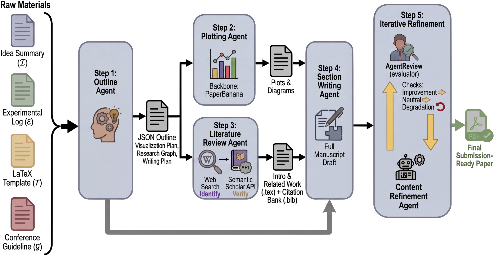
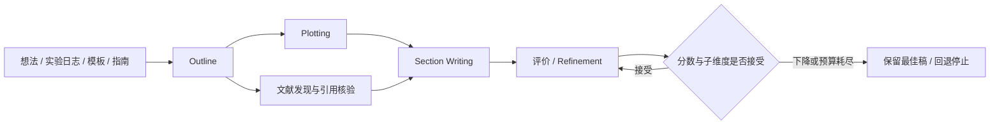

# PaperOrchestra：五 Agent 论文写作流程

> 历史目录补漏：成本过高，不复现（审查 DONE）。无可执行 adapter、生成能力指标或 GPU 通过声明，不进入自动实现/重试队列。

## 论文信息

| 字段 | 内容 |
|---|---|
| 论文链接 | [PaperOrchestra: A Multi-Agent Framework for Automated AI Research Paper Writing](https://arxiv.org/abs/2604.05018v1) |
| 公司 / 机构 | 一作 Yiwen Song，及其他作者均为 Google Cloud AI Research，见[作者项目页](https://yiwen-song.github.io/paper_orchestra/) |
| 首次公开日期 | **2026-04-06 18:00:00 UTC**，arXiv v1；本页方法与成本核对固定 v1 |
| 原作者代码 | 未核验到作者发布的实现，官方代码 SHA / 许可不适用；社区 `Ar9av/PaperOrchestra` 不是作者实现，不作官方开源证据 |
| Adapter | catalog key `paperorchestra`；`adapter=null` |
| 本地复现代码 | 无实现代码目录；仅 `src/auto_research/paper_specs/catalog/agent-research/paperorchestra.json` 与本页审查材料 |
| 入库口径 | `historical-directory-backfill`；Google 目录新增页面不是 Apr6 论文的新首发 |

## 原始论文总结

### 背景与主要改动

PaperOrchestra 用 Outline、Plotting、Literature Review、Section Writing、Content Refinement 五个 Agent，把零散想法和实验日志转成含文献与图表的 LaTeX 稿件。大纲之后图示与文献检索并行，引用经过实体和时间截止核验，最终根据多维评价接受或回退修订；系统不负责替作者发明或执行新实验。

### 原论文关键图

<!-- paper-figure:start -->

图片来自[原论文](https://arxiv.org/html/2604.05018v1#S4)，版权归原作者所有。此为原论文中使用的架构图，不是本库重新生成的系统截图；来源见 `assets/provenance.json`。

<!-- paper-figure:end -->

### 核心公式

原文不是新神经网络损失。关键是有证据约束的编排：候选引用须映射到实际 Semantic Scholar 实体、有摘要、严格早于研究截止，并按 paper ID 去重。修订接受条件可写为

$$
\mathrm{accept}\iff s_{new}>s_{old}\quad\lor\quad
(s_{new}=s_{old}\land\Delta_{subaxes}\ge0).
$$

总分下降、平分时子维度净退步或达到三轮上限时回退/停止。仅实现该判定器、BibTeX 校验或社区 skill 的机械脚本，并不构成论文五 Agent 的文献综合与写作能力，因此本次不造“低成本替代实现”。

### 论文离线与线上效果

200 篇 PaperWritingBench 原始材料来自已发表论文。作者报告对 AI 基线的人工偏好绝对净胜率：文献综述 50–68 个百分点、整体质量 14–38 个百分点。自动评价与人工评价并不等价，文献综述的人机评分相关性明显较低；预训练污染、图示幻觉与稿件事实审查仍需关注。未报告生产线上 A/B。

## 本地复现

**成本过高，不复现（审查 DONE）**。原文附录 B 在 10 篇计时子集报告每文约 **60–70 次 LLM 调用、39.6 分钟裁尾均值**；完整 200 篇、多基线、多 judge 和人工评测成本远不止单次运行。写作需 Gemini3.1Pro，检索为 Gemini3Flash＋联网搜索，另有图像生成和多轮审稿。以上为作者报告和配置判断，不是本地测量，也不假设外部 API 免费或无限。

不启动长写作任务、不调用付费 API，不下载完整评测材料、不自动重试。没有本地 metrics、operator、运行命令或 GPU receipt；`requires_gpu_validation=false`、`gpu_validation_passed=false` 不是已验证标记。若后续单独接入协议，也必须保持生成端不见原稿/gold，引用与事实由独立评价端核对；本页未声称完成该接入。
