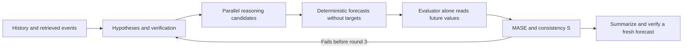
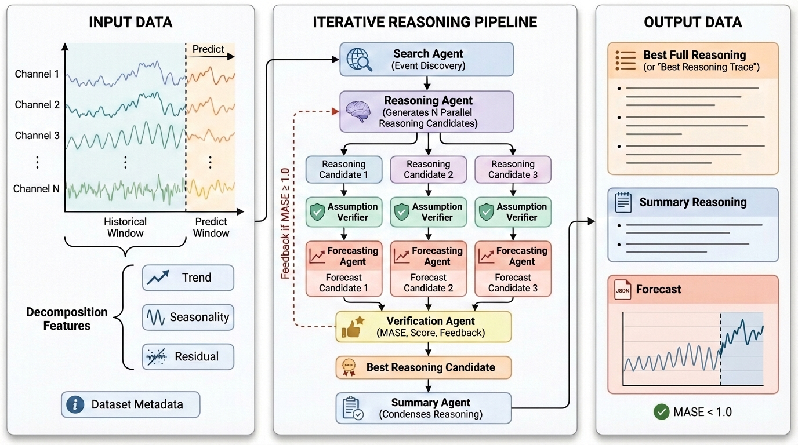

# TFRBench: Separating forecast reasoning from numerical error

<!-- source-sha256: 14f63418841921c9307118bb5f34fd2fc9fec8bb80512c9dd63e94406ddc85b3 -->

[简体中文](README.md)

> A CPU scoring and reference-building protocol, currently verified only with fixed L0 callbacks. **Label-conditioned reference construction is not leakage-free forecast evaluation.** The full experiment is **not reproduced due to cost (review DONE)**.

## Paper information

| Field | Value |
| --- | --- |
| Paper | [TFRBench](https://arxiv.org/abs/2604.05364); [v1 §§3–4](https://arxiv.org/html/2604.05364v1) |
| Organization | First author Md Atik Ahamed: Google Cloud AI Research and University of Kentucky (dual affiliation on the [authors' site](https://tfrbench.github.io/)); co-first author Mihir Parmar is with Google |
| First published | 2026-04-07 03:04:45 UTC (arXiv v1) |
| Original author code | A [benchmark and leaderboard](https://tfrbench.github.io/) are available; the reviewed pages did not identify a separate algorithm source repository |
| Local adapter | None; standalone key `tfrbench` |
| Local reproduction code | `src/auto_research/agent_research/google16_tfrbench.py`; `scripts/run_google16_evaluation.py` |

## Original paper summary

### Background and main changes

A close forecast can lack sound reasoning, and persuasive reasoning can lead to the wrong forecast. Search, Reason, Forecast, Verify, and Summary roles construct reference trajectories that meet both numerical and reasoning criteria. Labels participate in selection and feedback, so construction results cannot serve as held-out capability scores. See [Algorithm 1](https://arxiv.org/html/2604.05364v1#alg1).



<!-- paper-figure:start -->
### Key figure from the paper

[](https://arxiv.org/html/2604.05364v1/figures/tfrbench_gen.jpg)

Figure 2 from the [original paper](https://arxiv.org/abs/2604.05364); copyright belongs to the authors. The verifier's supervision must not leak into the evaluated model's view.
<!-- paper-figure:end -->

### Core equation

MASE normalizes forecast absolute error by the historical seasonal difference scale:

$$
\operatorname{MASE}=\frac{H^{-1}\sum_{t=1}^{H}|Y_t-\widehat Y_t|}
{(T-m)^{-1}\sum_{j=m+1}^{T}|X_j-X_{j-m}|}.
$$

A reference must satisfy `MASE < 1` and consistency `S >= 4`. A summary must be forecast again and pass independently; success of the longer trajectory is not sufficient. MASE is undefined at zero historical scale, and the local implementation rejects the sample rather than adding epsilon to create a perfect score. See [§§3.2 and 4](https://arxiv.org/html/2604.05364v1#S3.SS2).

The paper does not uniquely prescribe numerical weights for compound ranking. Supply `ReferenceModels.select` explicitly. The example minimizes MASE, then maximizes S; that is a declared local policy, not an inferred paper equation. Multichannel MASE normalizes each channel then macro-averages, also as a documented local choice.

### Offline and online results in the paper

The paper evaluates forecasting and reasoning across ten datasets in five domains. This is an offline benchmark without production A/B. The API, retrieval, and judge matrix was not run locally. See [§§4–5](https://arxiv.org/html/2604.05364v1#S4).

## Local reproduction

```bash
PYTHONPATH=src python scripts/run_google16_evaluation.py \
  --component tfrbench --fixture-demo --seed 42 \
  --output runs/google16/tfrbench.json
```

### Data contract and leakage controls

`ForecastView` contains only history, reasoning, horizon, and description; `OutcomeEvaluator` holds the future target. Trusted Python callbacks are not a sandbox and can still read files or closures. Audit provider information flow before using real models.

`build_reference` runs at most three rounds, can read events from the forecast period, and selects trajectories using the outcome. Its fixed label is `outcome_conditioned_benchmark_construction_not_heldout_evaluation`. It **cannot promote a model**.

`evaluate_forecaster` is a separate one-call held-out interface without feedback or reselection. It rejects events whose source publication is after the cutoff, but known future holidays can pass if published earlier. The caller must establish that external reasoning did not come from label-conditioned construction; metadata alone does not prove semantic isolation.

### Results, code mapping, and limits

The [fixed callback artifact](metrics/protocol-cpu-seed42.json) checks candidate counts, the MASE equation, and summary revalidation. Its linear sequence, trend prediction, and flat prediction are authored inputs, not real LLM forecasts. MASE=0 is not capability evidence.

| Code | Implemented behavior |
| --- | --- |
| `mase` | Paper scoring formula and checks for shape, finiteness, and zero scale |
| `build_reference` | Search, hypothesis verification, candidates, selection, feedback, and summary recheck |
| `evaluate_forecaster` | One-shot held-out evaluation and time cutoff for news sources |
| `ReferenceModels` | Explicit replaceable callbacks for all semantic roles |

The ten-dataset matrix with multiple strong models, candidates, and three retrieval/verification rounds is too costly for this single A100/A30 or Mac budget and is closed as not reproduced. The current CPU protocol has no CUDA path. A future CUDA forecaster would require actual A100/A30 validation before being called verified.
