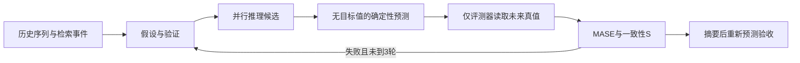
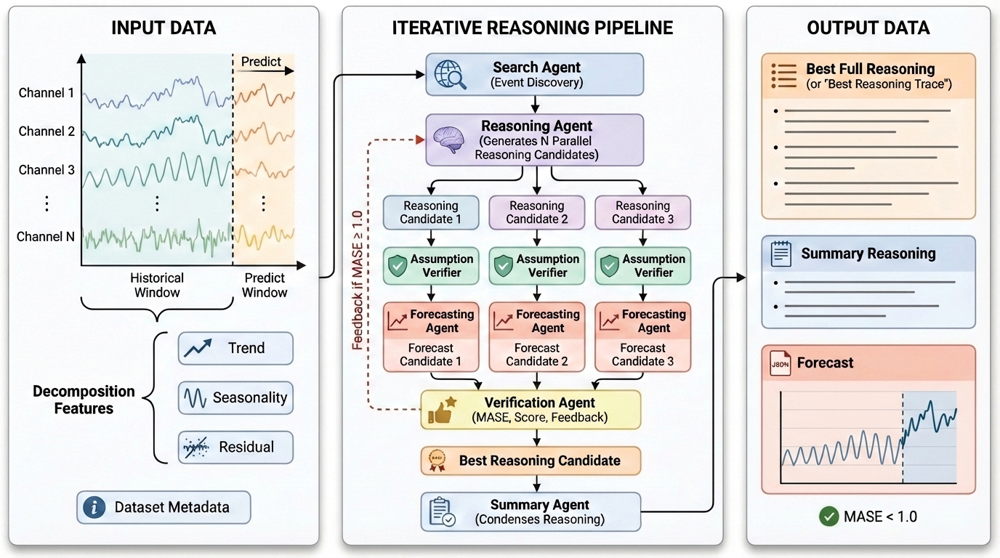

# TFRBench：把预测推理与数值误差分开验收

> CPU 评分与参考构建协议，当前仅 L0 固定回调验证。**有标签参考构建不是无泄露预测评测**。完整实验 **成本过高，不复现（审查 DONE）**。

## 论文信息

| 字段 | 内容 |
| --- | --- |
| 论文链接 | [TFRBench](https://arxiv.org/abs/2604.05364)，[v1 §3–4](https://arxiv.org/html/2604.05364v1) |
| 公司/机构 | 一作 Md Atik Ahamed：Google Cloud AI Research / University of Kentucky（[作者官网](https://tfrbench.github.io/)双属）；共一 Mihir Parmar 为 Google |
| 首次公开日期 | 2026-04-07 03:04:45 UTC（arXiv v1） |
| 原文开源代码 | 有[benchmark/排行榜](https://tfrbench.github.io/)；本轮已核页面未找到独立算法源码仓库 |
| 本地 Adapter | 无；独立组件 key：`tfrbench` |
| 本地复现代码 | `src/auto_research/agent_research/google16_tfrbench.py`；`scripts/run_google16_evaluation.py` |

## 原始论文总结

### 背景与主要改动

预测值接近真值不保证推理有根据，流畅推理也可能导致错误预测。论文联合 Search、Reason、Forecast、Verify、Summary 构建数值与推理同时合格的参考轨迹。标签参与参考筛选与反馈，因此这个构建过程不能直接作为留出能力成绩。[原文 Algorithm 1](https://arxiv.org/html/2604.05364v1#alg1)



<!-- paper-figure:start -->
### 原论文关键图

[](https://arxiv.org/html/2604.05364v1/figures/tfrbench_gen.jpg)

图片来自[原论文](https://arxiv.org/abs/2604.05364) Figure 2，版权归原作者所有。图中 verifier 的监督不应泄露到被评模型视图。
<!-- paper-figure:end -->

### 核心公式

按历史季节差分尺度归一化预测绝对误差：

$$
\operatorname{MASE}=\frac{H^{-1}\sum_{t=1}^{H}|Y_t-\widehat Y_t|}
{(T-m)^{-1}\sum_{j=m+1}^{T}|X_j-X_{j-m}|}.
$$

参考准入是 `MASE < 1` 且一致性 `S >= 4`。摘要必须单独再次预测并过门槛，不因原长轨迹成功而自动通过。零历史尺度时 MASE 未定义，本地拒绝该样本而不是加 epsilon 制造满分。[§3.2、§4](https://arxiv.org/html/2604.05364v1#S3.SS2)

原文没有唯一指定复合排序数值权重，`ReferenceModels.select` 必须显式注入。示例采用先最小 MASE 再最大 S；这是本地声明策略，不是擅自补写论文公式。多通道 MASE 先按通道归一化再宏平均，同样明确记录为本地策略。

### 论文离线与线上效果

原文跨十数据集、五领域评估预测与推理；属于离线 benchmark，未报告生产线上 A/B。本地不执行这些 API/检索/judge 矩阵，不报论文效果复现。[§4–5](https://arxiv.org/html/2604.05364v1#S4)

## 本地复现

```bash
PYTHONPATH=src python scripts/run_google16_evaluation.py \
  --component tfrbench --fixture-demo --seed 42 \
  --output runs/google16/tfrbench.json
```

### 数据协议与防泄露

`ForecastView` 只含 history、reasoning、horizon、description，不包含未来 target。未来值由 `OutcomeEvaluator` 持有。Python 回调是受信任代码，不是安全沙箱，不能阻止外部 callback 自行读取文件或闭包中的目标值；接真实模型时还要审计提供方信息流。

`build_reference` 最多三轮，可读取未来期事件并按真值挑选轨迹，输出固定标记 `outcome_conditioned_benchmark_construction_not_heldout_evaluation`。它**不能用于模型晋级**。

`evaluate_forecaster` 是独立的一次调用、无反馈、无重选的留出入口。拒绝 source publication 晚于 cutoff 的事件；已预先公布的未来节日可以通过。调用方还须证明外部 reasoning 不是从有标签参考构建回灌，函数不凭元数据宣称语义无泄露。

### 结果、代码映射与边界

[固定回调产物](metrics/protocol-cpu-seed42.json)只证明候选计数、MASE公式和摘要重验路径可执行。示例中的线性数列及趋势/平坦预测是自写刺激，不是实际 LLM 预测，MASE=0 不是模型能力证据。

| 位置 | 已实现 |
| --- | --- |
| `mase` | 原式评分、维度/有限值/零尺度检查 |
| `build_reference` | 搜索、假设验证、候选、选择、反馈、摘要重验 |
| `evaluate_forecaster` | 一次留出评测与新闻来源时间门禁 |
| `ReferenceModels` | 所有语义角色的显式可替换回调 |

完整十数据集×多个强模型×多候选×三轮检索/验证的运行矩阵成本高；一张 A100/A30 或 Mac 不适合本轮完整复现，已作终态不复现。当前纯 CPU 协议没有 CUDA 路径；未来若接 CUDA 预测底模，须实际 A100/A30 验收后才能宣称已验证。
