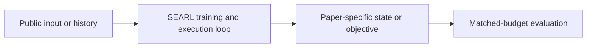
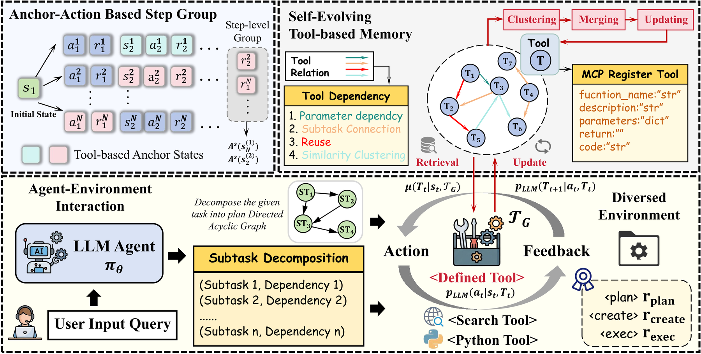

# SEARL: jointly evolving a policy and tool-graph memory

<!-- source-sha256: 0ef0bbbb781dd49f0a645e80af9396f8b8bcaf3878fa24a066c5a9187c711948 -->

[简体中文](README.md)

> **Fidelity: core mechanism.** The deterministic mini-suite does not stand in for the paper's full benchmark.

## Paper information

| Field | Details |
|---|---|
| Paper | [SEARL: jointly evolving a policy and tool-graph memory (arXiv 2604.07791)](https://arxiv.org/abs/2604.07791) |
| Organization | Shanghai AI Laboratory / Shanghai Jiao Tong University |
| First public release | 2026-04-09 (arXiv v1) |
| Authors' code | No official author repository was found. |
| Adapter / method | `searl` |
| Local reproduction code | [`src/auto_research/agent_research/`](https://github.com/daiwk/auto-research/tree/main/src/auto_research/agent_research/) |

## Original paper

### Motivation and method

Maintain tools and successful transitions in a memory graph. Each new rollout updates both the policy and graph-edge weights, closing the loop between experience, retrieval, and improvement.



<!-- paper-figure:start -->
### Key figure from the paper

[](https://arxiv.org/html/2604.07791v3/figs/overview_v1_01.png)

> **Figure 2:** Core architecture, modules, and their connections. From the [original paper](https://arxiv.org/abs/2604.07791); copyright remains with the authors.
<!-- paper-figure:end -->

### Core equations

$$
a_t\sim\pi_\theta(\cdot|x,G),\quad G\leftarrow G+\Delta(\tau,R),\quad\theta\leftarrow\theta+\eta\nabla J(\theta;G).
$$

### Paper results

On several tool-agent tasks, joint policy and graph-memory optimization outperforms separate updates. No production online A/B test is reported; no online figures are inferred.

## Local reproduction

PlanBench mini-suite, 120 episodes, seed 42: joint success **1.0000**, average cost 0.3400, and nonzero method-specific telemetry.

```bash
auto-research agent-eval --method searl --benchmark planbench-mini --episodes 120 --seed 42
auto-research evolve --model agent --dataset planbench-mini --direction "组合 searl 与已安装论文算子" --generations 2 --population 4
```

See the [fixed metrics](../../experiments/global-p0-20260808-seed42.json).

## Reproduction boundaries

The local run checks the paper-specific objective, state updates, and fair budgets. It does not reproduce large models, multi-GPU RL, private environments, real websites, or the full benchmark. It verifies the mechanism, not the numerical results in the original tables.
