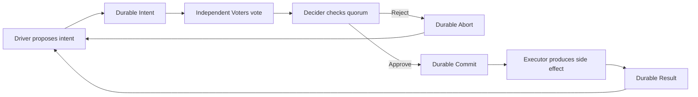
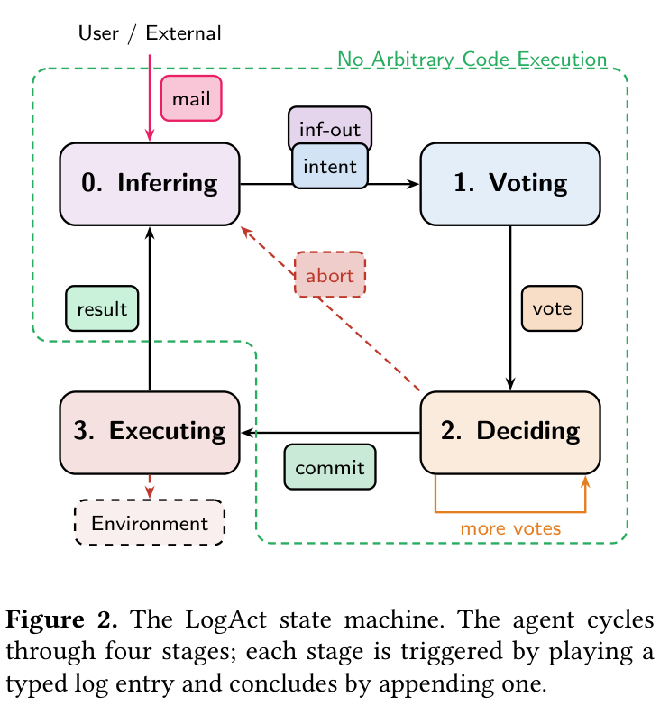

# LogAct: Log, vote, and commit before executing agent actions

<!-- source-sha256: 8c8c777db9ff96d147d7b42ee801bcad241419025ea9e91d5f959eb5af77a3e1 -->

[简体中文](README.md)

## Paper information

| Field | Value |
| --- | --- |
| Paper link | [arXiv 2604.07988 v1](https://arxiv.org/abs/2604.07988v1); [pinned PDF](https://arxiv.org/pdf/2604.07988v1) |
| Original title | LogAct: Enabling Agentic Reliability via Shared Logs |
| Organization | First author Mahesh Balakrishnan; Meta |
| First published | 2026-04-09 08:58:23 UTC (arXiv v1); historical backfill, not an October debut |
| Original author code | [Official MIT-licensed repository](https://github.com/facebookresearch/logact), checked at commit `db395449fb2dbb534c8eec848900252ac8324ab2`; the agent plugin is not installed |
| Local adapter / stable key | `logact`; `adapter: null`, `component_only` |
| Local reproduction code | `src/auto_research/agent_research/logact.py`; tests: `tests/test_logact.py` |
| Full experiment | Not reproduced due to cost (review DONE); only the bounded, model-free single-machine persistence protocol is delivered |

## Original paper summary

### Background and main changes

LogAct splits the agent into Driver, Voter, Decider, and Executor. A shared durable log records intents, independent votes, commit/abort decisions, and execution results. Only committed actions that meet the approval condition may execute. Safety review is separate from execution, and the protocol preserves uncertain states after a crash. Recovery of external effects still requires an explicit idempotency or transaction contract: replaying a conversation log is not enough.



<!-- paper-figure:start -->
### Key figure from the paper

[](https://arxiv.org/pdf/2604.07988v1#page=4)

**Figure 2, page 4.** Each stage consumes one kind of log entry and emits the next. Abort does not proceed to execution. Cropped and rendered from the [original PDF](https://arxiv.org/pdf/2604.07988v1#page=4), without redrawing scientific content. Copyright belongs to the authors; the arXiv nonexclusive distribution license is not the code's MIT license. [Original figure provenance and SHA-256](assets/provenance.json).
<!-- paper-figure:end -->

### Core protocol

Let $I$ be a durable intent, $V(I)$ the deduplicated set of valid votes, and $Q$ the configured approval condition. The execution precondition is:

$$
\operatorname{Execute}(I)\Rightarrow
\operatorname{Durable}(I)\land
Q(V(I))\land\operatorname{Durable}(\operatorname{Commit}(I)).
$$

The local implementation supports at least $k$ approvals among $N$ named voters. It neither counts repeat votes twice nor allows changing a vote. Once approvals reach $k$, the action commits and remaining votes cannot reverse the outcome. If approvals plus uncast votes fall short of $k$, it aborts. $k=N$ and $k=1$ are the paper's AND and OR special cases, not the entire dynamic policy language.

$$
a\ge k\Rightarrow \operatorname{Commit};\qquad
a+(N-n_{voted})<k\Rightarrow\operatorname{Abort}.
$$

Section 3.2 emphasizes that the Executor **is not** ordinary state-machine replication. Arbitrary external commands may be non-idempotent and cannot be blindly repeated from the log. A replacement Executor must fence the previous one or rely on an idempotent or transactional API that tolerates repeated calls. The local protocol distinguishes:

| State | Behavior |
| --- | --- |
| Uncommitted or rejected | Do not call the executor |
| Committed but not started | Persist `started` first, then call the trusted callback |
| Succeeded with a durable Result | Return the cached result without repeating the side effect |
| `started` without a successful Result | Preserve uncertainty; do not retry by default |
| Explicit idempotency and `recover=True` | Once the local lock excludes a live executor on the same database, retry with the original stable key |

Log writes and external effects do not share an atomic transaction, so the crash window is real. The caller must satisfy the executor/API contract declared by `idempotent`: either the operation is idempotent or the external service transactionally deduplicates stable keys. Recording just one result does not prove exactly-once effects.

### Offline and online results in the paper

The paper reports 1.4% attack success and 78.4% benign task utility with two voters on AgentDojo, against 48.2% and 81.4% for the older undefended model. Residual attacks are conversational and perform no environmental action. Static rules were generated offline from older model runs, so the result is not proof against unknown attacks. The paper also reports semantic recovery and a 6-agent swarm. These are the authors' offline results, not local results or production A/B evidence.

## Local reproduction

```bash
PYTHONPATH=src python -c 'from auto_research.agent_research.logact import diagnostic; print(diagnostic(42))'
PYTHONPATH=src python -m pytest tests/test_logact.py -q
```

### Data contract and implementation mapping

`DurableLogAct` uses single-machine SQLite WAL, `synchronous=FULL`, and transactions to persist intents, votes, decisions, execution state, and the append-only log together. Policy and bus identity are fixed at creation, so reopening cannot silently lower quorum or attach a different action to an existing intent ID. Each logical agent may have only one unfinished intent; unresolved failures block later intents.

The callback receives only a fixed-shape `IntentView` (intent ID, operation, public-argument JSON) and a stable effect key. It receives no evaluation answers, hidden tests, or database connection. `arguments` returns a fresh copy. A trusted integration must ensure arguments are not gold labels and that callbacks do not read private evaluation data via files or closures. This is not a sandbox for malicious code.

A local POSIX file lock is held throughout the callback to exclude concurrent executors using the same database. SQLite durability covers process restarts, not permanent disk loss. There is no remote replication, consensus, distributed lease, authentication, network isolation, or exactly-once guarantee for arbitrary external effects. Full mailbox/inference/policy hot updates, Driver election, and LLM semantic recovery are not implemented.

### Verification and limits

Tests actually write files and use a separate SQLite connection to confirm that Intent, Vote, and Commit are durable. A subprocess calls `os._exit` after committing an effect to an external SQLite database but before it writes Result. Reopening refuses replay by default. Explicit recovery under an idempotency contract retries the same key, and the external transaction leaves only one effect. Tests also cover rejection, repeated votes, illegal vote changes, concurrent execution blocking, cached results, unfinished state, and isolation of public callback fields.

`diagnostic(seed)` performs real SQLite and file operations in a temporary directory with scripted trusted callbacks and small random integers; `actual_llm_calls=0`. Passing a seed confirms this bounded protocol, not agent capability, security rate, or reproduction of the paper's effects. It is L1, `diagnostic_only=true`, `promotion_eligible=false`, and `evolve_integrated=false`. No GPU, model, or paid API is required.

### Cost and unreproduced scope

The full configuration uses remote frontier/legacy model services, Claude Code, the unreleased AnonHarness, many AgentDojo interactions, multiple log backends, and a 6-agent swarm. Model identities, internal systems, and the cost of a full reproduction cannot be established within this round's short single-A100/A30 or Mac budget. Full experiments are **not reproduced due to cost (review DONE)**, with no paid API probing or distributed or long-trajectory runs. The CPU-only protocol is delivered separately as a verifiable L1 component, not a fixture presented as the full experiment.
