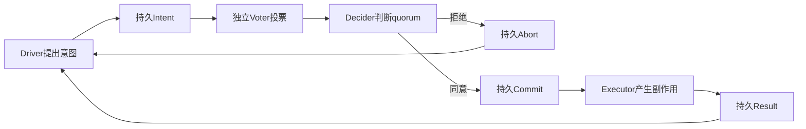
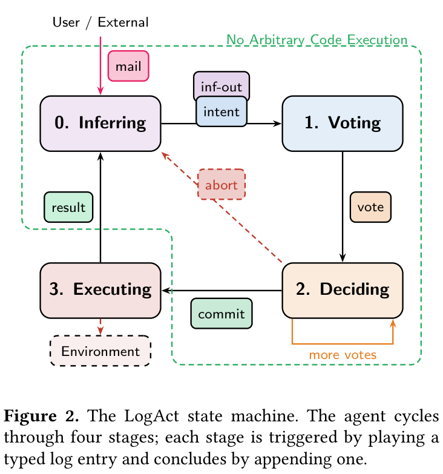

# LogAct：先记录、投票、提交，再执行 Agent 动作

## 论文信息

| 字段 | 内容 |
| --- | --- |
| 论文链接 | [arXiv 2604.07988 v1](https://arxiv.org/abs/2604.07988v1)；[固定原文 PDF](https://arxiv.org/pdf/2604.07988v1) |
| 原文标题 | LogAct: Enabling Agentic Reliability via Shared Logs |
| 公司 / 机构 / 学校 | 一作 Mahesh Balakrishnan；作者单位为 Meta |
| 首次公开日期 | 2026-04-09 08:58:23 UTC（arXiv v1）；本轮为历史补发现，不是10月新首发 |
| 原作者代码 | [官方 MIT 仓库](https://github.com/facebookresearch/logact)，核对固定 commit `db395449fb2dbb534c8eec848900252ac8324ab2`；本轮不安装其 Agent 插件 |
| 本地 adapter / 稳定键 | `logact`；`adapter: null`，`component_only` |
| 本地复现代码目录 | `src/auto_research/agent_research/logact.py`；测试 `tests/test_logact.py` |
| 完整实验 | 成本过高，不复现（审查 DONE）；仅交付无需模型的有界单机持久协议 |

## 原始论文总结

### 背景与主要改动

LogAct 将 Agent 拆成 Driver、Voter、Decider 和 Executor，用持久共享日志记录意图、独立投票、commit/abort和执行结果，只有达到批准条件的已提交动作才能执行。它将安全审查与动作执行解耦，并保留崩溃后的不确定状态；外部副作用恢复仍需要明确的幂等或事务契约，不能只凭对话记录盲目重放。



<!-- paper-figure:start -->
### 原论文关键图

[](https://arxiv.org/pdf/2604.07988v1#page=4)

**Figure 2，第4页**：四个阶段分别消费一种日志项并产生下一阶段的日志项，Abort 不进入执行阶段。图片来自[原论文](https://arxiv.org/pdf/2604.07988v1#page=4)，版权归原作者所有；只从原始 PDF 裁切渲染，未重绘科学内容。[原图来源与 SHA-256](assets/provenance.json)。原文是 arXiv 非独占发表许可，不把论文图片误标为代码的 MIT 许可。
<!-- paper-figure:end -->

### 核心协议

记 $I$ 为持久意图，$V(I)$ 为去重后的有效投票集合，$Q$ 为配置的批准条件。执行的前置条件是：

$$
\operatorname{Execute}(I)\Rightarrow
\operatorname{Durable}(I)\land
Q(V(I))\land\operatorname{Durable}(\operatorname{Commit}(I)).
$$

本地只支持固定 $N$ 个命名 Voter 中至少 $k$ 个批准。重复同一 Voter 的投票不重复计票，投票不能改写；批准数已达 $k$ 时提交，即使剩余未投票，结果也不会反转；批准数加未投票数仍不足 $k$ 时拒绝。$k=N$ 和 $k=1$ 对应论文举例中的 AND/OR 特例，不冒充全部动态策略语言。

$$
a\ge k\Rightarrow \operatorname{Commit};\qquad
a+(N-n_{voted})<k\Rightarrow\operatorname{Abort}.
$$

原文 §3.2 特别强调：Executor **不是**普通状态机复制，任意外部命令可能不是幂等的，不能从日志中盲目重复执行。新 Executor 需要隔离旧执行器，或依赖能容忍重复调用的幂等/事务 API。本地因此区分：

| 状态 | 行为 |
| --- | --- |
| 未提交或已拒绝 | 不调用执行器 |
| 已提交、尚未开始 | 先持久记录 `started`，再调用可信回调 |
| 已成功、Result 已持久化 | 重放只返回缓存结果，不再次产生副作用 |
| 有 `started`、没有成功 Result | 保留不确定状态；默认不重试 |
| 明确声明幂等且显式 `recover=True` | 本机执行锁排除仍活跃的同库执行器后，使用原始稳定 key 重试 |

日志写入和外部副作用不在同一个原子事务中，崩溃窗口真实存在。`idempotent` 是调用方必须履行的执行器/API 契约：重复操作本身幂等，或外部服务对稳定 key 事务去重。只记录一次返回结果，不足以证明副作用恰好一次。

### 论文离线与线上效果

原文报告 AgentDojo 中双 voter 的攻击成功率1.4%、正常任务 utility 78.4%，对照无防御旧模型为48.2%与81.4%。残留攻击是没有环境动作的对话类攻击；静态规则还曾使用旧模型运行记录离线生成，因此不能把结果解释为对未知攻击的绝对安全证明。论文另有语义恢复和6 Agent swarm 实验。它们是作者的离线实验，不是本地结果；未报告生产线上 A/B。

## 本地复现

```bash
PYTHONPATH=src python -c 'from auto_research.agent_research.logact import diagnostic; print(diagnostic(42))'
PYTHONPATH=src python -m pytest tests/test_logact.py -q
```

### 数据协议与实现映射

`DurableLogAct` 用单机 SQLite 的 WAL、`synchronous=FULL` 和事务，将意图/投票/决策/执行状态与追加日志共同落盘。策略和 bus identity 在创建时固定，重开数据库不能悄悄降低 quorum；同一个 intent ID 也不能绑定另一动作。每个逻辑 Agent 至多一个未完成意图，失败未决会阻止后续意图越过它。

执行回调只得到不可扩展的 `IntentView`（intent ID、operation、公共参数 JSON）与稳定副作用 key，不提供评价答案、隐藏测试或数据库连接。`arguments` 每次返回新副本。可信集成仍须保证传入参数本身不是金标，且回调不得通过文件系统/闭包读取私有评价数据；这不是恶意代码沙箱。

本机 POSIX 文件锁在回调期间保持，排除同一数据库的并发本地执行器。SQLite 耐久性覆盖进程重启，不覆盖磁盘永久故障；没有远程复制、共识、分布式 lease、身份认证、网络隔离或任意外部动作 exactly-once 保证。不实现完整 mailbox/inference/policy 热更新、Driver 选举或 LLM 语义恢复。

### 验证与结果边界

测试不仅检查状态名，还实际写文件，并从另一 SQLite 连接确认 Intent/Vote/Commit 已持久化。独立子进程在外部 SQLite 副作用提交后直接 `os._exit`，来不及写 Result；重开后默认拒绝重放，只有显式幂等契约与恢复请求才允许对同一个 key 重试，外部事务去重后仍只有一条副作用。另覆盖拒绝动作、重复投票、非法改票、并发执行拦截、已有 Result 缓存、未完成状态和公共回调字段隔离。

`diagnostic(seed)` 在临时目录执行真实 SQLite 与文件读写，使用脚本化可信回调和随机小整数；`actual_llm_calls=0`。逐 seed 的通过只证明这一有界协议的行为，不是 Agent 能力、安全率或原论文效果复现。固定为 L1、`diagnostic_only=true`、`promotion_eligible=false`、`evolve_integrated=false`；不需要 GPU，也不会启动模型或付费 API。

### 成本与未复现范围

完整原配置使用远程 frontier/旧模型服务、Claude Code、未公开 AnonHarness、AgentDojo 大量交互、多个日志后端及6 Agent swarm。模型具体身份、内部系统和完整复现费用无法用本轮单 A100/A30 或 Mac 的短时预算确定，依成本门槛标为**成本过高，不复现（审查 DONE）**，不探测付费接口、不展开多机或长轨迹实验。CPU 日志协议本身无需模型，故单独作为可验证 L1 组件交付，而不把缺失模型替换成 fixture 后声称完整实验已经完成。
