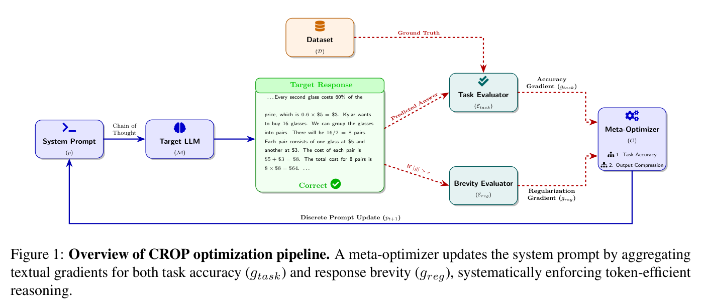
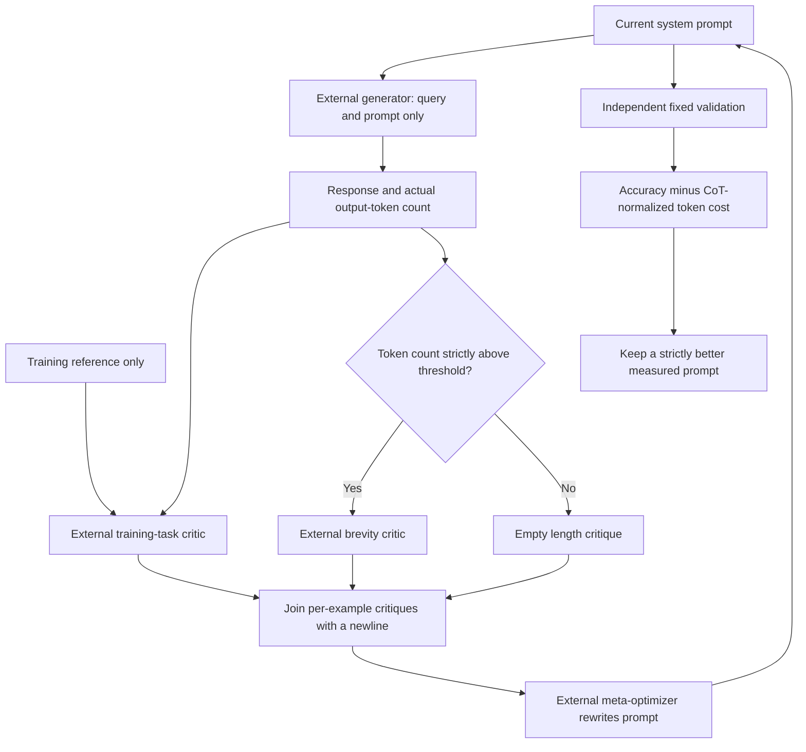

# CROP: Prompt optimization with accuracy and length feedback

<!-- source-sha256: 55e2954ae4dbabbd3ba050aa41c7af7f7b8149fa94df72381fa7e870fb17baa2 -->

[简体中文](README.md)

> Local status: **L1 external-callback control component; diagnostic only**. It does not establish LLM prompt optimization capability or train model weights. Full experiments: **not reproduced due to cost (review complete)**, with no automatic retry.

## Paper information

| Field | Details |
| --- | --- |
| Paper | [CROP: Token-Efficient Reasoning in Large Language Models via Regularized Prompt Optimization](https://arxiv.org/abs/2604.14214v1) |
| Affiliations | First author Deep Shah, Sanket Badhe and Nehal Kathrotia: Google LLC; Priyanka Tiwari: Purdue University |
| First public release | 2026-04-08 19:31:25 UTC, arXiv v1. This was a historical backfill from the official publication directory, not an October 30 first release. |
| Author code | As of 2026-10-30, neither the paper nor the [Google publication page](https://research.google/pubs/crop-token-efficient-reasoning-in-large-language-models-via-regularized-prompt-optimization/) linked to a verifiable author repository for CROP. The upstream TextGrad project is not a CROP implementation. |
| Local key | `crop`; standalone component, no adapter or Evolve integration |
| Local code | `src/auto_research/agent_research/crop.py` |
| Entry points | `optimize_prompt`, `tradeoff_score`, `diagnostic` |
| Validation | CPU-only control contract; [three-seed metrics](metrics/component-cpu-seeds42-44.json) |

## What the paper changes

Automatic prompt optimization can make reasoning increasingly verbose when each error leads to another instruction. CROP keeps the target model frozen and supplies two kinds of natural-language critique during offline optimization: a task evaluator identifies accuracy problems, and a length evaluator, called only when the answer exceeds a token threshold, suggests removing redundant narration while keeping essential computation. A meta-optimizer rewrites the system prompt using both critiques. Deployment still requires only one generation by the target model.

This is not hard truncation, a length reward added to GRPO, or a numerical gradient of the prompt text. Here a *text gradient* is a critique produced by an external evaluator. The local component implements the control flow that gates, joins and forwards that feedback and selects prompts using external validation results.

### Original paper figure



Figure 1 from page 4 of the [original paper](https://arxiv.org/pdf/2604.14214v1), with the original figure and caption preserved. Copyright belongs to the original authors. The training reference goes only to the task evaluator; the threshold controls the length branch; the update changes the prompt, not model weights. See [figure provenance](assets/provenance.json) for the crop coordinates and checksum.



### Core equations

Equations 1–3 and Algorithm 1 first obtain the answer and the task critique:

$$
\hat y_i=\mathcal M(x_i;p),\qquad
g_{\mathrm{task},i}=\mathcal E_{\mathrm{task}}(p,x_i,\hat y_i,y_i).
$$

The length critique $g_{\mathrm{reg},i}$ is generated only if $\mathrm{tokens}(\hat y_i)>\tau$; otherwise it is empty. Each text gradient is the literal concatenation of the task critique, a newline and the length critique. Section 3.3 uses a strict threshold: an answer exactly at the threshold does not trigger the critic. Token counts come from a real tokenizer or provider, not character counts. Appendix A.5 also supplies the query to the length critic. Appendix A.6 gives the optimizer the current prompt, query, generated answer and both critiques, without a direct reference-answer field.

Equation 4 scores a prompt by

$$
S(p)=\mathrm{Accuracy}(p)-\lambda
\frac{\mathrm{MeanOutputTokens}(p)}{\mathrm{MeanOutputTokens}(p_{\mathrm{CoT}})}.
$$

The denominator is the fixed chain-of-thought baseline's **mean output length**, not the prompt length or the longest response. The paper searches $\lambda\in[0.01,0.5]$ on validation and selects 0.2; the local default is 0.2, not a value tuned on a user's data. Algorithm 1 monitors training batches and saves a best prompt before updating. The local implementation instead selects on a fixed, independent validation cohort. In either case, an unmeasured final proposal must not be returned as the best prompt.

### Results reported by the authors

Table 3 reports offline public benchmarks, **not a production A/B test**. For Gemini 2.0 Flash, BBH Object Counting went from 101.2 to 19.6 average tokens and from 96.0% to 94.8% accuracy. GSM8K went from 198.4 to 50.0 average tokens and from 95.3% to 93.4% accuracy. These rows show a trade-off, not lossless compression. The experiments use Gemini 2.0 Flash and Qwen2.5-7B as target models, Gemini 3.1 Pro Thinking as meta-optimizer and Gemini 2.0 Flash for both critics.

## Local reproduction and limits

`optimize_prompt` takes finite, prebatched training examples and five callbacks: `generate`, `task_evaluator`, `brevity_evaluator`, `optimizer` and `validate`. It performs the strict threshold check, text concatenation, iterative update and best-prompt selection, but does not implement or call any LLM or API by default.

The training reference is passed only to `task_evaluator`. The generator receives the current prompt and query; the immutable `OptimizerContext` contains the query, response and critiques, not the reference or validation answers. An external critic can still copy an answer into free text, and a Python callback is not a sandbox. Callers must audit those paths; the interface cannot prove semantic non-leakage.

The CoT baseline and each validation round must have the same public data revision, sample IDs, order and per-example token alignment. Training and validation IDs must be disjoint. The interface rejects train/test selection, a zero CoT denominator, non-finite penalties, missing token counts and cohort changes. It cannot verify callers' tokenizer, checkpoint or data-isolation claims.

```bash
PYTHONPATH=src python -m pytest tests/test_oct30_crop.py -q
PYTHONPATH=src python -c 'from auto_research.agent_research.crop import diagnostic; print(diagnostic(42))'
```

Deterministic callback doubles test the 12-token trigger and the non-trigger at exactly four tokens with threshold four, exact newline concatenation, Equation 4 selection and rejection of an unmeasured final proposal. Additional negative controls cover changed IDs, ordering or data revision, train/validation overlap, incorrectly typed results, earlier-prompt tie breaking and the CPU-only entry point. Three seeds vary the synthetic contract sample order; they do not establish a training effect or a public benchmark gain. No TextGrad backend, live critic, checkpoint, or Evolve executor is included.

### Full experiment: not reproduced

The complete protocol calls for repeated Gemini 3.1 Pro Thinking optimization, two Gemini critics, Gemini/Qwen 7B target inference, GSM8K/LogiQA/BBH runs, baselines and hyperparameter selection. The paper does not fully specify the iteration/batch counts or total GPU/API cost. The full matrix is too expensive for the available single A100/A30 or Mac, so review is complete without downloading weights, issuing API calls, probing the model or scheduling retries.
