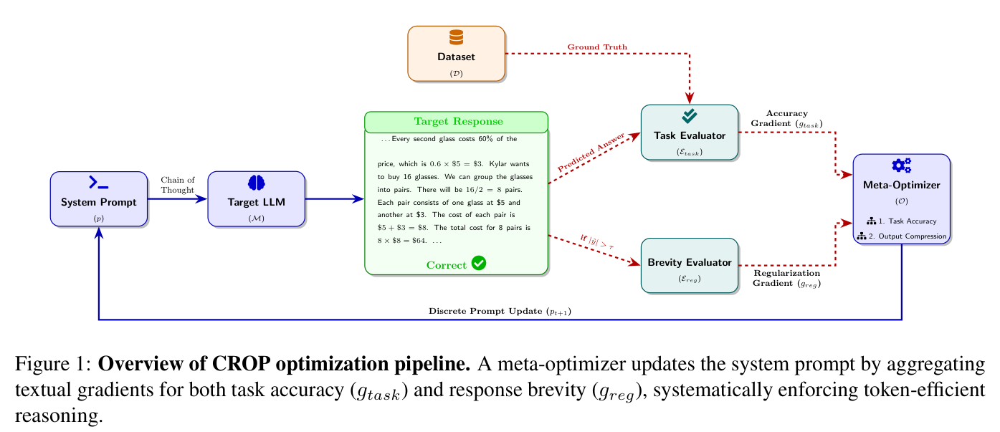
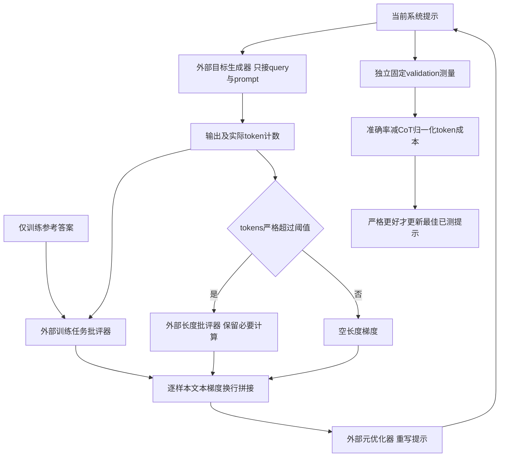

# CROP：用准确性与长度双文本反馈优化提示

> 本地状态：**L1 外部回调控制组件，diagnostic only**，不是已验证的 LLM 提示优化能力或权重后训练。完整实验：**成本过高，不复现（审查 DONE）**，不自动重试。

## 论文信息

| 字段 | 内容 |
| --- | --- |
| 论文 | [CROP: Token-Efficient Reasoning in Large Language Models via Regularized Prompt Optimization](https://arxiv.org/abs/2604.14214v1) |
| 公司 / 作者机构 | 一作 Deep Shah：**Google LLC**；Sanket Badhe、Nehal Kathrotia 同属 Google，Priyanka Tiwari 属 Purdue University |
| 原始发布日期 | **2026-04-08 19:31:25 UTC**，arXiv v1；本次为官方目录历史补漏，不是10月30日新首发 |
| 原作者代码 | 截至2026-10-30，[Google官方目录](https://research.google/pubs/crop-token-efficient-reasoning-in-large-language-models-via-regularized-prompt-optimization/)及论文**未提供可核实的作者源码仓库**；不将 TextGrad 上游误写成 CROP 开源实现 |
| 本地 Adapter / key | `crop`；独立组件，adapter 为 null，未接入 evolve |
| 本地复现代码 | `src/auto_research/agent_research/crop.py` |
| 本地入口 | `optimize_prompt`、`tradeoff_score`、`diagnostic` |
| 验证 | 纯 CPU 控制合同；`metrics/component-cpu-seeds42-44.json`，不需要 CUDA |

## 原始论文总结

### 背景与主要改动

自动提示优化通常根据答错原因不断添加指令，可能使推理越来越长。CROP固定目标模型的权重，在离线优化阶段加入第二条文本反馈：任务评估器指出准确性问题；长度评估器在输出token数超过阈值时，建议逐步删掉叙述性冗余、保留必要计算。元优化器接收两条反馈，更新系统提示，最终推理仍只需要目标模型的一次前向生成。

它既不是把答案硬截断，也不是向GRPO loss直接加长度reward，更不是对提示文本求数值梯度。“文本梯度”是外部评估模型生成的自然语言批评；本地只实现这两类批评如何组织、门控、传给优化器，以及如何根据外部validation结果选提示。

<!-- paper-figure:start -->
### 原论文关键图



图片来自[原论文](https://arxiv.org/pdf/2604.14214v1) PDF第4页Figure 1，保留原图与完整图注，未经重绘，版权归原作者所有。目视核对：gold只流向训练任务评估器，长度分支受token阈值约束，更新作用于系统提示而非模型权重。来源、裁剪坐标与SHA256见`assets/provenance.json`。
<!-- paper-figure:end -->



### 核心公式

正文Eq.1-3与Algorithm1：

$$
\hat y_i=\mathcal M(x_i;p),\qquad
g_{\mathrm{task},i}=\mathcal E_{\mathrm{task}}(p,x_i,\hat y_i,y_i),
$$
$$
g_{\mathrm{reg},i}=\begin{cases}
\mathcal E_{\mathrm{reg}}(p,\hat y_i),&\mathrm{tokens}(\hat y_i)>\tau,\\
\text{空文本},&\text{其余情况},
\end{cases}
\qquad
g_i=g_{\mathrm{task},i}\oplus\text{换行}\oplus g_{\mathrm{reg},i}.
$$

严格`>`来自Sec.3.3，不能在恰好阈值时仍施加长度反馈；token计数由外部真实tokenizer或provider提供，不用字符数冒充。附录A.5的长度批评还读取query上下文，本地保留该接口；附录A.6给优化器当前prompt、query、生成结果和两种反馈，**没有直接的reference字段**。

Eq.4为：

$$
S(p)=\mathrm{Accuracy}(p)-\lambda\frac{\mathrm{MeanOutputTokens}(p)}{\mathrm{MeanOutputTokens}(p_{\mathrm{CoT}})}.
$$

分母是冻结CoT基准的**平均输出token数**，不是当前prompt长度或单次最长输出。论文validation搜索$\lambda\in[0.01,0.5]$并选择0.2；本地默认0.2但不声称已为用户数据调优。Algorithm1按训练batch监控并在更新前保存最佳prompt；本地显式加强为独立固定validation选优。保留更新时序：最后一次新提案尚未测量，不能直接当作最佳结果。

### 论文离线与线上效果

原文Table3是公开基准离线结果，**未报告线上生产A/B**。例如Gemini2.0Flash在BBH ObjectCounting由CoT的101.2平均tokens降至19.6，准确率96.0%降至94.8%；GSM8K由198.4降至50.0，准确率95.3%降至93.4%。因此正文“无准确率损失”的措辞不能代替逐格数据，本库保留实际权衡，不宣称无损压缩。

目标模型包含Gemini2.0Flash与Qwen2.5-7B，优化器为Gemini3.1Pro Thinking，双评估器为Gemini2.0Flash。不是只执行一次字符串拼接就能复现表格收益。

## 本地复现

### 数据协议与实现边界

`optimize_prompt`接受有限的外部预分批训练样本及五类回调：`generate`、`task_evaluator`、`brevity_evaluator`、`optimizer`、`validate`。它实际执行阈值分流、文本拼接、循环更新和最佳提示选择，不实现或默认调用任何LLM/API。

训练reference仅传给`task_evaluator`；目标生成器仅接当前prompt和query；优化器的不可变`OptimizerContext`只含query、生成结果与文本反馈，不含reference或validation答案。外部critic仍可能在自由文本中复制答案，Python回调也不是安全沙箱，调用方须审计；本组件不声称能自动证明语义无泄漏。

CoT基准与每轮validation必须有完全一致的公开数据revision、固定样本ID及顺序，token计数逐条对齐；训练ID与validation ID不重叠。接口拒绝train/test选优、零CoT基准、非有限惩罚、缺少实际token计数、改变cohort等输入。这些检查不能替代调用方对tokenizer、模型revision及数据真实隔离的证明。

```bash
PYTHONPATH=src python -m pytest tests/test_oct30_crop.py -q
PYTHONPATH=src python -c 'from auto_research.agent_research.crop import diagnostic; print(diagnostic(42))'
```

### 本地结果与负控

诊断用确定性回调替身，不是LLM能力：检查12-token回复触发长度批评、4-token回复在阈值4时不触发；两文本批评严格换行拼接；固定validation中的已测提示以Eq.4选中；未测最终提案不得晋级。额外负控覆盖验证集改名/改序/改revision、训练验证重叠、错类型输出、同分保留较早prompt与CPU-only入口。

三种子仅改变生成式合同样本顺序，不意味着三次真实模型训练、公开基准验证或稳定改善。没有完整TextGrad后端、真实评估模型、提示质量保证、模型checkpoint或统一evolve执行器。

### 高成本完整实验

完整协议需要多轮Gemini3.1Pro Thinking元优化、双Gemini评估、Gemini/Qwen7B目标推理、GSM8K/LogiQA/BBH三数据集以及多基线与validation超参搜索。原文未完整给出T/B和总GPU/API费用，不能把未知成本推定成便宜。相对单张A100/A30或Mac，完整矩阵**成本过高，不复现（审查 DONE）**；不下载权重、不启动API或模型探针、不进入自动重试队列。
