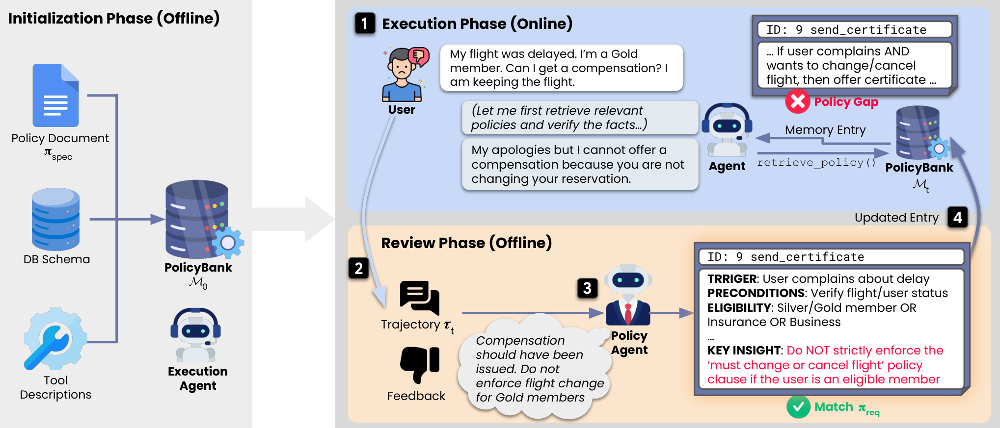

<!-- source-sha256: c7edc9f6e99adaecc9c6877b41b8ebfb00812bf3eb4595c83a0cf55cd47c6c65 -->
# PolicyBank: tool-capability memory and explicit feedback updates

[简体中文](README.md)

> **component_only/L0 interface diagnostics, not full-model or agent capability.** The full experiment is not reproduced because of cost (review DONE). Only structured memory contracts execute; the defining semantic Policy Agent is absent.

## Paper information

| Field | Value |
| --- | --- |
| Paper | [PolicyBank: Evolving Policy Understanding for LLM Agents](https://arxiv.org/abs/2604.15505v1), [fixed v1](https://arxiv.org/html/2604.15505v1) |
| Institution | First author Jihye Choi, Google Cloud; also University of Wisconsin-Madison; verified priority affiliations: Google Cloud. Collaboration does not replace the first-listed affiliation |
| Original publication | **2026-04-16 20:29:30 UTC**; a historical repair, not a November13 first release |
| Authors' code | No verifiable dedicated author source release was found in fixed v1 or bounded official-entry checks; cited libraries and third-party replicas are not counted |
| Local adapter / key | `policybank`; `adapter=null`; no Evolve integration |
| Local code | `src/auto_research/agent_research/policybank.py` |

## Original paper

### Motivation and changes

An agent may follow ambiguous written policy yet violate real requirements. PolicyBank distinguishes execution errors from specification–requirement gaps instead of equating textual compliance with correct authorization. It refines interpretations using trusted pre-deployment developer feedback.

Each capability entry has TRIGGER, PRECONDITIONS, ELIGIBILITY, ACTION and KEY INSIGHT fields. During interaction, the actor requests headers then selects IDs for full entries. An offline Policy Agent chooses Add/Revise/Omit after a task. Neither every task nor every feedback item implies a valid rule change.

### Architecture


<!-- paper-figure:start -->
### Key original figure

[](https://arxiv.org/html/2604.15505v1/overview.png)

From the [original paper](https://arxiv.org/html/2604.15505v1#S5.F2); copyright remains with the original authors. These are official HTML PNG bytes without cropping, redrawing or PDF rendering. The full online-retrieval/offline-update loop; its semantic Policy Agent is absent locally.
<!-- paper-figure:end -->

### Core equations

$$
e=(id,tool,trigger,preconditions,eligibility,action,key\ insight),\qquad
\mathcal M_{t+1}=\operatorname{Add/Revise/Omit}(\mathcal M_t;\tau_t,feedback_t).
$$

Entries are auditable semi-structured language, not formally verified permit/deny programs. Local code stores/retrieves externally authored changes without inferring authorization or classifying Type I/II failures. Trace and developer-feedback references must be retained.

### Author results

Fixed v1 reports adaptation on streaming airline/retail sister tasks in extended τ-Bench. pass^1…pass^4 measure consistency across all repeated trials, not at-least-one success pass@k. This is offline pre-deployment testing, not production A/B. The commercial-model matrix was not rerun locally.

## Local reproduction

### Protocol and code mapping

Capability stores the full schema. headers exposes capability titles; retrieve(selected_ids) returns only selected full entries. Change permits add/revise/omit: add cannot overwrite, revise cannot create, and omit carries no update. apply_after_task names the intended phase, not a semantic Policy Agent or concurrency-isolation mechanism.

```bash
PYTHONPATH=src python -c 'from auto_research.agent_research.policybank import diagnostic; print(diagnostic(42))'
PYTHONPATH=src python -m pytest tests/test_nov13_colm_agent_components.py -q
```

### Evidence and controls

Checks separate headers from full content, preserve identity on revision, keep memory unchanged on omit, reject unknown selections and retain feedback provenance. Corrected rules are explicit fixtures, not purported autonomous discoveries.

Three-seed mechanism receipts are in [CPU metrics](metrics/component-cpu-seeds42-44.json) and the batch's frozen record. Fixed-input diagnostics are not full training, capability gain or online benefit. GPU acceptance requires actual A100/A30 evidence.

## Boundaries

No semantic Policy Agent, real tools, user simulation, authorization executor, τ-Bench bridge or capability evaluation is supplied. Bad feedback can cause policy drift; type checks cannot establish truth. Do not use it to alter real production permissions without review.

### Full experiment not reproduced

The full streaming matrix covers two extended τ-Bench domains, five task-order seeds, pass^1…pass^4 and Gemini3Pro/ClaudeOpus4.5 with commercial PolicyAgent/UserSimulator models. This paper/upstream configuration exceeds the current single-A100/A30-or-Mac budget. It is a source-reported configuration, not local training measurement. No cost probe, paid API, checkpoint download or full experiment was attempted. **Too costly; not reproduced (review DONE)**. Automatic retry and implementation queues remain disabled.
