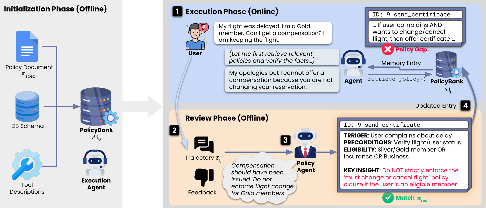

# PolicyBank：工具能力级策略记忆与显式反馈更新

[English](README-en.md)

> **component_only／L0接口诊断，不是完整模型或Agent能力复现。** 完整实验成本过高，不复现（审查 DONE）；仅以下结构化记忆合同可执行，核心语义PolicyAgent未实现。

## 论文信息

| 字段 | 内容 |
| --- | --- |
| 论文链接 | [PolicyBank: Evolving Policy Understanding for LLM Agents](https://arxiv.org/abs/2604.15505v1)，[固定 v1 原文](https://arxiv.org/html/2604.15505v1) |
| 公司 / 机构 | 一作 Jihye Choi，Google Cloud；另署 University of Wisconsin-Madison；已核优先署名：Google Cloud，合作属性不覆盖第一署名机构 |
| 首次公开日期 | **2026-04-16 20:29:30 UTC**；历史补漏，不是2026-11-13新首发 |
| 原作者代码 | 固定v1与本轮有界官方入口检索未找到可核实专属源码；未把引用库或第三方复刻算作作者代码 |
| 本地 adapter / key | `policybank`；`adapter=null`；未接入Evolve |
| 本地复现代码 | `src/auto_research/agent_research/policybank.py` |

## 原始论文总结

### 背景与主要改动

Agent 可能严格遵守含糊的书面规则，却仍违反真实业务要求。PolicyBank 区分执行失败与 specification–requirement gap，不把“按原规则做了”当成授权正确；目标是部署前根据可信开发反馈修正理解。

每条 tool-capability 记忆拆成 TRIGGER、PRECONDITIONS、ELIGIBILITY、ACTION 和 KEY INSIGHT。Actor 在对话中主动请求能力标题，再选 ID 取得完整条目；离线 Policy Agent 在任务后 Add／Revise／Omit。不是每个任务都自动改规则，也不把外部反馈无条件当真。

### 架构与流程


<!-- paper-figure:start -->
### 原论文关键图

[](https://arxiv.org/html/2604.15505v1/overview.png)

图片来自[原论文](https://arxiv.org/html/2604.15505v1#S5.F2)，版权归原作者所有。保存官方HTML原PNG字节，未裁剪、重画或PDF渲染。完整在线检索／离线更新闭环；本地不包含图中的语义 Policy Agent。
<!-- paper-figure:end -->

### 核心公式

$$
e=(id,tool,trigger,preconditions,eligibility,action,key\ insight),\qquad
\mathcal M_{t+1}=\operatorname{Add/Revise/Omit}(\mathcal M_t;\tau_t,feedback_t).
$$

原文条目是可审计的半结构化自然语言，不是已经形式验证的 permit/deny 程序。本地只存、检索与应用外部明确给出的变更；不会从 prose 自动推授权，也不判断 Type I／II。变更必须保留外部轨迹和 developer feedback 引用。

### 论文离线与线上效果

固定 v1 在扩展 τ-Bench 的 Airline／Retail 流式姐妹任务上报告适应改善，使用 pass^1…pass^4 表示所有重复试验均成功的稳定性，不是至少一次成功的 pass@k。它是离线部署前测试，不是生产线上 A/B；本地没有重跑商业模型矩阵。

## 本地复现

### 数据协议与代码映射

`Capability` 显式保存所有 schema 字段；`headers` 暴露能力标题，`retrieve(selected_ids)` 只返回选择的完整条目。`Change` 只允许 add/revise/omit，add 不覆盖既有 ID、revise 不新建、omit 不带伪更新。`apply_after_task` 的命名表达使用阶段，不是语义 Policy Agent 或并发执行隔离机制。

```bash
PYTHONPATH=src python -c 'from auto_research.agent_research.policybank import diagnostic; print(diagnostic(42))'
PYTHONPATH=src python -m pytest tests/test_nov13_colm_agent_components.py -q
```

### 结果与负控

检查标题与完整内容分开、同 ID revision 不堆重复项、omit不改memory、未知选择拒绝、feedback引用保留。诊断中的修正规则是人工明示fixture，不是假装agent从失败学到的新授权。

三seed机制执行回执见[CPU组件指标](metrics/component-cpu-seeds42-44.json)及本轮冻结记录；它是固定输入机制诊断，不是完整训练、能力提升或线上收益。GPU验收仅以真实A100/A30回执为准。

## 复现边界

未实现自然语言PolicyAgent、真实工具、用户模拟、动态授权执行器、τ-Bench bridge或正式能力评测。恶意／错误反馈可能导致policy drift；本地类型检查不能证明反馈真实性。不得用于未经审核修改真实生产权限。

### 高成本完整实验

扩展tau-bench两领域、5种任务序、pass1–4、Gemini3Pro/ClaudeOpus4.5和商业PolicyAgent/UserSimulator；完整流式能力矩阵高成本不复现。 这是论文／上游配置成本依据，不是本地训练测量。没有为估价试训、调用收费API或下载checkpoint。**成本过高，不复现（审查 DONE）**；不进入自动重试或自动实现队列。
