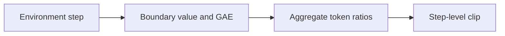
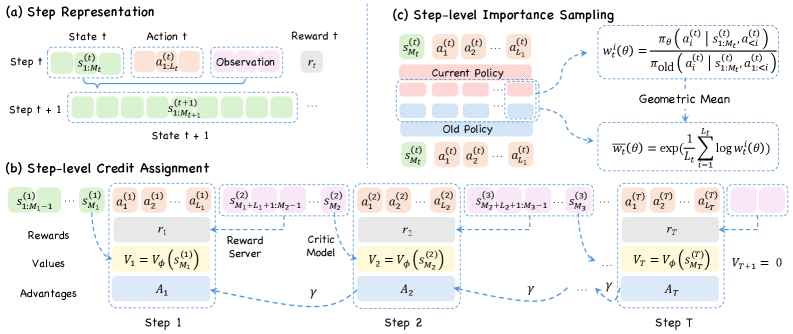

# StepPO: Step-Aligned Agent Policy Optimization

<!-- source-sha256: 3c5a82b66c6bcb85bd3176106e903cf68a3661e6d3c4d65e092ede759b9d8630 -->

[简体中文](README.md)

> **Core mechanism evidence.** Paper and local evaluation are separate.

## Paper information

| Field | Value |
| --- | --- |
| Paper | [StepPO (arXiv 2604.18401)](https://arxiv.org/abs/2604.18401) |
| Affiliations | University of Science and Technology of China |
| First public release | 2026-04-20 |
| Authors' code | No official code found. |
| Adapter / method | `steppo` |
| Local code | [`src/auto_research/agent_research/`](https://github.com/daiwk/auto-research/tree/main/src/auto_research/agent_research/) |

## Original paper

### Background and contribution

The environment observation/action step is the natural agent decision unit, unlike token-level MDP credit. Estimate values and GAE at step boundaries, then aggregate token ratios within a step before clipping.



<!-- paper-figure:start -->
### Key figure from the paper

[](https://arxiv.org/html/2604.18401v4/x3.png)

Original Figure 3: StepPO. From the [paper](https://arxiv.org/abs/2604.18401); copyright belongs to the authors. Not a local result.
<!-- paper-figure:end -->

### Core mechanism

$$
\hat A_t^{\rm step}=\sum_{l\ge0}(\gamma\lambda)^l\delta_{t+l},\qquad r_t^{\rm step}=\exp\!\left(\frac1{|\mathcal T_t|}\sum_{j\in\mathcal T_t}\log r_j\right).
$$

### Paper results

The paper reports consistent gains over token-centric RL on multi-hop QA, paper search, and text-world actions. No online A/B.

## Local reproduction

PlanBench mini applies boundary values, step GAE, and step ratio clipping at every action and records counts. [Metrics](../../experiments/rl-papers-summary-seed42.json).

```bash
auto-research agent-eval --method steppo --benchmark planbench-mini --episodes 120 --seed 42
```

## Reproduction limits

Actions are deterministic tool plans, not generated LLM tokens. Tests validate step alignment, not full-scale agent training.
