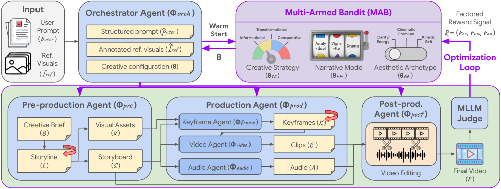

<!-- source-sha256: 58ad99ff56809bf5026bbab820d90e9777cdbdc92d9c55f7e90eda1fc40a4216 -->
# Co-Director: factored creative UCB and separate video-quality selection

[简体中文](README.md)

> **component_only/L1 mechanism diagnostics, not full-model or agent capability.** The full experiment is not reproduced because of cost (review DONE); only the explicitly bounded components below execute.

## Paper information

| Field | Value |
| --- | --- |
| Paper | [Co-Director: Agentic Generative Video Storytelling](https://arxiv.org/abs/2604.24842v1), [fixed v1](https://arxiv.org/html/2604.24842v1) |
| Institution | First author Yale Song, Google Inc.; verified priority affiliations: Google. Collaboration does not replace the first-listed affiliation |
| Original publication | **2026-04-27 18:00:00 UTC**; a historical repair, not a November13 first release |
| Authors' code | [Verified public repository](https://github.com/GoogleCloudPlatform/genmedia-izumi-agent/tree/main/demos/backend/ads_codirector); presence does not mean the full system ran locally |
| Local adapter / key | `co-director`; `adapter=null`; no Evolve integration |
| Local code | `src/auto_research/agent_research/co_director.py` |

## Original paper

### Motivation and changes

Co-Director separates global creative direction from local multimodal refinement. Direction has three strategy, three narrative and four aesthetic arms. Each full video receives three strategic-effectiveness rewards for independent axis updates; a separate quality score chooses the final video.

The paper describes UCB1 and LLM-initialized expectations. The linked implementation concretely prioritizes a recommended unpulled arm without inventing observation counts. Local code follows that verifiable interface and supplies no fabricated numerical priors, MLLM scores or video.

### Architecture


<!-- paper-figure:start -->
### Key original figure

[](https://arxiv.org/html/2604.24842v1/pipeline.png)

From the [original paper](https://arxiv.org/html/2604.24842v1#S2.F1); copyright remains with the original authors. These are official HTML PNG bytes without cropping, redrawing or PDF rendering. The full original pipeline, not locally connected video models.
<!-- paper-figure:end -->

### Core equations

$$
UCB_j(a)=\bar r_j(a)+c\sqrt{\frac{\log(\sum_bN_j(b))}{N_j(a)}},\qquad
R=(r_{strategy},r_{narrative},r_{aesthetic})\in[0,100]^3.
$$

The official UCBBandit defaults to c=2. Unpulled arms come first, with an untried recommendation prioritized; other untried choices use seeded local RNG. Ties among tried arms use fixed categorical order locally. Only three selected arms update, not36 joint paths. Missing factored rewards are rejected rather than using the upstream compatibility fallback to a global score.

### Author results

Authors compare complete multi-model video generation on400 GenAd-Bench scenarios using quality/semantic/human evaluations and search ablations. MLLM axis scores are observations, not identified causal contributions; factored updates do not establish solved causal credit assignment. No production A/B is reported. Local tests measure arithmetic only.

## Local reproduction

### Protocol and code mapping

VideoEvaluation requires identity, three choices, three strategic rewards and separate quality. FactoredUCB performs actual selection/count/mean updates; best_video selects an existing external artifact by quality without generation. No video bytes, actor or evaluator gold are inputs.

```bash
PYTHONPATH=src python -c 'from auto_research.agent_research.co_director import diagnostic; print(diagnostic(42))'
PYTHONPATH=src python -m pytest tests/test_nov13_colm_agent_components.py -q
```

### Evidence and controls

Checks cover recommended unpulled arms, mandatory untried exploration, factor-separated updates, fully-observed UCB, quality selection despite a lower strategic sum, and duplicate video IDs. Fixed scores establish neither creative performance nor audience effects.

Three-seed mechanism receipts are in [CPU metrics](metrics/component-cpu-seeds42-44.json) and the batch's frozen record. Fixed-input diagnostics are not full training, capability gain or online benefit. GPU acceptance requires actual A100/A30 evidence.

## Boundaries

Orchestrator, LLM recommendations, storyline/keyframe refinement, model/media APIs, GenAd-Bench and video judges are absent. External MLLM scores need independent validation. Random rewards are not a substitute for real visual evaluation, and Evolve is not integrated.

### Full experiment not reproduced

The full setup has400 scenarios, four complete video pipelines per scenario, up to three local retries, Gemini3Pro/NanoBananaPro/Veo3.1/TTS/Lyria2 and four-shot12-second outputs. This paper/upstream configuration exceeds the current single-A100/A30-or-Mac budget. It is a source-reported configuration, not local training measurement. No cost probe, paid API, checkpoint download or full experiment was attempted. **Too costly; not reproduced (review DONE)**. Automatic retry and implementation queues remain disabled.
